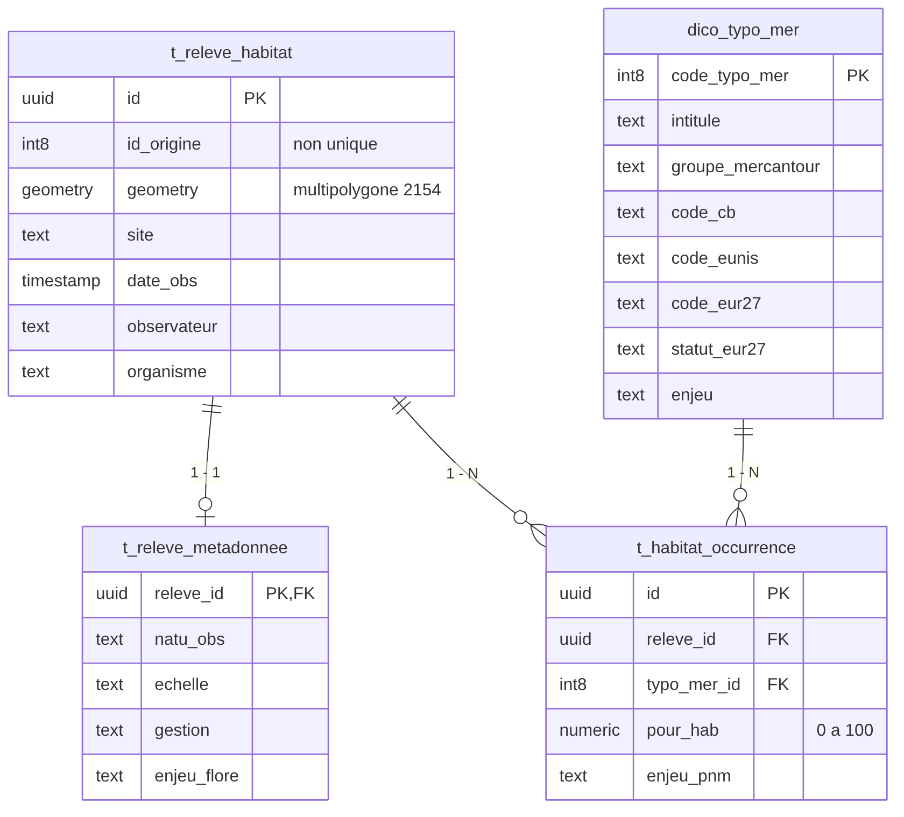

# habitats

## Description

Ce schéma contient la **cartographie des habitats naturels** du Parc national du Mercantour. Il rassemble des cartographies réalisées lors de plusieurs projets, fusionnées dans une même couche (`t_fusion_habitats_vegetation`), puis réorganisées ici sous la forme d'une base de données relationnelle.

Chaque **polygone** correspond à un secteur observé. Un polygone peut porter plusieurs habitats (une *mosaïque*) : dans la couche d'origine, il pouvait en porter jusqu'à quatre ; le schéma actuel n'impose plus de limite.

Deux notions sont au centre du schéma :

- le **`typo_mer`** : le code d'un habitat dans la typologie du Parc. Chaque code est décrit dans le dictionnaire `dico_typo_mer` (intitulé, groupe, correspondances Corine Biotopes, EUNIS et EUR27, enjeu...) ;
- le **`pour_hab`** : le pourcentage du polygone couvert par cet habitat.

!!! info "Les libellés de la typologie sont enregistrés sans accents"
    Par exemple `Forets`, `Fourres` ou `Tres fort`. Il faut les écrire ainsi dans les filtres et les requêtes.

!!! warning "Nomenclature à compléter"
    Une nomenclature métier complète reste à mettre en place. Pour l'instant, de nombreux champs descriptifs sont stockés en `text` et leurs valeurs ne sont pas toutes encadrées par des listes de référence. Les valeurs documentées ici reflètent l'état actuel des données.


## Projets Qgis associés
Vous trouverez la documentation du projet [ici](../projets_qgis/habitats.md).


## Tables remarquables

Le schéma est constitué de 4 tables et de 3 vues.


/// caption
Les quatre tables du schéma (extrait des colonnes). Un polygone a au plus une ligne de métadonnées et autant de lignes d'occurrences que d'habitats présents.
///

### Tables

|Nom de la table|Description|
|:--:|:--|
|t_releve_habitat|Un polygone cartographié : sa géométrie, le site, la date, l'observateur et l'organisme.|
|t_releve_metadonnee|Les informations complémentaires sur le polygone (méthode, gestion, altitude, enjeu flore...). Au plus une ligne par polygone.|
|t_habitat_occurrence|Un habitat présent sur un polygone, avec le pourcentage du polygone qu'il couvre (`pour_hab`). C'est la table à interroger pour savoir *quels habitats* se trouvent *où*.|
|dico_typo_mer|Le dictionnaire des habitats : un `typo_mer` par ligne, avec sa description.|

### Vues

Les vues recomposent les tables pour la cartographie et l'analyse. Elles sont en lecture seule et sont celles utilisées par le [projet QGIS](../projets_qgis/habitats.md).

|Nom de la vue|Une ligne par|Description|
|:--:|:--:|:--|
|v_releve_dominant|polygone|L'habitat dominant de chaque polygone, la composition complète de la mosaïque, la part Natura 2000 et les métadonnées. Couche principale du projet.|
|v_occurrence_carto|habitat sur un polygone|Chaque habitat avec la géométrie de son polygone et sa surface. Permet de cartographier un habitat précis, **même quand il n'est pas dominant**.|
|v_stats_habitat|habitat de la typologie|Nombre de polygones et surface de chaque habitat, y compris les habitats jamais observés. Sans géométrie.|


## Description des colonnes remarquables
!!! Warning "Ne sont décrites ici que les colonnes remarquables, ou dont le nom pourrait prêter à confusion."

#### t_releve_habitat

| Nom de la colonne | Type | Description |
| :--- | :---: | :--- |
| id | (PK) uuid | Identifiant du polygone |
| id_origine | int8 | Identifiant du polygone dans la couche d'origine. **Il n'est pas unique** (plusieurs polygones peuvent le partager) : il sert à retrouver l'origine d'un polygone, pas à faire une jointure. |
| geometry | multipolygone | Contour du polygone, en Lambert-93 (EPSG:2154) |
| site | text | Site cartographié |
| date_obs | timestamp | Date de l'observation |
| observateur | text | Observateur |
| organisme | text | Organisme ayant réalisé l'observation |

#### t_releve_metadonnee

| Nom de la colonne | Type | Description |
| :--- | :---: | :--- |
| releve_id | (PK, FK) uuid | Polygone concerné (`t_releve_habitat.id`) |
| natu_obs, unit_vege, echelle, grand_type, legende | text | Informations de méthode : nature de l'observation, unité de végétation, échelle, grand type, légende |
| gestion, gestion_b | text | Informations sur la gestion du milieu |
| alt_obs, alt_grille | text | Altitude, observée ou issue de la grille |
| enjeu_flore | text | Enjeu flore |
| ec_exp, comm_exp, grille_ec, note_ec | text | Informations issues de la couche d'origine : expertise, commentaire, grille et note |

#### t_habitat_occurrence

| Nom de la colonne | Type | Description |
| :--- | :---: | :--- |
| id | (PK) uuid | Identifiant de l'occurrence |
| releve_id | (FK) uuid | Polygone sur lequel l'habitat est présent (`t_releve_habitat.id`) |
| typo_mer_id | (FK) int8 | Habitat présent (`dico_typo_mer.code_typo_mer`) |
| pour_hab | numeric(5,2) | Pourcentage du polygone couvert par l'habitat, de 0 à 100. La somme sur un polygone devrait être proche de 100, sans que ce soit imposé : les données de terrain ne sont pas toujours exactes. Peut être vide. |
| enjeu_pnm | text | Enjeu propre à cette occurrence (ancienne colonne `ENJEU_PNM_i` de la couche d'origine) |

Un même habitat ne peut figurer qu'une fois sur un polygone (contrainte d'unicité sur `releve_id` et `typo_mer_id`).

#### dico_typo_mer

| Nom de la colonne | Type | Description |
| :--- | :---: | :--- |
| code_typo_mer | (PK) int8 | Code de l'habitat dans la typologie du Parc |
| intitule | text | Nom de l'habitat |
| groupe_mercantour | text | Grand groupe d'habitats : `Forets`, `Pelouses`, `Milieux rocheux`, `Fourres`, `Zones humides`, `Friches`, `Landes`, `Megaphorbiaies` |
| groupe_mer_pelouses | text | Comme `groupe_mercantour`, avec les pelouses détaillées par type (par exemple `Pelouses calcicoles de crete`) |
| groupe, sous_groupe, sous_sous_groupe | text | Niveaux de classement plus fins |
| rata_ordre, rata_allia, rata_assoc | text | Rattachement phytosociologique : ordre, alliance, association. La valeur `A definir` ou `A preciser` indique un rattachement à compléter. |
| code_cb, lib_cb | text | Code et libellé Corine Biotopes |
| code_eunis, lib_eunis | text | Code et libellé EUNIS |
| code_eur27, lib_eur27 | text | Code et libellé de l'habitat d'intérêt communautaire (Natura 2000, EUR27). Vides si l'habitat n'est pas concerné. |
| statut_eur27 | text | `IC` : habitat d'intérêt communautaire, `PR` : habitat prioritaire, `NC` : non concerné |
| enjeu | text | Enjeu associé à l'habitat dans la typologie : `Tres fort`, `Fort`, `Moyen`, `Faible` ou `Non defini` |
| fiche_merc | text | Fiche descriptive de l'habitat, quand elle existe |
| code_guide_habitats_alpes | text | Code de l'habitat dans le guide des habitats naturels et semi-naturels des Alpes |

<!-- À valider avant publication : signification de IC / PR / NC (déduite des données : 123 IC, 33 PR, 98 NC, contre 158 habitats ayant un code EUR27). -->

#### v_releve_dominant

| Nom de la colonne | Type | Description |
| :--- | :---: | :--- |
| id | uuid | Identifiant du polygone |
| typo_mer_dominant, habitat_dominant, pour_hab_dominant | int8, text, numeric | L'habitat dominant : son code, son nom et son pourcentage |
| groupe_mercantour, enjeu, code_cb, code_eunis, code_eur27, statut_eur27... | text | Description de l'habitat dominant, reprise du dictionnaire |
| nb_habitats | bigint | Nombre d'habitats présents sur le polygone |
| mosaique | boolean | Vrai si le polygone porte plus d'un habitat |
| total_pour_hab | numeric | Somme des pourcentages des habitats du polygone |
| composition | text | Liste des habitats du polygone, du plus au moins couvrant, un par ligne (`121 - Nom de l'habitat (60 %)`) |
| natura2000 | boolean | Vrai si au moins un habitat du polygone est d'intérêt communautaire ou prioritaire (`statut_eur27` = `IC` ou `PR`), quel que soit son pourcentage |
| pour_hab_n2000 | numeric | Part du polygone couverte par des habitats Natura 2000 |
| prioritaire | boolean | Vrai si au moins un habitat prioritaire (`PR`) est présent |
| surface_ha | numeric | Surface du polygone, en hectares |
| natu_obs, unit_vege, echelle... | text | Métadonnées du relevé, reprises de `t_releve_metadonnee` |

L'**habitat dominant** est celui qui a le plus fort `pour_hab`. À égalité, c'est celui qui a le plus petit code `typo_mer`. Un polygone sans habitat n'a pas d'habitat dominant.

#### v_occurrence_carto

| Nom de la colonne | Type | Description |
| :--- | :---: | :--- |
| id | uuid | Identifiant de l'occurrence |
| releve_id | uuid | Polygone concerné |
| typo_mer_id, habitat | int8, text | Code et nom de l'habitat |
| pour_hab | numeric | Pourcentage du polygone couvert par l'habitat |
| surface_ha | numeric | Surface occupée par l'habitat : surface du polygone × `pour_hab` / 100, en hectares |
| groupe_mercantour, enjeu, statut_eur27... | text | Description de l'habitat, reprise du dictionnaire |
| natura2000 | boolean | Vrai si l'habitat est d'intérêt communautaire ou prioritaire |

!!! note "Les surfaces sont planimétriques"
    `surface_ha` est calculée sur la carte, en Lambert-93, et non sur le relief. En montagne, la surface réelle du terrain est plus grande. Une occurrence sans `pour_hab` n'a pas de surface.

_____
_Documentation pour utilisateurs avancés et maintenance_


## Exemples de requêtes

Surface de chaque groupe d'habitats :

```postgreSQL
SELECT groupe_mercantour, round(sum(surface_ha), 1) AS surface_ha
FROM habitats.v_occurrence_carto
GROUP BY groupe_mercantour
ORDER BY surface_ha DESC;
```

Tous les polygones où un habitat est présent, même s'il n'est pas dominant (ici le `typo_mer` 98) :

```postgreSQL
SELECT r.id, r.site, o.pour_hab
FROM habitats.t_habitat_occurrence o
JOIN habitats.t_releve_habitat r ON r.id = o.releve_id
WHERE o.typo_mer_id = 98
ORDER BY o.pour_hab DESC NULLS LAST;
```

Surface des habitats prioritaires, habitat par habitat :

```postgreSQL
SELECT typo_mer_id, habitat, count(*) AS nb_polygones, round(sum(surface_ha), 1) AS surface_ha
FROM habitats.v_occurrence_carto
WHERE statut_eur27 = 'PR'
GROUP BY typo_mer_id, habitat
ORDER BY surface_ha DESC;
```

Les polygones en mosaïque, avec leur composition :

```postgreSQL
SELECT site, habitat_dominant, pour_hab_dominant, replace(composition, E'\n', ' | ') AS composition
FROM habitats.v_releve_dominant
WHERE mosaique
ORDER BY site;
```

Les habitats de la typologie jamais observés :

```postgreSQL
SELECT code_typo_mer, intitule
FROM habitats.v_stats_habitat
WHERE nb_polygones = 0
ORDER BY code_typo_mer;
```


## Dépendances

- Les tables ont été créées à partir de la table `habitats.t_fusion_habitats_vegetation` (la couche d'origine, au format « large » : `TYPO_MER_1` à `4`, `POUR_HAB_1` à `4`).
- `dico_typo_mer` a été chargé depuis le fichier de la typologie des habitats du Parc (`Typologie_habitats_PNMercantour_Correspondances_table_Attributaire_Cartographie_Habitats_Rattachement_UFL.csv`), dont seules les colonnes de classification et de correspondance ont été retenues.
- Les vues dépendent des quatre tables et utilisent `ST_Area` (PostGIS) pour calculer les surfaces.


## Choix de conception

La couche d'origine plaçait les habitats dans des colonnes numérotées (`TYPO_MER_1` à `TYPO_MER_4`, avec leurs pourcentages) : c'est une relation « un polygone, plusieurs habitats » écrite en colonnes. Le schéma la remplace par une table d'occurrences, une ligne par habitat. Les choix qui en découlent :

|Choix|Raison|
|:--|:--|
|Une table d'occurrences, une ligne par habitat|Pas de limite à quatre habitats, et une requête simple pour retrouver un habitat quel que soit son rang.|
|Identifiants `uuid`, avec `id_origine` conservé|Des clés robustes, tout en gardant la trace de l'ancien identifiant. (uuid plutôt qu'id pour intégration dans QFieldCloud)|
|`id_origine` sans contrainte d'unicité|L'identifiant de la couche d'origine n'est pas unique. Il ne doit jamais servir de clé de jointure.|
|Pas de colonne « rang »|La position (1 à 4) n'a pas de sens pour l'habitat. L'importance se lit dans `pour_hab`. À la place, un habitat ne peut figurer qu'une fois par polygone.|
|Colonnes Corine Biotopes, EUNIS, EUR27 retirées de l'occurrence|Ce sont des attributs de l'habitat, déjà dans `dico_typo_mer` : les recopier sur chaque ligne ferait diverger les copies. Une jointure les restitue (voir les vues).|
|Intitulé de l'habitat (`INTIT_MER_i`) retiré|Redondant avec `dico_typo_mer.intitule`.|
|`enjeu_pnm` conservé sur l'occurrence|Il peut différer de l'`enjeu` du dictionnaire.|
|Métadonnées dans une table à part|`t_releve_habitat` ne garde que l'essentiel : où, quand, qui.|
|Pourcentages additionnés pour un habitat répété|Quand le même `typo_mer` figurait sur deux rangs d'un polygone, les deux pourcentages ont été additionnés.|
|`pour_hab` limité à 0-100, sans contrôle de la somme|Les données de terrain ne totalisent pas toujours 100 ; le contrôle se fait par requête (voir plus bas).|

### Migration des données

La migration est faite par le script de [création](./habitats/sql/creation.sql). Deux points techniques méritent d'être connus :

- l'`id` de la couche d'origine n'étant pas unique, une jointure sur cet identifiant multiplierait les lignes. Le script rattache chaque ligne source à son nouveau polygone par `ctid` (identifiant physique de ligne), dans une table temporaire ;
- les habitats dont le `typo_mer` est absent du dictionnaire ne sont pas migrés (la clé étrangère l'interdirait).

### Contrôler la migration

Le fichier [controle_migration.sql](./habitats/sql/controle_migration.sql) regroupe sept requêtes de contrôle. Les quatre dernières ne doivent rien retourner, ou seulement des cas compris :

1. nombre de polygones, source et cible ;
2. nombre d'habitats, avant et après regroupement des doublons ;
3. `typo_mer` de la source absents du dictionnaire (occurrences perdues) ;
4. comparaison détaillée, par `id_origine` et par `typo_mer`, entre la source recalculée et la cible : aucune ligne signifie que la migration est cohérente ;
5. polygones où le même `typo_mer` figurait sur plusieurs rangs ;
6. polygones dont la somme des pourcentages s'écarte de 100 de plus de 5 points ;
7. occurrences sans pourcentage.

!!! note "Limite de la comparaison détaillée"
    Elle regroupe par `id_origine`. Si deux polygones distincts partagent le même `id_origine`, le contrôle valide leur groupe, pas chacun d'eux.


## Code de création des tables

- Tables et migration : [creation.sql](./habitats/sql/creation.sql)
- Contrôles après migration : [controle_migration.sql](./habitats/sql/controle_migration.sql)
- Vues : [vues.sql](./habitats/sql/vues.sql)

Le script de création charge le dictionnaire avec la commande `\copy`, propre à `psql` : il faut le lancer avec `psql` depuis le dossier qui contient le fichier CSV du dictionnaire. En pratique le script est lancé par bloc à la main.


