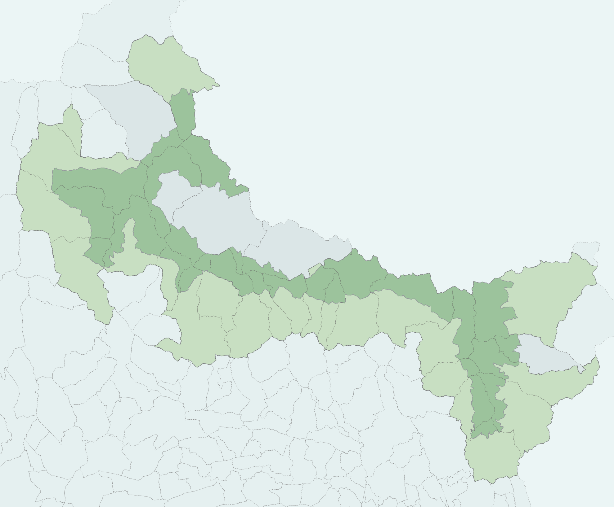

---
hide:
  - path
  - toc
  - navigation
---

{ .pnm-hero__logo }

# La base de données du Parc

Cette documentation décrit : le **contenu** général, la **source** des données, les [projets QGIS](../projets_qgis/index.md) associés, le détail des colonnes de certaines tables importantes, et des informations utiles pour la maintenance de chaque [schéma*](../tutos/glossaire.md#schema "Un schéma est un sous-ensemble organisé d'une base de données").  

Choisissez un schéma ci-dessous pour en savoir plus !

[:material-magnify: Utilisez la recherche en haut de page](#){ .md-button .md-button--primary onclick="document.querySelector('[data-md-toggle=search]').checked=true; document.querySelector('.md-search__input').focus(); return false;" }

!!! tip "Comment accéder à la base de données ?"
    Les données sont stockées dans la base de données du Parc [:octicons-arrow-right-24: Se connecter à la base de données dans QGIS](../tutos/installer_certificats_base_de_donnees.md).

## :material-map-outline: Limites et territoire

-   :material-city-variant-outline: **admin_express**

    ---

    Limites administratives (produites par l'IGN).

    [:octicons-arrow-right-24: Voir le schéma](./admin_express.md){ .stretched }

-   :material-vector-polygon: **limites**

    ---

    Limites du Parc et limites administratives.

    [:octicons-arrow-right-24: Voir le schéma](./limites.md){ .stretched }

-   :material-leaf-circle: **inpn**

    ---

    Limites des parcs nationaux, des parcs régionaux et des réserves naturelles.

    [:octicons-arrow-right-24: Voir le schéma](./inpn.md){ .stretched }

-   :material-home-map-marker: **cadastre**

    ---

    Données publiques issues du cadastre.

    [:octicons-arrow-right-24: Voir le schéma](./cadastre.md){ .stretched }

## :material-binoculars: Biodiversité et milieux naturels

-   :material-binoculars: **geonature_synthese**

    ---

    Observations GeoNature, détaillées et agrégées selon différents critères.

    [:octicons-arrow-right-24: Voir le schéma](./geonature_synthese.md){ .stretched }

-   :material-waves: **bd_lacs**

    ---

    Données concernant les lacs.

    [:octicons-arrow-right-24: Voir le schéma](./bd_lacs.md){ .stretched }

-   :material-water: **bd_source**

    ---

    Données concernant les sources.

    [:octicons-arrow-right-24: Voir le schéma](./bd_source.md){ .stretched }

-   :material-pine-tree: **foret**

    ---

    Données concernant les forêts.

    [:octicons-arrow-right-24: Voir le schéma](./foret.md){ .stretched }

-   :material-flower: **vegetation**

    ---

    Données concernant la flore.

    [:octicons-arrow-right-24: Voir le schéma](./vegetation.md){ .stretched }

## :material-sign-direction: Gestion et fréquentation

-   :material-sheep: **ag_pasto**

    ---

    Agropastoralisme.

    [:octicons-arrow-right-24: Voir le schéma](./ag_pasto.md){ .stretched }

-   :material-sign-direction: **geotrek**

    ---

    Sentiers du Parc.

    [:octicons-arrow-right-24: Voir le schéma](./geotrek.md){ .stretched }

-   :material-sprout: **PAEC**

    ---

    Indicateurs AgroEnvironnementaux et Climatiques.

    [:octicons-arrow-right-24: Voir le schéma](./paec.md){ .stretched }

-   :material-hiking: **tourisme**

    ---

    Tourisme et fréquentation du Parc (compteurs...).

    [:octicons-arrow-right-24: Voir le schéma](./tourisme.md){ .stretched }

## :material-shield-check-outline: Réglementation et zonages

-   :material-file-document-check-outline: **charte**

    ---

    Données nécessaires à la réalisation de la carte des vocations.

    [:octicons-arrow-right-24: Voir le schéma](./charte.md){ .stretched }

-   :material-weather-night: **rice**

    ---

    Réserve Internationale de Ciel Étoilé.

    [:octicons-arrow-right-24: Voir le schéma](./rice.md){ .stretched }
    
-   :material-helicopter: **survol**

    ---

    Zones sensibles en lien avec les autorisations de survol.

    [:octicons-arrow-right-24: Voir le schéma](./survol.md){ .stretched }

!!! note "Tous les schémas ne sont pas accessibles à tous les agents"
    Certains contiennent des données sensibles, si un schéma n'apparaît pas dans QGIS, contactez le SI : `si@mercantour-parcnational.fr`.

!!! info "Documentation en cours"
    Si vous avez besoin d'infos complémentaires sur la donnée stockée dans la base contactez le SI : `si@mercantour-parcnational.fr`.  
