# F.A.Q.

Vous trouverez dans ce fichier une liste de problèmes et questions fréquentes avec des solutions simples. Parfois, la définition des termes techniques peut solutionner un problème : rdv sur le [glossaire](glossaire.md) :wink:
        
        
!!! tip "Liste des sujets"
      L'ensemble des sujets abordés sont listés dans la table des matières à droite de la page, vous pouvez vous rendre directement sur le sujet qui vous intéresse en cliquant dessus.

!!! question "Une question restée en supsens ?"
    Adressez-vous à `si@mercantour-parcnational.fr`.

## Concernant le parc

### J'ai un souci avec les limites du parc
Du fait de la méthode de leur tracé, les limites du parc sont compliquées à estimer avec une très grande précision.  
Pour la plupart, elles s'appuient réglementairement sur le cadastre qui peut manquer de précision, mais il arrive aussi qu'elles traversent des parcelles.  
Les cartes sur lesquelles les limites s'appuient sont tracées au 1/100 000.

Pour ces raisons, la délimitation à très grande échelle des limites du parc est un travail en cours. 

Pour ce qui concerne les calculs de superficie de pourcentage de zone coeur/d'aire d'adhésion, se référer au document 
> X:\6.7 SYSTEME INFORMATION\6_OUTILS_MEMO\STATS-CHIFFRES CLES\Données par communes.xlsx

N'hésitez pas à signaler les erreurs importantes/à conséquence.

___________________________________

### Je souhaite réaliser une carte à l'aide de données qui ne me sont pas accessibles

Contacter le chargé de mission référent sur le sujet, et s'assurer qu'il ne s'agit pas de données sensibles dont la diffusion est limitée.  

___________________________________

## Dans QGIS

### J'ai un problème et je ne sais pas quoi faire
`Vérifier l'emplacement des données`
: Est-ce qu'il s'agit de données qui sont sur la base de données, en local sur la machine, sur une tablette connectée en USB....
: Pour le savoir : ++"Clic Droit"++ sur la couche en erreur ++"Changer la source des données..."++    
: 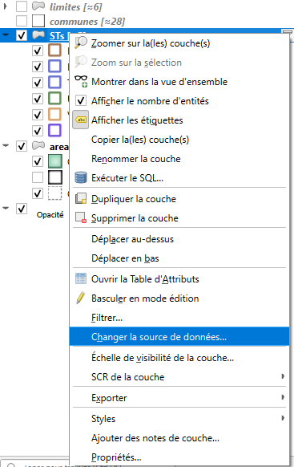
  
`Vérifier la projection des données` 
: Elle doit être, la plupart du temps, à EPSG:2154 - Lambert-93  
: Pour le savoir : ++"Propriétés de la couche"++ > ++"Source"++ 
: 

`Vérifier le format des données`
:      * Le type de géométrie : point/ligne/polygone
:      * Le type d'attribut : on ne peut pas faire de calculs sur des attributs au format texte
	
___________________________________

### QGIS plante quand j'essaie d'ouvrir la table d'attribut d'une couche
Il est probable que la table que vous essayer d'ouvrir est trop grande pour être gérée par QGIS.  

==Solution== : limiter le nombre d'entités affiché par défaut dans la table d'attributs.  
Dans la barre d'outils cliquer sur ++"Préférences"++ > ++"Options"++

Dans les onglets de gauche, cliquer sur ++"Sources de données"++, puis dans ++"Comportement des tables d'attributs"++ choisir ++"Montrer les entités visibles sur la carte"++.  

Dorénavant, la table d'attribut ne montrera que les entités visibles sur l'étendue du canevas visible, en zoomant vous limiterez le nombre d'entités à charger dans la table d'attribut et donc le risque de plantage de QGIS. 

___________________________________

### La table d'attribut d'une couche ne montre pas toutes les entités

Si vous êtes sûrs que votre couche contient un grand nombre d'entités, mais seules quelques unes, voire aucune ne sont visibles dans la table d'attribut.

==Solution== : autoriser une couche à afficher toutes ses entités dans la table d'attributs.    
En bas à gauche de de la fenêtre de la table d'attributs se trouve une petite icône avec un menu déroulant ++"Ne montrer que les entités visibles sur la carte"++.  
Vous pouvez choisir à la place l'option ++"Montrer toutes les entités"++ si vous savez que la taille de la table d'attributs n'est pas trop grande pour la mémoire de votre machine. 

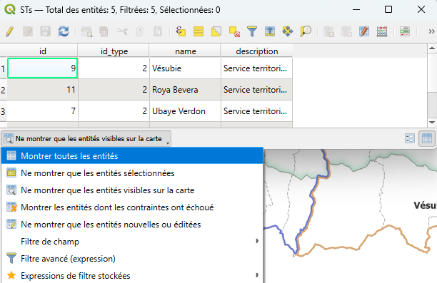

Vous pouvez aussi vérifier le ^^nombre d'entités^^ contenu dans une couche en passant par :  
> ++"clic droit"++ sur la couche > ++"Propriétés"++ > ++"Information"++ : Décompte d'entités  

Si ce nombre ne correspond pas au nombre d'entités dans la table d'attribut vous pouvez appliquer la solution ci-dessous.

**Explication**  
QGIS est paramétré par défaut pour ne montrer que les entités de la table d'attribut qui sont visibles sur la carte.   
Cela évite de faire planter instantanément QGIS en essayant de charger une table d'attribut contenant des milliers d'entités, comme il en existe sur le serveur. 
___________________________________

### Je ne vois pas toutes les entités d'une couche sur la carte

Au chargement d'un projet, certaines couches peuvent être filtrées. Ce filtre peut être appliqué par l'outil filtre et/ou dans le menu symbologie.   
Ces filtres doivent être modifiés pour accéder aux données pertinentes, ou à l'intégralité des données.

    
!!! tip "L'application d'un filtre est signalée par l'icône de filtre"
      En cliquant dessus on accède au constructeur de requête qui permet de modifier les paramètres du filtrage.  
    
L'utilisation d'une expression dans la symbologie (++"Couche"++ > ++"Propriétés"++ > ++"Symbologie"++ ou ++"double clic"++ sur la couche > onglet ++"symbologie"++) permet de filtrer ou regrouper l'information.   
Dans l'exemple ci-dessous on obtient la somme de n_obs par maille. L'expression est modifiable directement ou en cliquant sur le ε pour accéder à l'éditeur d'expressions.
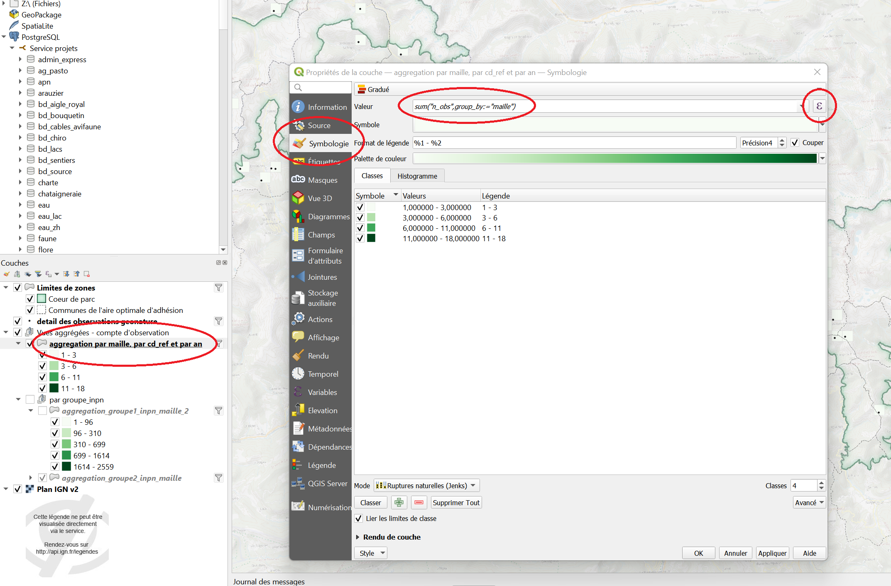

___________________________________

### Traiter les couches inutilisables à l'ouverture d'un projet : certaines couches ne s'affichent pas

Un projet QGIS ne stocke pas les données en dur, mais uniquement les chemins vers celles-ci.   
Par conséquent, si des données ont été supprimées, déplacées ou stockées sur le PC d'un collègue uniquement, QGIS ne les "trouve plus", et renvoie un message d'erreur à l'ouverture d'un projet utilisant ces données.  

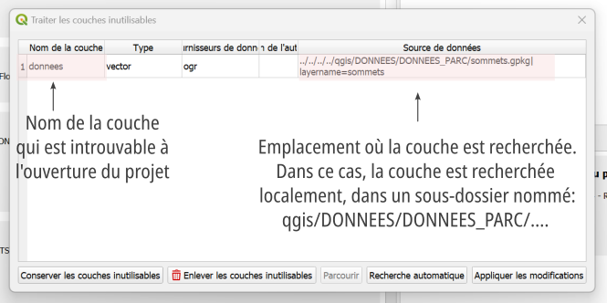

==Solutions== :

`S'il s'agissait de données enregistrées localement sur la machine`
: Il suffit de sélectionner la couche manquante dans cette fenêtre, puis de cliquer sur ++"Parcourir"++ et de montrer à QGIS où se situent les données. Une fois le projet enregistré, l'erreur ne devrait plus apparaitre.  

`S'il s'agissait de données enregistrées sur le serveur`
: Le plus simple est de cliquer sur ++"Conserver les couches inutilisables"++. Une fois le projet ouvert : ++"clic droit"++ sur la couche introuvable, et choisir ++"Réparer la source des données"++

: 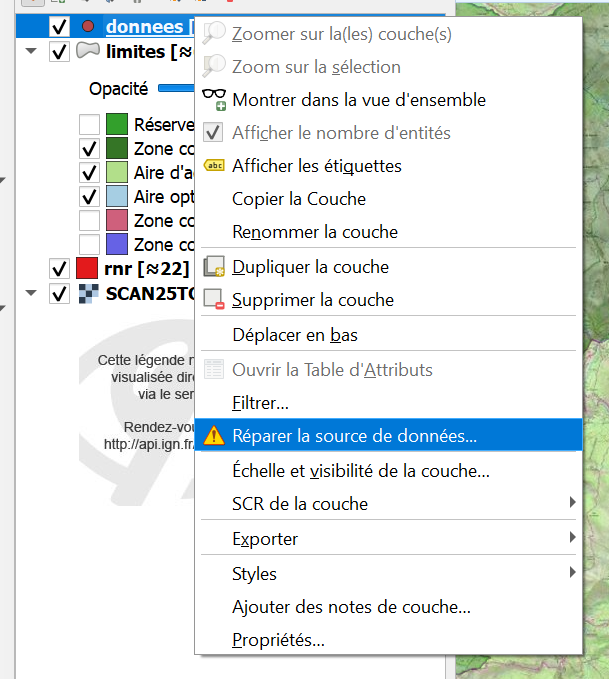

: Une toute petite fenêtre s'affiche, vous pouvez l'aggrandir. 
: Descendez jusqu'à trouver ++"PostgreSQL"++, puis ++"Service projets"++ ainsi que les schémas et tables contenant les données du parc. 

: 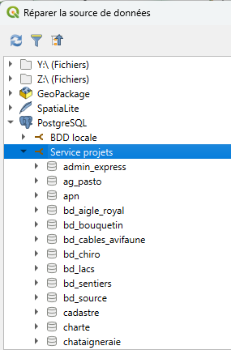

En cas de doute, vous pouvez toujours double cliquer sur la couche manquante, et regarder dans ses propriétés sa source afin de retrouver le nom du schéma et de la table correspondant. 

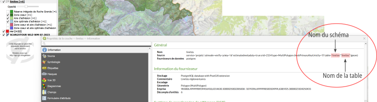

___________________________________

### Message d'erreur "L'entité ...  a une géométrie non valide" pendant un géotraitement
Même si elles ne sont pas formulées, les géométries dans QGIS répondent à des règles. Une entité invalide peut tout de même être affichée, mais toute tentative de traitement, ou de jointure avec une autre couche renverra cette erreur. 

==Solutions== :

`Réparer les géométries` 
: Dans la ++"Boîte à outils"++ de QGIS se trouve un outil ++"Réparer les géométries"++ qui peut tenter de réparer les erreurs de géométries. 

`Modification manuelle`
: Si le message d'erreur donne les identifiants des entités aux géométries incorrectes, il est possible de les examiner et de modifier manuellement pour corriger les éventuelles erreurs. 

___________________________________

### Impossible de charger un projet depuis la base de données PostgreSQL
Il existe plusieurs cas de figures :

`Vous ne disposez pas d'un accès à la base de données`
: Si vous êtes bien sur votre poste de travail, et que c'est la première fois que vous vous connectez à la base de données contacter le SI.

`Vous pouvez charger des couches depuis la base de données en passant par le gestionnaire de sources de données`  
: Dans le Gestionnaire des sources de données (++ctrl+l++ ou onglet ++"Couche"++ > ++"Gestionnaire des sources de données"++)
: Sélectionner l'onglet ++"PostgreSQL"++
: Sélectionner la connexion ++"Service projets"++
: Cliquer sur ++"Editer"++. 
: Une nouvelle fenêtre s'affiche en bas de laquelle se trouve la case à cocher ++"Permettre l'enregistrement et le chargement de projets QGIS dans la base de données."++

___________________________________

### Je ne vois plus le panneau couches/explorateur/...
Le plus probable est qu'un panneau ait été déplacé/fermé dans une mauvaise manipulation.  
Pour le faire réapparaître, il suffit de cliquer sur l'onglet ++"Vue"++ > ++"Panneaux"++  
Puis de cocher les cases d'intérêt (généralement: Couches/Boîtes à Outils de traitements/Style de couche)

___________________________________

### Je ne vois pas les projets, mais seulement les tables de la base de données

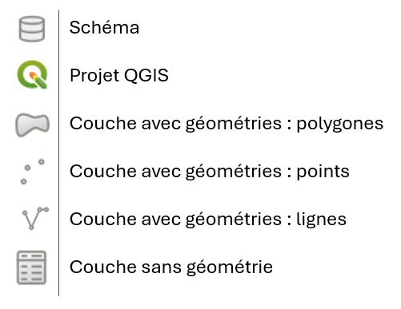

Vous ne voyez pas les icones de "projet QGIS" dans l'explorateur ?

Faire un ++"clic droit"++ sur Postgis/Service Projets dans l'explorateur, cliquer ++"Editer la connexion"++ et cocher ++"Permettre le chargement et l'enregistrement de projets QGIS"++ puis ++"OK"++.

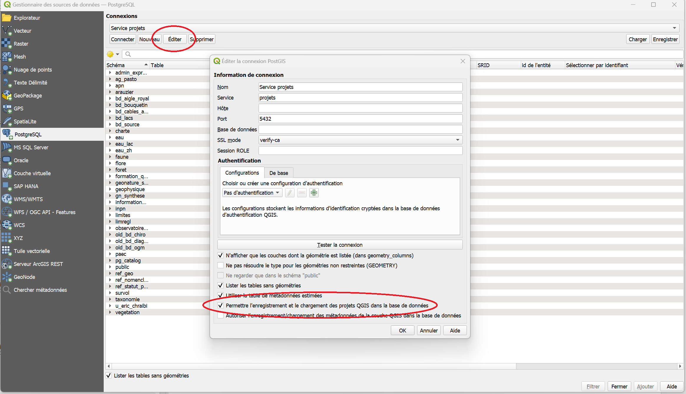

___________________________________

### Je ne vois pas tables sans géométries stockées sur le serveur

Vous ne voyez pas les icones de "couche sans géométrie" dans l'explorateur ?

Faire un ++"clic droit"++ sur Postgis/Service Projets dans l'explorateur, cliquer ++"Editer la connexion"++ et cocher ++"Lister les tables sans géométries"++ puis ++"OK"++.

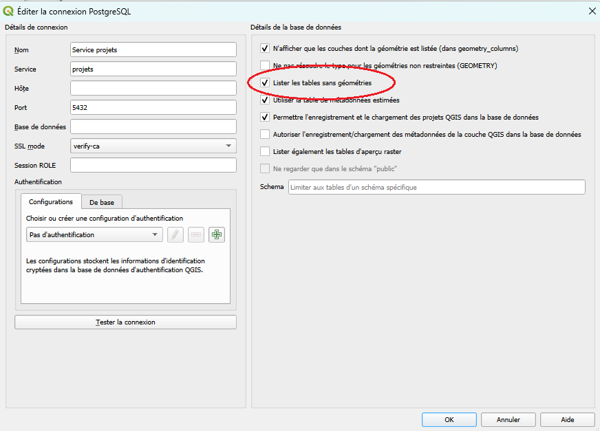
	
___________________________________

### Je souhaite enregistrer une couche avec sa symbologie

Les formats traditionnels d'enregistrement ne permettaient pas d'associer les données et leur mode de représentation, mais le format **GeoPackage** si.  

==Solution== :  
Pour cela, il faut passer par l'outil ++"Empaquetage de couche"++ de la ++"Boîte à outils"++ (accessible à l'aide de ++ctrl+alt+t++ ou dans l'onglet ++"Traitement"++ de la barre de menu).

Pensez à sélectionner les couches que vous voulez sauvegarder dans le GeoPackage : cliquer sur les ++"..."++ du haut.  
Et à enregistrer la couche créée dans un fichier **GeoPackage** (deuxième ++"..."++).  
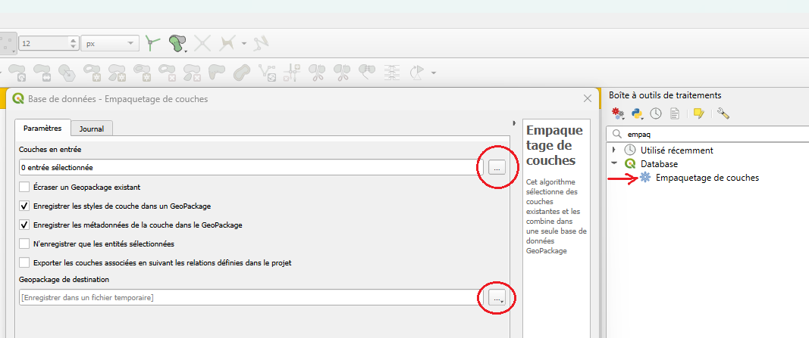

___________________________________

### Problème d'affichage des couches IGN WMTS dans QGIS

#### Symptômes
- QGIS ne charge pas les couches WMTS de l'IGN.
- Les requêtes HTTP vers le service IGN échouent.
- Aucun message d'erreur clair dans QGIS, ou des erreurs liées à SSL/TLS.

#### Cause
Depuis avril 2023, l'IGN a mis à jour ses certificats SSL pour ses services web. Ces certificats sont à priori installés d'office sur windows. Or il se trouve que sur certaines installations ils ne sont pas présents.  
Si QGIS n'a pas ces certificats installés, les connexions HTTPS vers les services WMTS de l'IGN échouent par manque de confiance dans le certificat du serveur.

#### Solution
1. Télécharger les certificats SSL mis à jour par l'IGN :  
   [https://geoservices.ign.fr/2023-04-certificat-ssl](https://geoservices.ign.fr/2023-04-certificat-ssl)

2. Ajouter les certificats dans QGIS :  
      - Aller dans **Préférences > Options > Authentification > Certificats SSL**.
      - Cliquer sur **+** puis **Importer** et sélectionner les fichiers téléchargés.
      - Redémarrer QGIS si nécessaire.

3. Tester l'accès au service WMTS :  
      - Ajouter à nouveau la couche WMTS IGN.
      - La couche devrait maintenant s'afficher correctement.

#### Remarques
- Cette étape est nécessaire uniquement si votre QGIS ne reconnaît pas automatiquement les certificats racine de l'IGN.
- Ne pas installer de certificats issus d'internet si l'on est pas certain de leur provenance.

___________________________________

## Oruxmaps

### Charger une couche dans Oruxmaps

Pour rendre une couche accessible dans Oruxmaps, il est nécessaire de produire un fichier au format **.kml** de cette couche, puis de la charger dans le téléphone. 

- Dans QGIS, charger la couche d'intérêt. 
- Cliquer droit sur la couche ++"Exporter"++ > ++"Sauvergarder les entités sous..."++
- Choisir le format Keyhole Markup Language (**KML**)
- Parcourir les dossiers en cliquant sur l'icône suivant, et enregistrer le fichier là où il sera facile à retrouver.
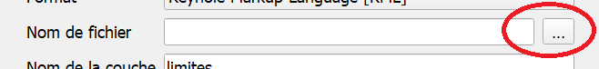
- Brancher le portable ou la tablette à l'ordinateur. 
- Copier le fichier KML dans le dossier : `...> oruxmaps > overlay`
- Ouvrir Oruxmaps, ouvrir les options de cartes, 
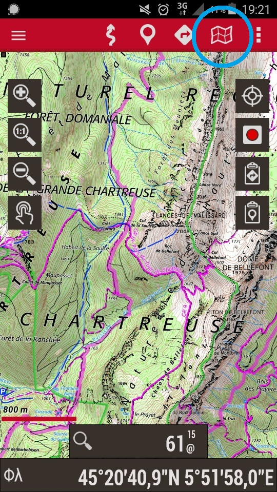
- Ouvrir ++"Options des couches"++ puis ++"Charger une couche KML"++

Vous devriez trouver le fichier kml, et pouvoir le sélectionner pour le charger. 

### Charger le scan 25 dans Orux Maps

> https://data.geopf.fr/private/wmts?SERVICE=WMTS&VERSION=1.0.0&REQUEST=GetCapabilities&apikey=ign_scan_ws

## Recherche de données

### Je souhaite importer des courbes de niveau dans mon projet QGIS.
`Traitement vecteur`
: **WFS** IGN : courbes de niveau > ELEVATION.CONTOUR.LINE:courbe

`Affichage uniquement d'images`
: **WMS** IGN : Courbes de niveau > ELEVATION.CONTOUR.LINE 