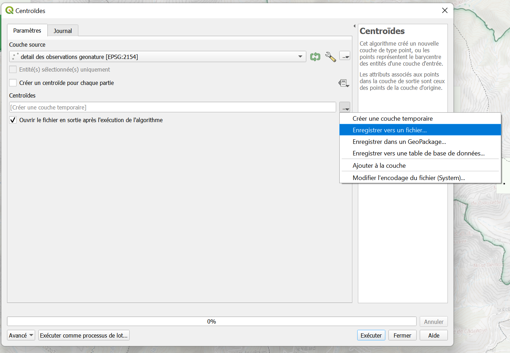

# Bonnes Pratiques

!!! tip "Comment bien travailler ensemble :wink: "
    Ce document vise à définir les bonnes pratiques pour le travail géomatique, et les conventions de nommage pour les fichiers, projets et couches QGIS dans la [BD_PNM](../bd_pnm/index.md).  
    Ces recommandations sont sujettes à exception, mais leur respect général permettra de faciliter la relecture, la communication en cas de problème, et le travail collaboratif.

## Préconisations de nommage
 - Éviter les **accents**, **espaces** et **caractères spéciaux** dans les noms de fichiers (*, #, !, é, ê, ...)
 - Rester **cohérent** (éviter de changer une nomenclature de nommage i.e.: "Projet1_2023", "2023 projet-2", ...)
 - Privilégier le **français** (a minima rester cohérent)
 - Éviter les **abbréviations** qui rendent les noms cryptiques (ex: "liste_patrimoine_protection" plutôt que "lst_pp")

## Dans QGIS

### Général
1. Importer les couches et projets depuis le **Gestionnaire de sources de données** :  

     ++"Couches"++ > ++"Gestionnaire de source de données"++ ou ++ctrl+l++  
     Non pas depuis l'explorateur 

     Particulièrement pour les couches provenant de la base de données (PostgreSQL)
    

2. **Les filtres** :

    Au chargement d'un projet, certaines couches peuvent être filtrées. Ce filtre peut être appliqué par l'outil filtre et/ou dans le menu symbologie.   
    Ces filtres doivent être modifiés pour accéder aux données pertinentes, ou à l'intégralité des données.
    
    
    !!! tip "L'application d'un filtre est signalée par l'icône de filtre"
        En cliquant dessus on accède au constructeur de requête qui permet de modifier les paramètres du filtrage.  
    
    L'utilisation d'une expression dans la symbologie (++"Couche"++ > ++"Propriétés"++ > ++"Symbologie"++ ou ++"double clic"++ sur la couche > onglet ++"symbologie"++) permet de filtrer ou regrouper l'information.   
    Dans l'exemple ci-dessous on obtient la somme de n_obs par maille. L'expression est modifiable directement ou en cliquant sur le ε pour accéder à l'éditeur d'expressions.
    

	 
3. ^^Éviter^^ tout particulièrement les **accents**, **espaces** et **caractères spéciaux** dans les noms de fichier ou de projet.

4. Ne pas trop encombrer un projet QGIS de trop nombreuses couches, préférer utiliser **un projet par objectif**.

5. Avoir un dossier par projet, contenant le projet QGIS dédié, et les données locales (s'il y en a) ainsi que les notes associées. 
    * Utiliser des **alias** pour les couches pour en faciliter la lecture (en utilisant le ++"clic droit"++ sur la couche puis ++"Renommer"++. Cette opération n'est que cosmétique et ne modifie pas les données ni le fichier).
    * Penser à utiliser des **groupes** pour organiser les couches de travail. Cela peut se faire en faisant ++"clic droit"++ dans le panneau des couches puis en cliquant sur ++"Ajouter un groupe"++. On peut ensuite glisser des couches dans le groupe pour les rendre _visible/invisible_ en un clic. 

 
### Pour le travail en local
 - Organiser ses fichiers et projets QGIS. Garder les projets QGIS dans des dossiers où il sera facile de les retrouver, et si possible, conserver les donnéees utilisées dans chaque projet proches.
 - Toujours conserver une copie intacte des données de travail par exemple dans un sous-dossier.
 - Penser à supprimer les produits intermédiaires de votre projet, et des fichiers.
 - Privilégier les exports en dur aux couches temporaires pour les résultats de géotraitements. 

    
    /// caption
    **Enregistrer vers un fichier** plutôt que **Créer une couche temporaire**
    ///
 
### En cas de problème
 - Consulter la [FAQ](FAQ.md)
 - Vérifier la [projection](FAQ.md#jai-un-problème-et-je-ne-sais-pas-quoi-faire) (CRS: EPSG:2154) 
 - Vérifier qu'on travaille bien sur [les bons fichiers](FAQ.md#jai-un-problème-et-je-ne-sais-pas-quoi-faire) (++"Couche"++ > ++"Propriétés"++ > ++"Source"++)
 - Vérifier la [nature des données](FAQ.md#jai-un-problème-et-je-ne-sais-pas-quoi-faire) sur lesquelles on travaille (vecteur/raster, type de données dans les colonnes...)
 - Si la tâche voulue ne s'exécute que sur une ou deux couches, essayer de l'exécuter dans un projet vierge.
 - Redémarrer QGIS.

