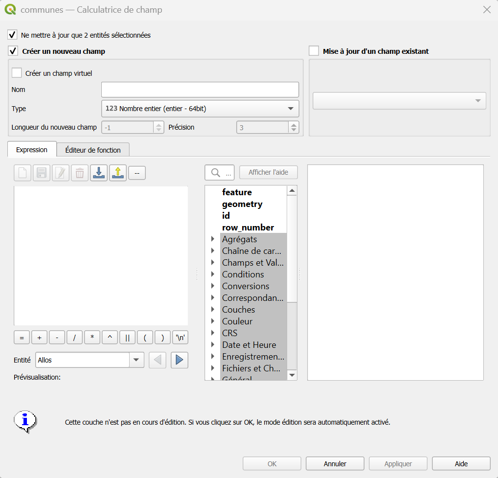

# La calculatrice de champs

La **calculatrice de champs** permet de remplir ou de modifier la [table attributaire](./glossaire.md#table-attributaire) d'une couche **grâce à une formule**, plutôt qu'en saisissant les valeurs à la main, entité par entité.

!!! info "À quoi ça sert ?"
    - **Calculer** des valeurs à partir de la géométrie : surface, longueur, coordonnées.
    - **Combiner ou nettoyer** des textes : concaténer deux champs, passer en majuscules, retirer des espaces.
    - **Classer** des entités selon une règle (« petite / moyenne / grande surface »).
    - **Remplir** un champ d'un seul coup pour toutes les entités (ou seulement celles sélectionnées).

--- 

## Avant de commencer

!!! warning "La calculatrice modifie vos données"
    Elle écrit dans la table de la couche. Si la couche n'est pas en mode Édition, QGIS l'y place automatiquement avant de calculer.

    - Travaillez sur une **copie locale** de la couche ([:octicons-arrow-right-24: Faire une copie locale de la couche](./creer_modifier_couche.md#faire-une-copie-locale-de-la-couche)) : les couches de la base de données ne sont pas modifiables directement.
    - Vérifiez le résultat dans la table attributaire **avant** d'enregistrer les modifications.
    - ++ctrl+z++ annule un calcul tant que vous n'avez pas quitté le mode **Édition** en enregistrant.

---

## Ouvrir la calculatrice

Depuis la **table attributaire** de la couche ou la barre d'outils : cliquez sur l'icône de la calculatrice de champs : , ou utilisez le raccourci ++ctrl+i++.

---


## Pas à pas

1. **Choisissez ce que vous voulez calculer**
    - *Seulement sur les entités sélectionnées* : cochez cette option pour ne modifier que les entités sélectionnées. Sinon, **toute** la couche est traitée.
2. **Créez un nouveau champ ou mettez à jour un champ existant**
    - **Créer un nouveau champ** : donnez-lui un **nom** et un **type**.
    - **Mettre à jour un champ existant** : choisissez le champ dans la liste. Ses valeurs actuelles seront **remplacées**.
3. **Écrivez l'expression** dans la zone de saisie.
    - Le bouton ou la zone de recherche à gauche donne accès aux **fonctions** classées par thème ; en bas, l'**aperçu** affiche le résultat calculé pour une entité.
4. Contrôlez l'aperçu, puis cliquez sur **OK**.
5. Vérifiez la table, puis **enregistrez** les modifications (crayon > confirmer).




!!! info "Longueur de champ & précision"
    Pour un décimal, la **longueur** est le nombre total de chiffres, la **précision** le nombre de chiffres après la virgule.   
    Longueur `10` et précision `3` : 7 chiffres avant la virgule, 3 après.

!!! tip "Un champ « virtuel » : un calcul qui se met à jour tout seul"
    En cochant **Créer un champ virtuel**, la valeur n'est pas écrite dans les données : elle est **recalculée** à chaque affichage, et suit donc les modifications de la couche (par exemple, une surface mise à jour dès que la géométrie change).  
    Le champ virtuel n'est conservé que **dans le projet** QGIS, pas dans le fichier de la couche : il disparaît à l'export si vous ne le prévoyez pas.

---

## Écrire une expression

Les expressions de la calculatrice suivent **la même syntaxe que l'éditeur d'expression** [:octicons-arrow-right-24: détaillée dans les filtres](./filtres.md#ecrire-un-filtre)

!!! tip "Cliquer plutôt qu'écrire"
    Double-cliquez sur un **champ** ou sur une **fonction** de la liste : elle s'insère dans l'expression, avec son aide à droite. Cela évite les fautes de frappe. Un trait rouge souligne les erreurs de syntaxe.

---

## Exemples courants

!!! example "Calculer une surface en hectares"
    ```sql
    $area / 10000
    ```
    `$area` donne la surface de chaque polygone (en m² par défaut). On divise par 10 000 pour obtenir des hectares. Pour arrondir à 2 décimales :

    ```sql
    round($area / 10000, 2)
    ```

!!! example "Calculer une longueur en kilomètres"
    ```sql
    $length / 1000
    ```

!!! example "Récupérer les coordonnées d'un point"
    ```sql
    $x
    ```
    ```sql
    $y
    ```
    Ces expressions donnent les coordonnées du point, dans le système de coordonnées de la couche ([:octicons-arrow-right-24: Systèmes de coordonnées](./scr.md#quel-est-le-scr-de-ma-couche-)).

!!! example "Assembler deux champs de texte"
    ```sql
    "prenom" || ' ' || "nom"
    ```
    L'opérateur `||` colle les textes bout à bout ; `' '` insère un espace entre les deux.

!!! example "Mettre un texte en majuscules"
    ```sql
    upper("nom")
    ```
    `lower()` met en minuscules ; `trim()` retire les espaces superflus au début et à la fin.

!!! example "Insérer la date du jour"
    ```sql
    now()
    ```
    Pour récupérer l'année d'un champ de type date : `year("date_obs")`.

!!! example "Remplacer les valeurs vides"
    ```sql
    coalesce("commentaire", 'Non renseigné')
    ```
    `coalesce` renvoie la première valeur non vide.

!!! note "Les unités dépendent du projet"
    `$area` et `$length` utilisent l'**ellipsoïde** et les **unités** définis dans ++"Projet"++ > ++"Propriétés"++ > **Général**. Si vos résultats paraissent incohérents, vérifiez ces paramètres.


---

## Calculatrice ou saisie manuelle ?

| | **Calculatrice de champs** | **Saisie dans la table** |
|---|---|---|
| **Pour** | Remplir ou modifier **beaucoup** d'entités avec une règle | Corriger **une ou quelques** valeurs |
| **Portée** | Toute la couche ou la sélection | Une cellule à la fois |
| **Risque** | Écrase les valeurs d'un champ existant en une fois | Faible |


---

## En cas de problème

| Symptôme | Cause probable | Solution |
|----------|----------------|----------|
| L'aperçu affiche une erreur | Faute de syntaxe | Vérifiez guillemets `"`, apostrophes `'`, parenthèses ; insérez champs et fonctions par double-clic |
| Le résultat est vide (`NULL`) | Un des champs utilisés est vide pour cette entité | Utilisez `coalesce()` pour fournir une valeur par défaut |
| Le résultat est tronqué ou arrondi | Longueur ou précision du champ trop petites | Recréez le champ avec une longueur plus grande |
| Le calcul s'applique à toute la couche | L'option « entités sélectionnées » n'était pas cochée | Annulez avec `Ctrl+Z` avant d'enregistrer, puis recommencez |
| Le champ créé disparaît après export | C'était un champ virtuel | Recréez-le comme champ normal, ou cochez-le à l'export |
| La calculatrice est grisée | La couche ne supporte pas l'édition (couche de la base, WMS...) | Faites une copie locale de la couche |

!!! success "Documentation complète sur la ^^calculatrice de champs^^"
    La documentation de QGIS est très complète, n'hésitez pas à la parcourir pour explorer les possibilités : [calculatrice de champs](https://docs.qgis.org/3.44/fr/docs/user_manual/working_with_vector/attribute_table.html).

    Maintenez ++ctrl++ en cliquant pour que la fenêtre s'ouvre dans un nouvel onglet :wink: