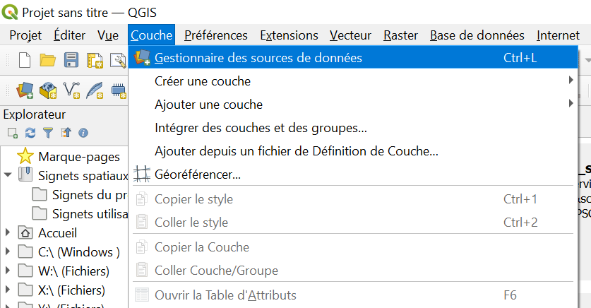
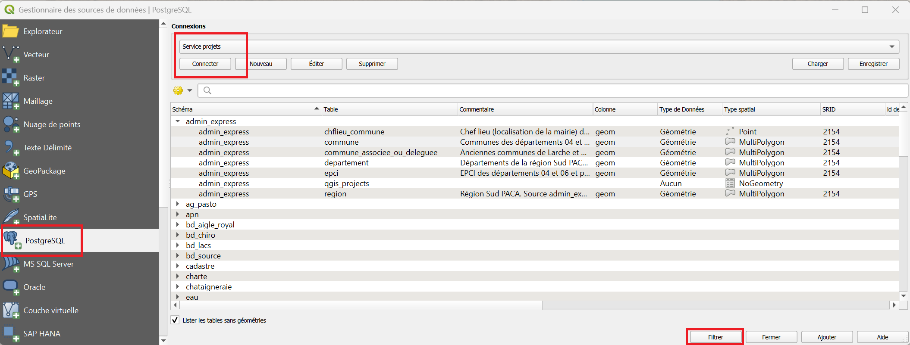

# Charger une couche depuis la base de données

## Pourquoi charger une couche depuis la base ?

La base de données du Parc contient des données organisées en tables, auxquelles les agents peuvent accéder directement depuis QGIS.  
Cela évite de manipuler des copies de fichiers qui deviendraient vite obsolètes : vous travaillez toujours sur la donnée de référence.

## Prérequis : [accès à la base de données du PNM](./installer_certificats_base_de_donnees.md)
Pour ouvrir une couche de la base, il faut avoir accès à la connexion **Service projets**.  
Si elle n'apparaît pas dans votre liste de connexions décrite plus bas, suivez d'abord [ce tutoriel](./installation_certificats_base_de_donnees.md).

En cas de difficulté, contactez le SI : `si@mercantour-parcnational.fr`.

## Charger une couche

- Ouvrir le **gestionnaire de sources de données** (++ctrl+l++ ou en cliquant sur l'onglet ++"Couche"++ de la barre de menu puis ++"Gestionnaire de sources de données"++)

    

- Aller dans l'onglet ++"PostgreSQL"++ à gauche
- Dans le menu déroulant ++"Connexions"++ Sélectionner **Service projets**
- Cliquer sur ++"Connecter"++

S'affichent les différents [schémas](./glossaire#schema) dans lesquels vous pouvez trouver les données.  
En les dépliants vous affichez les couches, qui ont des noms et des commentaires permettant d'identifier les données qu'elles contiennent. 

!!! question "Tous les schémas ne sont pas accessibles à tous les agents" 
    Certains contiennent des données sensibles. Si vous avez besoin d'un schéma qui ne s'affiche pas, contactez les agents référents sur les données qui vous intéressent.

### ^^Facultatif^^ : Filtrer les données
Certaines tables (comme la table "detail" du schéma "geonature_synthese") sont ^^**très**^^ lourdes.  
Afin d'éviter de saturer votre machine il est possible d'y appliquer un filtre en cliquant sur l'option ++"Filtrer"++, avant d'ajouter la couche à votre projet.  
Ce filtre sera appliqué quand la table en question sera chargée en cliquant sur ++"Ajouter"++. 

Pour plus de détails sur les filtres : [tutoriel sur les filtres en cliquant ici](./filtres.md).

## Enregistrer une couche localement

Si vous souhaitez éditer une couche, il vous faudra copier les données de la base de données sur votre machine.  
Pour cela : 

- ++"clic droit"++ sur la couche à sauvegarder 
- ++"Exporter"++ > ++"Sauvegarder les entités sous"++
- Cliquer sur les ++"..."++ naviguer sur l'emplacement de votre machine ou vous souhaitez enregistrer la couche.

Une fois la nouvelle couche enregistrée, elle devrait apparaitre dans le projet. Vous pourrez vérifier qu'il s'agit bien d'une copie locale en vérifiant son emplacement dans ses propriétés (++"clic droit"++ > ++"Propriétés"++ > ++"Information"++).  
Cette nouvelle couche est éditable, sans impact sur les données de la base de données. 
