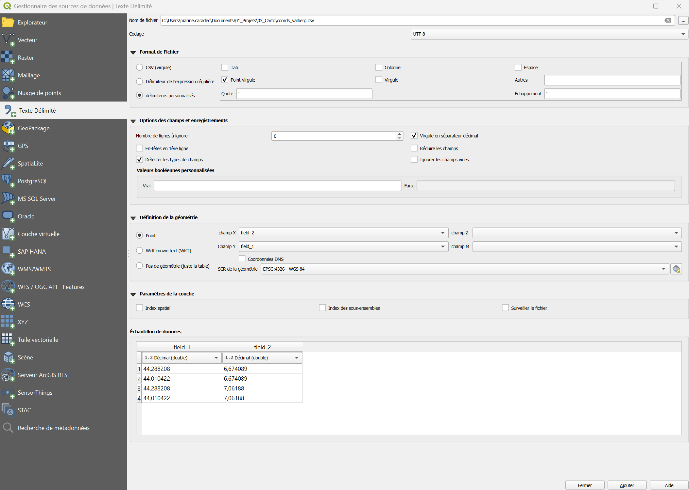
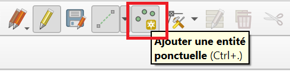
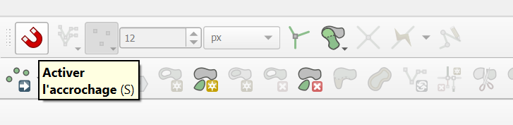
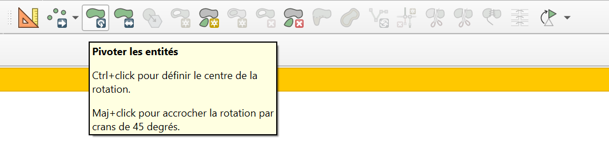
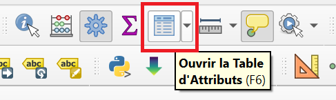

# Créer ou modifier une couche

C'est ici que vous entrez vos relevés de terrain, en créant ou modifiant une couche.

!!! info "Ce qui est couvert ici" 
    On se concentre sur les couches au format **vecteur**, comme toutes celles du projet tutoriel.  
    Il existe des méthodes pour modifier les **rasters**, mais elles ne sont pas abordées ici.

!!! note "Droits d'édition" 
    L'édition d'une couche contenue dans la base de données n'est possible que si des droits particuliers vous ont été accordés.  
    La plupart des couches sont uniquement **consultables** : c'est pourquoi on commence par en faire une **copie locale**.

--- 

## Faire une copie locale de la couche
Éditer une couche QGIS modifie le fichier de source des données. Soyez donc prudent·e et conservez une copie des données d'origine quand c'est possible.

1. ++"Clic droit"++ sur la couche > ++"Exporter"++ > ++"Sauvegarder les entités sous..."++
2. Cliquez sur les ++"..."++ pour naviguer jusqu'à l'emplacement de votre machine où vous souhaitez enregistrer la couche.
3. Validez.

La nouvelle couche apparaît dans le projet. Pour vérifier qu'il s'agit bien d'une copie locale, regardez son emplacement dans ++"clic droit"++ > ++"Propriétés"++, onglet Information. Vous pouvez désormais l'éditer sans impact sur les données de la base.

Où trouver des couches du PNM sur lesquelles travailler : [Ressources du PNM](./installer_certificats_base_de_donnees.md#charger-une-couche).

--- 

## Créer une nouvelle couche
Si les données que vous souhaitez representer n'ont pas de lien avec une couche de la base de données, créez une nouvelle couche vierge.  

- Dans la barre des menus, Cliquer sur ++"Couche"++ > ++"Créer une couche"++ > ++"Nouvelle couche GeoPackage"++ 

    

- Dans la fenêtre qui s'affiche, cliquer sur l'icône ++"..."++ pour renseigner l'emplacement où le fichier sera enregistré.

- Renseigner le type de géométrie selon le type d'usage voulu. Dans la plupart des cas: "Point", "Polyligne" ou "Polygone".
- Ne pas oublier d'indiquer la projection si elle est demandée: **EPSG:2154 - RGF v1 / Lambert-93**
- Si nécessaire, ajouter des champs. Il sera toujours possible d'en ajouter plus tard dans la [table d'attributs](#modification-de-la-table-attributaire).  

--- 

## Créer une couche à partir d'un tableau (CSV)
 
Si vos relevés sont dans un **tableur** (Excel, LibreOffice...) avec des colonnes de coordonnées, vous pouvez en faire une couche de points **sans rien ressaisir**.
 
!!! info "Préparer le tableau"
    - **Une ligne par relevé**, avec les **en-têtes** de colonnes en première ligne (évitez les accents et les espaces dans les noms : `date_obs` plutôt que `Date d'observation`).
    - **Deux colonnes de coordonnées** : une pour l'**X** (longitude si WSG84) et une pour le **Y** (latitude si WSG84).
    - Enregistrez au format **CSV** : ++"Fichier"++ > ++"Enregistrer sous"++ > **CSV UTF-8 (délimité par des points-virgules)**.

 
1. Ouvrez le **Gestionnaire de sources de données** : ++ctrl+l++, puis l'onglet **Texte délimité** (représenté par une grosse virgule).  
   Autre chemin : ++"Couche"++ > ++"Ajouter une couche"++ > ++"Ajouter une couche de texte délimité..."++
2. Cliquez sur les ++"..."++ pour sélectionner votre fichier `.csv`.
3. Vérifiez le **format de fichier** (**CSV**) et le **séparateur** (**point-virgule** pour un fichier issu d'Excel en français). L'**aperçu** en bas de la fenêtre doit afficher vos colonnes bien séparées.
4. Dans **Définition de la géométrie**, choisissez **Coordonnées du point**, puis indiquez le champ **X** (longitude) et le champ **Y** (latitude).
5. Choisissez le **SCR de la géométrie** : celui dans lequel sont exprimées vos coordonnées.
6. Cliquez sur **Ajouter**, puis **Fermer**.


 
| Vos coordonnées sont... | SCR à choisir |
|-------------------------|---------------|
| En **degrés** (GPS, téléphone) : `6.95`, `44.18` | **EPSG:4326 - WGS 84** |
| En **mètres** (Lambert-93) : `1020000`, `6340000` | **EPSG:2154 - RGF93 v1 / Lambert-93** |
 
!!! warning "Les points sont à l'ouest ?"
    Dans neuf cas sur dix : **X et Y sont inversés**, ou le **SCR est mauvais**. Rechargez le tableau en vérifiant ces deux réglages.  
    Si vos décimales s'écrivent avec une **virgule** (`6,95`), cochez **Virgule comme séparateur décimal** dans les options de la fenêtre.
 
!!! tip "Vérifier les types de colonnes"
    Ouvrez la table attributaire (++f6++) : les dates doivent être de type **Date** et les nombres de type **Entier** ou **Décimal**, pas **Texte**. Sinon, rechargez en cochant **Détecter les types de champs**.
 
---  

## Activer le mode Édition

Pour modifier une couche ou créer une entité, il faut d'abord activer le mode **Édition** pour la couche concernée. Trois façons de faire :

- Dans la **barre d'outils** QGIS 

    

- Par un ++"clic droit"++ sur la couche

     

- Depuis la fenêtre de la **table attributaire**

    


Dans tous les cas, cliquer sur le petit crayon activera le mode **Edition** pour la couche sélectionnée. On pourra alors y apporter des modifications de différentes façons :  


### Création d'entités/Modification de géométrie

En mode **Edition**, on peut aussi éditer directement la géométrie d'une entité, ou en créer de nouvelles.   
Quelques outils à connaître pour faciliter vos modifications :  [outils utiles :octicons-arrow-down-24:](#outils-utiles)

!!! tip "Documentation complète sur l'^^édition de couche^^"
    La documentation de QGIS est très complète, n'hésitez pas à la parcourir pour explorer les possibilités : [Edition d'une couche](https://docs.qgis.org/3.44/fr/docs/user_manual/working_with_vector/editing_geometry_attributes.html).

    Maintenez ++ctrl++ au moment de cliquer sur le lien pour l'ouvrir dans un nouvel onglet :wink:


### Outils utiles
- **Ajouter une entité**

     
    
      

    Cet outil permet de **créer de nouvelles données** dans la couche : points/lignes/polygones selon le type de géométrie paramétrée dans la couche.  
    La création d'une nouvelle entité se fait par une succession de ++"clics gauches"++, et est finalisée par un ++"clic droit"++ pour les polygones et lignes.  

    A la finalisation de chaque entité, une fenêtre s'ouvre proposant d'entrer les attributs connus. 

    

    Un **id** ou **fid** correspondant à l'identifiant unique de chaque entité peut être ^^généré automatiquement^^.   
    Il n'est pas nécessaire d'entrer les autres attributs pour que la nouvelle enttité soit sauvegardée. 


- Outil **sommet** 

      

    L'outil **sommet** permet de modifier la géométrie de points/lignes/polygones existants.  

    Une fois l'outil sommet sélectionné, on peut sélectionner n'importe quel sommet en cliquant dessus. Les sommets de chaque polygone sont visibles sous la forme de **petits cercles rouges**.

    

    - **Supprimer** un sommet : touche ++"Suppr"++ du clavier après avoir sélectionné un sommet.

    - **Déplacer** un sommet : cliquer à nouveau avec le ++"clic gauche"++ à un autre endroit après avoir sélectionné un sommet.   

    - **Créer** de nouveaux sommets : cliquer très précisément sur la croix qui apparait en faisant passer le curseur entre deux sommets.    

        

    En combinant le déplacement, la modification, et la création de sommets, il est possible de changer complètement la forme d'un polygone.


- **Outils de numérisation**  
    Il est souvent pratique d'afficher des barres d'outils supplémentaires (et parfois d'en cacher pour clarifier le menu : ++"clic droit"++ à n'importe quel endroit de la barre d'outils  
    ou menu ++"Vue"++ > ++"Barres d'outils"++)

    Deux outils à cocher peuvent être particulièrement pratiques : 

    * **Accrochage** qui permet de rendre "magnétique" le clic, et de superposer parfaitement des points
        

    * **Numérisation avancée** qui permet à des outils de modifications de géométries en mode édition : déplacer, pivoter, ...
        


!!! tip "Les autres barres d'outils peuvent contenir des outils pratiques !"
    N'hésitez pas à les explorer ! La documentation de QGIS est très complète : [Outils](https://docs.qgis.org/3.44/fr/docs/user_manual/introduction/general_tools.html#)

    Maintenez ++ctrl++ au moment de cliquer sur le lien pour l'ouvrir dans un nouvel onglet :wink:

!!! warning "Enregistrez vos modifications" 
    Vos modifications ne sont enregistrées et effectives qu'à la sortie du mode **Édition** (nouveau clic sur le crayon, puis confirmation).  
    Si le logiciel plante, ou si vous ne confirmez pas à la sortie, les modifications sont perdues et les données d'origine sont conservées.

### Modification de la table attributaire

Les couches au format vecteur contiennent une table attributaire, qui donne des informations sur les données de la couche : elle contient les champs qui ont été renseignés à la création de la couche.

Pour l'afficher : ++"clic droit"++ sur la couche > ++"Ouvrir la table d'attributs"++ (raccourci ++f6++)


Ou cliquer sur le bouton  dans la barre d'outils.


Elle peut se présenter de deux façons, entre lesquelles on bascule avec l'icône correspondante en bas à droite de la fenêtre.  


/// caption
Vue **Table** : elle permet de visualiser d'un coup d'œil l'ensemble des entités et attributs.
///  


/// caption
Vue **Formulaire** : elle permet de visualiser les entités une à une, la liste des entités apparaissant sur la gauche.
///


Si votre version de QGIS a bien été paramétrée, un bouton déroulant apparaît en bas à gauche de la table attributaire : `Ne montrer que les entités visibles sur la carte`.

!!! warning "Attention aux couches volumineuses" 
    Vous pouvez demander à toujours afficher toutes les entités, mais ce mode peut faire planter QGIS sur les couches contenant un grand nombre d'entités.  
    Le mode d'affichage par défaut se modifie dans ++"Préférences"++ > ++"Options"++ > ++"Sources de données"++, rubrique ++"Comportement des tables d'attributs"++.


En mode **Edition**, on peut modifier directement la table attributaire à la façon d'un tableur : ajouter/supprimer des colonnes, calculer une colonne avec l'outil ([calculatrice de champs](./calculatrice_champs.md)), etc ...

Supprimer une ligne revient à supprimer une entité de votre couche (point/ligne/polygone).


!!! tip "Documentation complète sur l'édition de ^^table attributaire^^"
    La documentation de QGIS est très complète, n'hésitez pas à la parcourir pour explorer les possibilités : [Table attributaire](https://docs.qgis.org/3.44/fr/docs/user_manual/working_with_vector/attribute_table.html).

    Maintenez ++ctrl++ au moment de cliquer sur le lien pour l'ouvrir dans un nouvel onglet :wink:


--- 

## Consulter les propriétés d'une couche

Double-cliquez sur une couche, ou faites ++"clic droit"++ > ++"Propriétés"++. Une série d'onglets donne des informations sur la couche.

L'onglet Information est particulièrement utile pour :

- **Vérifier la source des données** : si vous travaillez sur des données stockées sur votre machine, le chemin détaillé vers le fichier apparaît ; si vous travaillez sur le serveur, ce sont les paramètres de connexion qui sont visibles ;
- **Vérifier le type de données** (raster/vecteur, type de géométrie) et la projection ;
- **vérifier le nombre d'entités** (après application du filtre).

!!! tip "Un problème avec une couche ?" 
    Commencez par ses propriétés : s'agit-il bien du type de géométrie attendu ? Travaillez-vous bien sur le bon fichier ?

La table attributaire, elle, n'est pas visible dans les propriétés : ++f6++ sur une couche sélectionnée pour la visualiser. 


--- 

## Connceter des données entre couches 

Il arrive que les informations dont vous avez besoin soient réparties dans **plusieurs couches** ou **tables** : par exemple, une couche de taxons et leur sensibilité et une table de relevés d'observation qui y font référence.  

Plutôt que de tout recopier à la main, QGIS permet de les connecter. Il existe deux manières de le faire, selon ce que vous souhaitez obtenir :  

||Jointure|Relation|
|:--:|:--:|:--:|
|**Principe**|Les champs d'une couche sont **ajoutés** à la table de l'autre|Les deux couches restent **séparées** mais **liées**|
|**Correspondances**|**1 pour 1 **: une entité reçoit les infos d'une seule entité de l'autre couche|**1 pour 1 ou plusieurs** : une entité "parent" peut être liée à plusieurs entités "enfants"|
|**Résultat**|Des colonnes supplémentaires dans la table attributaire|Un tableau des entités liées, dans le formulaire de l'entité parent|
|**Se configure dans**|++"Propriétés"++ de la couche > ++"Jointures"++|++"Projet"++ > ++"Propriétés"++ > ++"Relations"++|
|**Utile pour**|Enrichir une couche avec des informations (nom, catégorie, statut...)|Saisir ou consulter plusieurs relevés rattachés à un même objet|


!!! info "Un point commun : le champ identifiant" 
    Dans les deux cas, les couches doivent partager un champ commun (un identifiant, un code...) : c'est lui qui permet à QGIS de savoir quelle ligne correspond à quelle entité.

!!! tip "Documentation complète sur la ^^connexion entre données^^"
    La documentation de QGIS est très complète, n'hésitez pas à la parcourir pour explorer les possibilités : [Jointure](https://docs.qgis.org/3.44/fr/docs/user_manual/working_with_vector/joins_relations.html#joining-features-between-two-layers) & [Relation](https://docs.qgis.org/3.44/fr/docs/user_manual/working_with_vector/joins_relations.html#joining-features-between-two-layers) .


--- 

## Les filtres

Un symbole  à droite d'une couche signifie qu'elle est **filtrée**.


Les filtres sont des outils très puissants, notamment pour limiter la charge sur vos ordinateurs.  
Ils sont appliqués au niveau du serveur et permettent de ne charger que les entités d'une couche que vous avez choisies par une expression.

^^Exemple^^ : en cliquant sur le symbole filtre de la couche **Vallees**, ou en faisant ++"clic droit"++ > ++"Filtre sur cette couche"++, vous voyez l'expression suivante :
```sql
"id_type" = 3
```

Cette expression signifie: 
```
"Ne charge que les entités pour lesquelles la colonne "id_type" a la valeur 3."
```

!!! warning "Vous pouvez modifier un filtre, mais pas l'enregistrer" 
    Certaines couches du serveur sont chargées par défaut avec des filtres.  
    Vous pouvez les modifier pour accéder à d'autres données, ou les restreindre le temps de la consultation.  
    Veillez cependant à ne pas enregistrer vos modifications sur un projet partagé.

Les filtres emploient une syntaxe SQL : vous êtes encouragé·e·s à apprendre à les utiliser avec le [tutoriel sur les filtres](./filtres.md).
