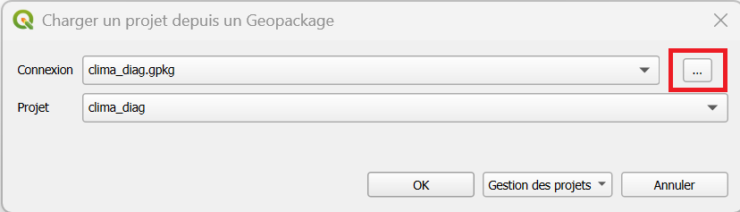

# Créer ou modifier un projet 
--- 
## Ouvrir un projet dans la base de donnée

- Dans la barre de menu, cliquez sur ++"Projet"++ > ++"Ouvrir depuis"++ > ++"PostgreSQL"++
- Choisissez la connexion **Service projets**, puis le **schéma** et le **projet** qui vous intéresse

!!! note "Remplacer les couches manquantes"
    Il est possible qu'un projet QGIS fasse référence à des données locales ou qui ont été supprimées / déplacées.  
	Cliquez sur **Conserver les couches inutilisables**.  
	  
    Vous pouvez modifier le chemin vers lequel la couche fait référence : [tuto ici](./FAQ.md#traiter-les-couches-inutilisables-a-louverture-dun-projet-certaines-couches-ne-saffichent-pas)

!!! success "Un projet ouvert depuis la bdd est partagé" 
    La plupart des projets de la bdd sont accessibles uniquement en lecture.  
    Vous pouvez à tout moment faire ++"Projet"++ > ++"Enregistrer sous..."++ pour créer une copie du projet qui n'est accessible qu'à vous.  
    Vous pourrez ensuite la modifier :wink:
--- 

## Créer un projet 

Dans la barre de menu, cliquez sur ++"Projet"++ > ++"Nouveau"++.

Vous pouvez ajouter les couches & fonds de carte qui vous intéressent.

--- 

## Enregistrer son projet 

- En **local** : choissisez l'emplacement du projet souhaité, donnez lui un nom et choissisez le format `.qgz`/`.qgs` (ShapeFile)
- Si vous souhaitez pouvoir **partager** facilement à vos collègues les couches et le projet dans un unique fichier, utilisez le format `.gpkg` (GeoPackage) et suivez la méthode : [partager un projet](./empaqueter_un_projet.md).

??? tip "Choisir le bon format"
    |Format|Ce qu'il contient|Avantages|Limites|
    |:--:|:--:|:--:|:--:|
    |`.qgz`/`.qgs` (ShapeFile)|Le projet uniquement : les chemins menant aux couches et leur définition de style|Léger|**Ne contient pas les données.** Une couche issue d'une base sécurisée ne s'affichera pas sur un ordinateur sans cet accès. Les fichiers locaux doivent se trouver exactement aux mêmes chemins sur l'autre machine.|
    |`.gpkg` (GeoPackage)|Le projet ^^et^^ les données, avec leurs styles|Un seul fichier, facile à échanger ; évite les problèmes de chemins|Plus lourd ; la démarche est plus longue|

--- 

## Ouvrir un projet en GeoPackage
- Dans la barre de menu, cliquez sur ++"Projet"++ > ++"Ouvrir depuis"++ > ++"GeoPackage"++
- Cliquez sur les ++"..."++ pour sélectionner le fichier **.gpk** à ouvrir
- Sélectionner le projet d'intérêt dans le menu déroulant.

