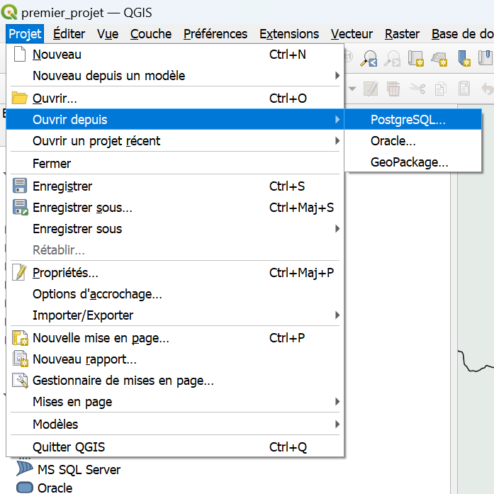
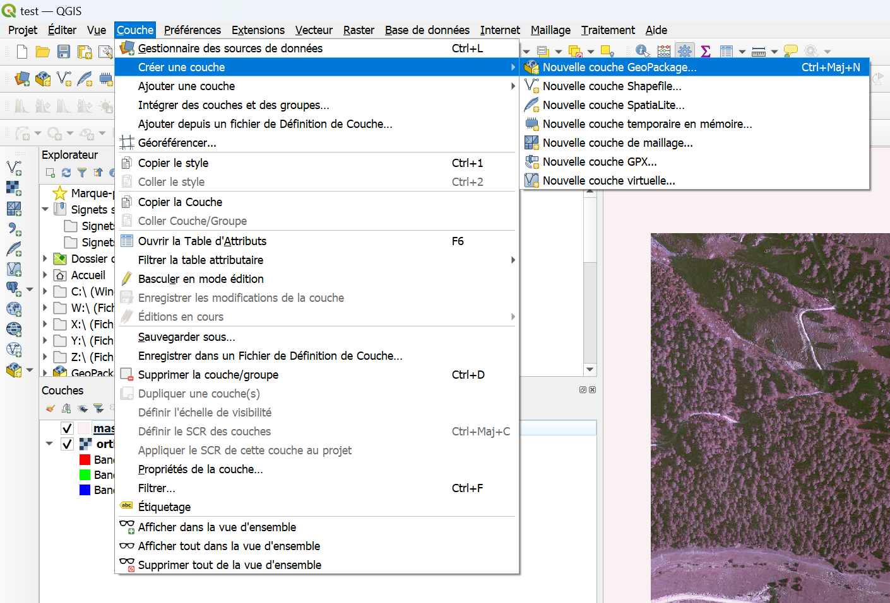
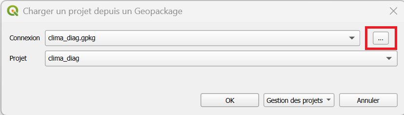

# Créer ou modifier un projet 
--- 
## Ouvrir un projet dans la base de donnée

- Dans la barre de menu, cliquez sur ++"Projet"++ > ++"Ouvrir depuis"++ > ++"PostgreSQL"++
- Choisissez la connexion **Service projets**, puis le **schéma** et le **projet** qui vous intéresse

!!! note "Remplacer les couches manquantes"
    Il est possible qu'un projet QGIS fasse référence à des données locales ou qui ont été supprimées / déplacées.  
	Cliquez sur **Conserver les couches inutilisables**.  
	  
    Vous pouvez modifier le chemin vers lequel la couche fait référence : [tuto ici](./FAQ.md#traiter-les-couches-inutilisables-a-louverture-dun-projet-certaines-couches-ne-saffichent-pas)

!!! success "Un projet ouvert depuis la bdd est partagé" 
    La plupart des projets de la bdd sont accessibles uniquement en lecture.  
    Vous pouvez à tout moment faire ++"Projet"++ > ++"Enregistrer sous..."++ pour créer une copie du projet qui n'est accessible qu'à vous.  
    Vous pourrez ensuite la modifier :wink:
--- 

## Créer un projet 

Le plus simple pour créer son propre projet et bien structurer ses données est de passer par le format GeoPackage.   
Légèrement plus fastidieux qu'un simple ++"Projet"++ > ++"Nouveau"++, cette méthode vous fera gagner beaucoup de temps par la suite. Elle est détaillée pas à pas ci-dessous.

??? tip "Choisir le bon format en local"
    |Format|Ce qu'il contient|Avantages|Limites|
    |:--:|:--:|:--:|:--:|
    |`.qgz`/`.qgs` (ShapeFile)|Le projet uniquement : les chemins menant aux couches et leur définition de style|Léger|**Ne contient pas les données.** Une couche issue d'une base sécurisée ne s'affichera pas sur un ordinateur sans cet accès. Les fichiers locaux doivent se trouver exactement aux mêmes chemins sur l'autre machine.|
    |`.gpkg` (GeoPackage)|Le projet ^^et^^ les données, avec leurs styles|Un seul fichier, facile à échanger ; évite les problèmes de chemins|Plus lourd ; la démarche est plus longue|

### Créer un GeoPackage vierge

Pour enregistrer le projet dans un GeoPackage, il faut d'abord en créer un vierge : ++"Couche"++ > ++"Créer une couche"++ > ++"Nouvelle couche GeoPackage..."++

### Définir la connexion à ce fichier

Par défaut, QGIS ne "connaît" pas le GeoPackage que vous venez de créer : il faut définir la connexion à ce fichier.

- Ouvrez le **gestionnaire de sources de données** ++ctrl+l++
- Dans le menu de gauche, faites un ++"clic droit"++ sur **GeoPackage** > ++"Nouvelle connexion..."++
- Naviguez jusqu'au fichier GeoPackage que vous venez de créer.

### Enregistrer le projet

Il ne reste qu'à enregistrer le projet et à lui donner un nom :

++"Projet"++ > ++"Enregistrer le projet sous..."++ > ++"GeoPackage"++

!!! tip "Vous pouvez enregistrer plusieurs projets dans un même GeoPackage"
    Il suffit de choisir le même fichier .gpk et donner un nom de projet différent.

--- 

## Ouvrir un projet en GeoPackage
- Dans la barre de menu, cliquez sur ++"Projet"++ > ++"Ouvrir depuis"++ > ++"GeoPackage"++
- Cliquez sur les ++"..."++ pour sélectionner le fichier **.gpk** à ouvrir
- Sélectionner le projet d'intérêt dans le menu déroulant.

