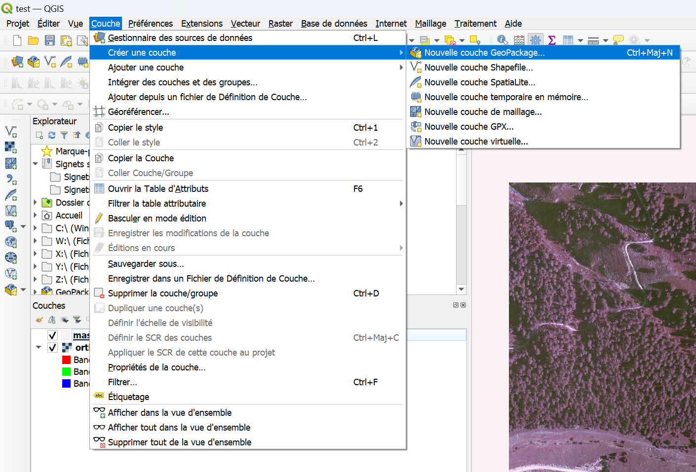

# Empaqueter un projet QGIS en Geopackage

---

## Comment partager un projet ?

Il est parfois nécessaire de partager un projet initialement construit sur une machine, avec des ressources se situant à différents endroits.   
Pour le partager simplement, le plus simple est d'enregistrer à la fois le projet, et les couches qu'il contient dans un [GeoPackage](./glossaire.md#geopackage-gpkg).  

!!! info "Un GeoPackage fonctionne comme une base de données" 
    Le format .gpkg fonctionne sur le modèle d'une base de données : un onglet lui est spécialement dédié dans le Gestionnaire de sources de données.

L'opération se fait en deux étapes :
 
- Empaqueter les couches du projet dans un GeoPackage
- Enregistrer le projet dans ce même GeoPackage
- Partager le fichier

--- 

## Empaquetage des couches

Dans un premier temps, il faut enregistrer toutes les données desquelles dépend le projet dans un GeoPackage.    
Pour cela, on peut utiliser l'outil **Empaquetage de couche**. 

!!! warning "N'empaqueter que les couches stockées ^^en dehors^^ de la base de données "Service projets""
    Les agents du Parc ont généralement le même accès que vous à la base, ainsi empaqueter ces couches reviendrait à dupliquer de la donnée et à la rendre obsolète.

Si toutes les couches que vous utilisez dans votre projet sont stockées dans **Service projets**, sauter ce paragraphe et rdv à l'[empaquetage du projet](#empaquetage-du-projet).

1. Affichez la boîte à outils de traitements : faites un ++"clic droit"++ sur la barre des menus, puis ++"Panneaux"++ > **Panneau**  ++"Boîte à outils de traitements"++

    

2. Dans le panneau qui s'affiche, la boîte à outils de traitement, recherchez l'outil **Empaquetage de couche**. 

3. Sélectionnez toutes les couches du projet, dans le premier ++"..."++ et enregistrez-les dans un GeoPackage, deuxième ++"..."++. 

    

4. Vérifiez ensuite que les couches du projet ouvert prennent bien leur source depuis le GeoPackage créé : ++"clic droit"++ sur la couche > ++"Propriétés"++ > onglet ++"Information"++.  

5. Si ce n'est pas le cas, chargez-les à nouveau dans le projet depuis le GeoPackage et retirer les anciennes, ou [changer la source des données](FAQ.md#jai-un-probleme-et-je-ne-sais-pas-quoi-faire).

!!! failure "Certaines couches ne peuvent pas être enregistrées dans un GeoPackage" 
    C'est le cas des couches qui ne sont pas des fichiers de données, comme les [fonds de carte WMS/WMTS](./wms_wfs.md).  
    Dans ces cas, d'autres solutions sont à envisager : par exemple, la personne qui reçoit le projet devra ajouter la connexion de son côté.

---

## Empaquetage du projet 

On va pouvoir utiliser le même GeoPackage qui contient les couches pour stocker également le projet. Dans ce cas là sauter l'étape suivante et rdv à [Définir la connexion à ce fichier](#definir-la-connexion-a-ce-fichier). 

Cependant, il est possible que vous n'ayez pas besoin d'empaqueter des couches avant de partager le projet (couches stockées uniquement dans la bdd du PNM), alors vous aurez besoin d'un support vierge pour enregistrer votre projet : [créer un GeoPackage vierge](#creer-un-geopackage-vierge).

### Créer un GeoPackage vierge

Pour enregistrer le projet dans un GeoPackage, il faut d'abord en créer un vierge : ++"Couche"++ > ++"Créer une couche"++ > ++"Nouvelle couche GeoPackage..."++

### Définir la connexion à ce fichier

Par défaut, QGIS ne "connaît" pas le GeoPackage que vous venez de créer : il faut définir la connexion à ce fichier.

- Ouvrez le **gestionnaire de sources de données** ++ctrl+l++
- Dans le menu de gauche, faites un ++"clic droit"++ sur **GeoPackage** > ++"Nouvelle connexion..."++
- Naviguez jusqu'au fichier GeoPackage que vous venez de créer.

### Enregistrer le projet

Il ne reste qu'à enregistrer le projet et à lui donner un nom :

++"Projet"++ > ++"Enregistrer le projet sous..."++ > ++"GeoPackage"++

!!! tip "Vous pouvez enregistrer plusieurs projets dans un même GeoPackage"
    Il suffit de choisir le même fichier .gpk et donner un nom de projet différent.

--- 

## Ouvrir un projet depuis un GeoPackage

++"Projet"++ > ++"Ouvrir depuis..."++ > ++"GeoPackage"++

!!! tip "Le GeoPackage n'apparaît pas dans la liste ?" 
    S'il n'est pas affiché parmi les connexions par défaut, cliquez sur l'icône ++"..."++ puis naviguez jusqu'au fichier GeoPackage.

