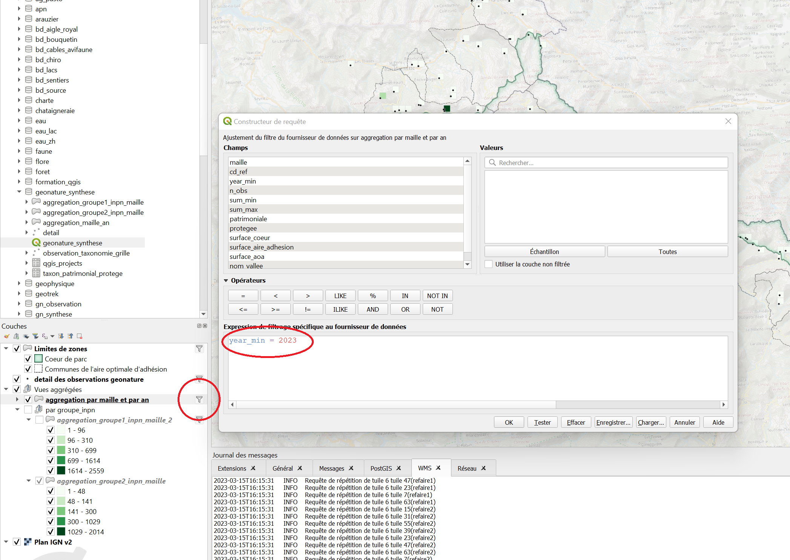
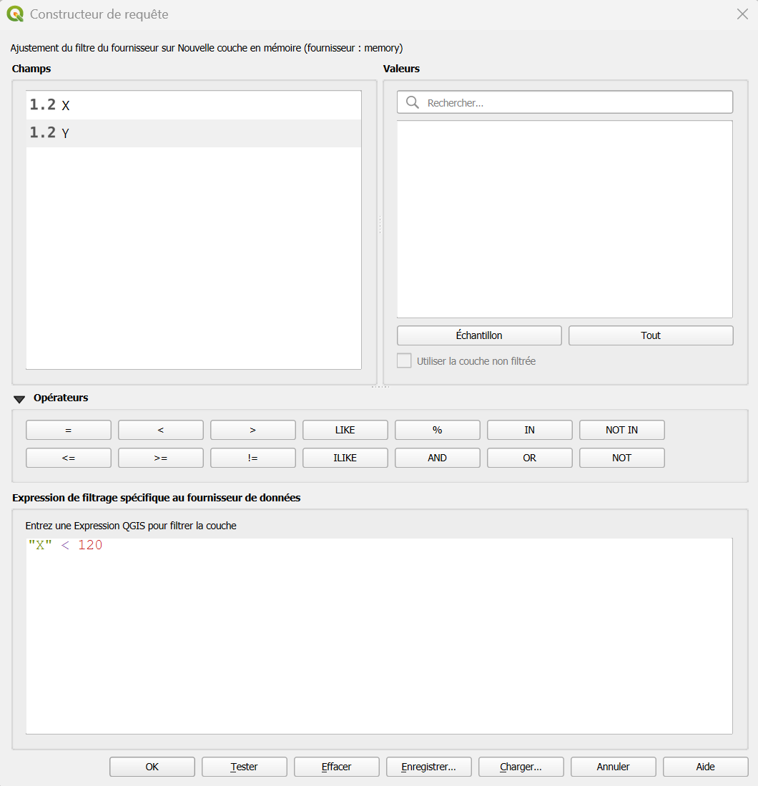

# Les Filtres

Un **filtre** limite les entités chargées dans QGIS à celles qui répondent à des critères portant sur la [table attributaire](./glossaire.md#table-attributaire) : par exemple, uniquement les observations d'une espèce, ou d'une année.
 
!!! info "Pourquoi filtrer ?"
    - **Alléger votre machine** : pour une couche issue de la base de données, le filtre est appliqué directement par le serveur. Seules les entités utiles sont envoyées à QGIS, ce qui évite de saturer votre poste sur les tables volumineuses.
    - **Y voir plus clair** : la carte et la table attributaire n'affichent que ce qui vous intéresse.
    - **Ne rien modifier** : le filtre n'altère pas les données. Il cache simplement les entités qui ne correspondent pas ; les retirer les fait réapparaître.

--- 

## Reconnaître une couche filtrée
 
Dans le panneau **Couches**, une couche filtrée est signalée par cette icône :    
 
Elle signifie que seules les entités répondant aux conditions du filtre sont visibles. C'est fréquent dans les projets de la base du Parc, où de nombreuses couches sont filtrées par défaut.
 
!!! tip "Il manque des entités sur ma carte ?"
    Avant de chercher plus loin, vérifiez si la couche porte l'icône de filtre : c'est la cause la plus fréquente.

--- 

## Ouvrir, modifier ou retirer un filtre
 
Cliquez sur l'icône de filtre, ou faites ++"clic droit"++ sur la couche > ++"Filtrer..."++ (raccourci : ++ctrl+f++).  
Le **constructeur de requête** s'ouvre, avec l'expression du filtre en cours.
 

 
- **Modifier** : changez l'expression, puis cliquez sur **OK**.
- **Retirer** : effacez toute l'expression, puis cliquez sur **OK**. Toutes les entités de la couche sont de nouveau affichées.


!!! warning "Filtre impossible en mode Édition"
    Si le bouton est grisé, c'est peut-être que la couche est en mode **Édition** : terminez d'abord l'édition, puis filtrez.
 
---

## Filtrer au moment de charger une couche
 
Pour les tables très lourdes, il vaut mieux filtrer **avant** le chargement : dans le **gestionnaire de sources de données**, sélectionnez la table, cliquez sur **Filtrer**, écrivez votre condition, puis **Ajouter**.   

[ :octicons-arrow-right-24: Charger une couche depuis la base de données](./installer_certificats_base_de_donnees.md#charger-une-couche).

---

## Écrire un filtre
 
Un filtre est une **condition** vérifiée pour chaque entité : si elle est vraie, l'entité est affichée.
 
Sa forme générale :
 
```sql
"nom_du_champ" opérateur valeur
```
 
!!! tip "Le plus simple et le plus sûr : cliquer, plutôt qu'écrire"
    Dans le constructeur de requête, double-cliquez sur un **champ**, un **opérateur** (`=`, `>`, `AND`...) ou une **valeur** pour l'insérer dans l'expression. Cela évite les fautes de frappe : une seule erreur de syntaxe suffit à empêcher l'exécution du filtre.  
    Le bouton **Valeurs** (ou **Tous**) liste les valeurs existantes d'un champ : inutile de les deviner.  

    


### Les règles de syntaxe à retenir
 
| Élément | Se note | Exemple |
|---------|---------|---------|
| **Nom de champ** | entre **guillemets doubles** `"` | `"nom"` |
| **Texte** | entre **apostrophes** `'` | `'Alpes-Maritimes'` |
| **Nombre** | sans rien | `4257` |
| **Texte contenant une apostrophe** | apostrophe **doublée** | `'Val d''Entraunes'` |
 
!!! warning "Majuscules et accents"
    Pour un texte, la valeur doit être **exactement** celle de la table (accents, tirets, majuscules).  
    `'Alpes-Maritimes'` fonctionne, `'alpes maritimes'` non.  
    Pour éviter les erreurs de frappe, rechercher la valeur d'un champ dans l'onglet **valeur** et double cliquer pour l'ajouter.


Le symbole `%` remplace n'importe quelle suite de caractères.  
Le symbole `_` remplace un seul caractère (exemple un mot qui contient - ou pas - un accent).


### Combiner plusieurs conditions
 
| Mot | Sens | Exemple |
|-----|------|---------|
| `AND` | **les deux** conditions doivent être vraies | `"cd_ref" = 4257 AND "date_min" >= 2022` |
| `OR` | **au moins une** des conditions doit être vraie | `"date_min" >= 2022 OR "cd_ref" = 4257` |
| `NOT` | **inverse** une condition | `NOT "cd_ref" = 4257` |
 
Le premier exemple affiche les observations de l'espèce 4257 **faites depuis 2022**. Le deuxième affiche **toutes** les observations depuis 2022, **plus** toutes celles de l'espèce 4257, quelle que soit leur date.
 
!!! warning "Utilisez des parenthèses dès que vous mélangez `AND` et `OR`"
    Sans parenthèses, `AND` est évalué avant `OR`, ce qui donne souvent un résultat inattendu.
    ```sql
        ("cd_ref" = 4257 OR "cd_ref" = 4258) AND "date_min" >= 2022
    ```
---

## Exemples
 
!!! example "Un seul département"
    ```sql
        "nom" = 'Alpes-Maritimes'
    ```
 
!!! example "Une liste d'espèces"
    ```sql
        "cd_nom" IN (60313, 60295, 60418, 60427, 60400, 79305, 79301)
    ```
 
!!! example "Observations récentes d'une espèce"
    ```sql
        "cd_ref" = 4257 AND "date_min" >= 2022
    ```
 
!!! example "Observations récentes, ou concernant une espèce donnée"
    ```sql
        "date_min" >= 2022 OR "cd_ref" = 4257
    ```
 
!!! note "Filtrer sur une date"
    Selon la table, `date_min` est soit un **nombre** (l'année), soit une **vraie date**. Dans le second cas, écrivez la date entre apostrophes au format `JJ-MM-AAAA` : `"date_min" >= '01-01-2022'`.
 
---

## Filtre ou sélection ?
 
Ces deux notions sont souvent confondues.
 
| | **Filtre** | **Sélection** |
|---|---|---|
| **Effet** | Les entités non retenues **disparaissent** (carte et table) | Les entités sont **surlignées** (en jaune), les autres restent visibles |
| **Durée** | Reste appliqué tant que vous ne le retirez pas, et est enregistré avec le projet | Temporaire |
| **Pour** | Travailler durablement sur un sous-ensemble ; alléger QGIS | Repérer ou traiter quelques entités ponctuellement |
 
---

## En cas de problème
 
| Symptôme | Cause probable | Solution |
|----------|----------------|----------|
| Message d'erreur à la validation | Faute de syntaxe | Vérifiez guillemets `"`, apostrophes `'`, parenthèses ; utilisez le bouton **Tester** du constructeur de requête |
| Aucune entité n'apparaît | Valeur de texte inexacte, ou filtre trop restrictif | Retirez le filtre, puis reconstruisez-le condition par condition |
| Le champ n'est pas reconnu | Nom mal orthographié ou sans guillemets doubles | Double-cliquez sur le champ dans la liste plutôt que de le taper |
| Entités qui manquent sur la carte | La couche est filtrée | Repérez l'icône de filtre et retirez ou modifiez-le |
| Le bouton **Filtrer** est grisé | La couche est en mode Édition | Quittez le mode Édition |
 
!!! tip "Documentation complète sur les ^^filtres^^"
    La documentation de QGIS est très complète, n'hésitez pas à la parcourir pour explorer les possibilités : [Filtres](https://docs.qgis.org/3.44/fr/docs/user_manual/working_with_vector/attribute_table.html#filtering-features).

    Maintenez ++ctrl++ en cliquant pour que la fenêtre s'ouvre dans un nouvel onglet :wink: