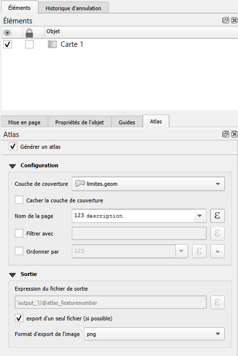

# Générer un atlas

Un **atlas** est une série de cartes qui ont la **même mise en page et la même symbologie**, mais chacune **centrée sur une entité différente** d'une même couche. QGIS les produit automatiquement, en un seul export.

!!! info "À quoi ça sert ?"
    - Une carte par commune, par secteur, par site ou par unité pastorale.
    - Des fiches avec un titre, des informations et une carte générés pour chaque entité.
    - Une série de cartes cohérentes, sans refaire la mise en page à la main.

!!! warning "Condition principale"
    Toutes les entités qui doivent apparaître dans l'atlas doivent se trouver **dans une même couche**. C'est cette couche, dite **couche de couverture**, qui détermine le nombre de pages et leur contenu.

---

## Le principe

| Élément | Rôle |
|---------|------|
| **Couche de couverture** | Une page de l'atlas est générée pour **chaque entité** de cette couche |
| **Carte de la mise en page** | Se recentre automatiquement sur l'entité de la page courante |
| **Textes dynamiques** | Affichent des informations propres à chaque entité (son nom, son numéro...) |

---

## Pas à pas

### 1. Ouvrir une mise en page

1. Partez d'un projet qui affiche déjà la carte que vous voulez décliner.
2. Dans la barre de menu, cliquez sur ++"Projet"++ > ++"Gestionnaire de mise en page"++.
3. Créez une **nouvelle mise en page**, ou ouvrez une mise en page existante.

### 2. Activer l'atlas

1. Dans la fenêtre de mise en page, cliquez sur ++"Atlas"++ > ++"Paramètres de l'atlas"++.
2. Dans le panneau de droite apparaît un onglet ++"Atlas"++, à côté de **Mise en page**, **Propriétés de l'objet** et **Guides**.
3. Cochez la case **Générer un atlas**.
4. Dans le menu déroulant **Couche de couverture**, choisissez la couche qui contient les entités sur lesquelles l'atlas doit être centré.

    

Options facultatives, dans le même onglet :

| Option | À quoi ça sert |
|--------|----------------|
| **Nom de page** | Champ qui nomme chaque page (utile pour les noms de fichiers à l'export) |
| **Filtrer avec** | Ne générer l'atlas que pour certaines entités de la couche |
| **Trier par** | Choisir l'ordre des pages à partir d'un champ de la couche |
| **Masquer la couche de couverture** | Cache la couche de couverture sur la carte, pour ne voir que le reste |

### 3. Lier la carte à l'atlas

Il faut dire à la carte de se recentrer sur chaque entité.

1. Cliquez sur la carte dans la mise en page.
2. Dans l'onglet **Propriétés de l'objet**, cochez **Contrôlé par l'atlas**.
3. Choisissez comment la carte s'adapte à l'entité :
    - **Marge autour des entités** : la carte cadre chaque entité avec une marge en pourcentage ;
    - **Échelle prédéfinie** : QGIS choisit la meilleure échelle parmi une liste ;
    - **Échelle fixe** : toutes les pages ont la même échelle, seule l'emprise change.

!!! tip "Quelle option choisir ?"
    - Entités de tailles très différentes (communes, par exemple) : **Marge autour des entités**.
    - Besoin de cartes comparables entre elles : **Échelle fixe**.

### 4. Ajouter un texte qui change à chaque page

Pour afficher par exemple le nom de l'entité en titre :

1. Ajoutez une **étiquette** : ++"Ajouter un objet"++ > ++"Ajouter une étiquette"++, puis dessinez-la sur la page.
2. Dans ses propriétés, saisissez une expression entre `[%` et `%]` : `Commune de [% "nom" %]`

Pour chaque page, `[% "nom" %]` est remplacé par la valeur du champ `"nom"` de l'entité. Vous pouvez aussi utiliser des **variables d'atlas** :

| Expression | Affiche |
|------------|---------|
| `[% @atlas_featurenumber %]` | Le numéro de la page courante |
| `[% @atlas_totalfeatures %]` | Le nombre total de pages |
| `[% @atlas_pagename %]` | Le nom de la page courante |

!!! tip "Même syntaxe que les filtres et sélections"
    Les noms de champs s'écrivent entre guillemets doubles `"`, les textes entre apostrophes `'` [:octicons-arrow-right-24: Détails dispo dans la page ^^Filtres^^](./filtres.md#les-regles-de-syntaxe-a-retenir).

### 5. Prévisualiser

Cliquez sur ++"Atlas"++ > ++"Prévisualiser l'atlas"++. Des boutons de navigation apparaissent : passez d'une page à l'autre pour vérifier que la carte se recentre bien et que les textes se mettent à jour.

### 6. Exporter

Le menu ++"Atlas"++ propose d'exporter l'atlas :

- en **PDF** ;
- en **images** ;
- en **SVG**.

!!! info "Un fichier ou un fichier par page ?"
    Dans les paramètres de l'atlas, l'option de sortie permet de réunir toutes les pages dans **un seul PDF**, ou de produire **un fichier par entité**, nommé d'après le **Nom de page**.

---

## En cas de problème

| Symptôme | Cause probable | Solution |
|----------|----------------|----------|
| La carte ne bouge pas d'une page à l'autre | **Contrôlé par l'atlas** n'est pas coché | Sélectionnez la carte, puis cochez-le dans **Propriétés de l'objet** |
| L'onglet **Atlas** n'apparaît pas | L'atlas n'est pas activé | ++"Atlas"++ > ++"Paramètres de l'atlas"++ |
| Trop ou pas assez de pages | **Filtrer avec** ou la couche de couverture | Vérifiez le filtre et le contenu de la couche |
| Le texte dynamique s'affiche tel quel (`[% "nom" %]`) | Faute dans l'expression, ou mode aperçu inactif | Vérifiez guillemets et crochets, puis lancez **Prévisualiser l'atlas** |
| Les entités sont toutes cadrées de la même façon | Mode **Échelle fixe** | Passez à **Marge autour des entités** |

!!! tip "Documentation complète sur les ^^atlas^^"
    La documentation de QGIS est très complète, n'hésitez pas à la parcourir pour explorer les possibilités : [créer une carte forestière avec un atlas](https://docs.qgis.org/3.44/fr/docs/training_manual/forestry/forest_maps.html).  
    Maintenez ++ctrl++ en cliquant pour que la fenêtre s'ouvre dans un nouvel onglet :wink: