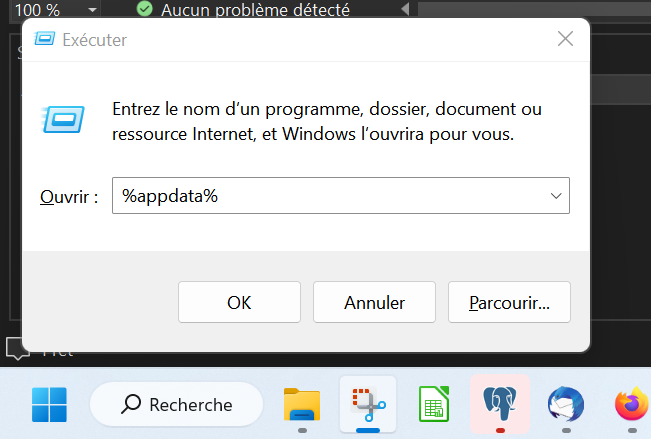
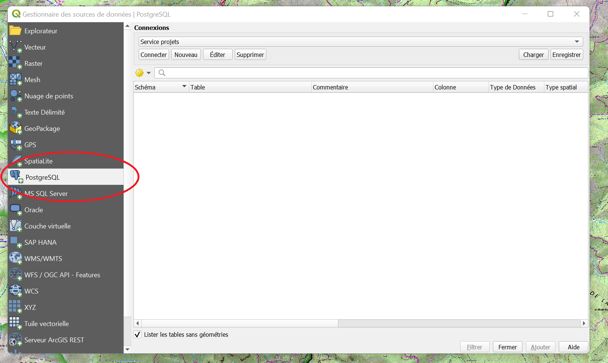
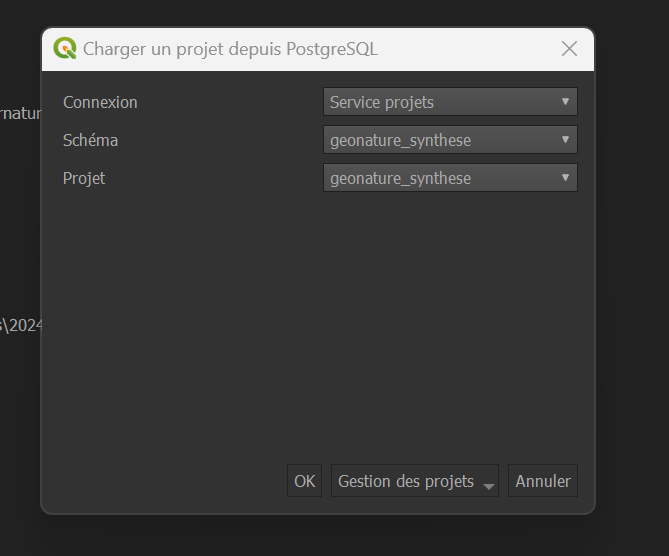

# Accéder aux ressources du PNM

L'accès à la base de données du parc est sécurisée par des certificats. QGIS ne peut pas, sans action de votre part, se connecter à la base de données du parc. 

!!! tip "Pourquoi un certificat plutôt qu'un simple mot de passe ?" 
	La base contient des données sensibles. Le certificat garantit que seul un poste autorisé peut s'y connecter, et sa durée de vie limitée réduit le risque si un fichier venait à être compromis.

!!! warning "À renouveler chaque année" 
	Les certificats ont une durée de validité limitée pour des raisons de sécurité. Passé ce délai, la connexion à la base échoue tant que vous n'avez pas réinstallé un nouveau jeu de certificats, selon la même procédure.

--- 

## Avant de commencer  

- Vous avez reçu un fichier **.zip** permettant le paramétrage de la connexion de la part du service informatique.
 
- Vous êtes bien connecté·e sur votre session.

## Déposer les certificats sur votre poste

- Télécharger le fichier **.zip** 
- Dézipper le fichier reçu dans un dossier (que vous pouvez retrouver facilement) 
- Aller dans le dossier `\AppData`. Deux façons de faire sont possibles :
	* **Recommandée** : Appuyer sur  ++win+r++ (la touche ++win++ se trouve entre ++ctrl++ et ++alt++) puis écrivez `%AppData%`
	* Naviguer manuellement dans l'explorateur de fichiers jusqu'à `C:\Users\ *[nomdelasession]* \AppData\Roaming`

		

- Vérifier si un dossier ++"postgresql"++ existe dans `..\AppData\Roaming`  
	* Sinon, le créer.

- Copier dans ce dossier tous les fichiers du zip à votre nom, y compris - ^^et surtout^^ - le fichier masqué **.pg_service.conf**.  
	* S'ils existent déjà, les remplacer.

!!! warning "Fichier invisible dans l'explorateur" 
	**.pg_service.conf** commence par un point, ce qui le rend masqué par défaut sous Windows.   
	Si vous ne le voyez pas dans le zip dézippé, activez l'affichage des fichiers cachés dans la fenêtre du dossier & fichiers : **Affichage > Éléments masqués dans l'explorateur de fichiers**.

## Connecter QGIS à la BD_PNM

- Lancer Qgis

- Ouvrir le **gestionnaire de sources de données** : onglet du haut ++"Couche"++ > ++"Gestionnaire de source de données"++ ou tout simplement ++ctrl+l++

	

- Cliquer sur ++"PostgreSQL"++ dans la barre de gauche

### Si vous ne voyez pas "service projets" dans le menu déroulant

- Télécharger le fichier de paramétrage en faisant ++"clic droit"++ > ++"Enregistrer la cible du lien sous"++ sur le lien suivant :  [services postgresql.xml](https://raw.githubusercontent.com/PnMercantour/donnees/main/docs/tutos/ressources/services_postgresql.xml)

- Cliquer sur **Charger** à droite de la fenêtre

- Sélectionner le fichier `services_postgresql.xml` que vous avez téléchargé. 

!!! success "La liste des tables et schémas accessibles devrait alors apparaître"
	Vous êtes prêt à accéder aux ressources du Parc : [:octicons-arrow-down-24: charger un projet, une couche ...](#charger-un-projet)

### Si vous voyez "service projets" dans le menu déroulant 

- Sélectionner **Service projets** dans le menu déroulant en haut

- Cliquer sur **Connecter**

- Vous avez maintenant accès à l'ensemble des schémas et projets de la base des données pour lesquels vos droits ont été définis.

!!! failure "Si un message d'erreur apparaît à la tentative de connexion à **Service projets**"
    Contactez le SI (`si@mercantour-parcnational.fr`), votre certificat est surement arrivé à expiration.  

--- 

## Charger un projet

!!! tip "Pourquoi charger un projet depuis la base ?"
	La base de données du Parc ne contient pas que des données : elle peut aussi stocker des [projets QGIS](../projets_qgis/index.md), c'est-à-dire la **mise en page** et les **options de représentation** d'un ensemble de couches.

	Les agents disposent ainsi de cartes **"prêtes à l'emploi"** pour différentes thématiques, en plus des données brutes. Tous les agents ouvrent le même projet et peuvent partager un même support de travail.
 
- Dans la barre de menu, cliquer sur ++"Projet"++
- Puis ++"Ouvrir depuis"++ > ++"PostgreSQL"++

    

- Choisir la connexion **Service projets**
- Sélectionner le **schéma** qui vous intéresse : les projets sont regroupés par thème.
- Puis sélectionner le **projet** souhaité.

    

- Si vous ne voyez aucun projet une fois le schéma sélectionné, c'est qu'il n'y a pas de projet stocké dans ce schéma.

!!! note "Remplacer les couches manquantes"
    Il est possible qu'un projet QGIS fasse référence à des données locales ou qui ont été supprimées / déplacées.  
	Cliquez sur **Conserver les couches inutilisables**.  

    Vous pouvez modifier le chemin vers lequel la couche fait référence : [tuto ici](./FAQ.md#traiter-les-couches-inutilisables-à-louverture-dun-projet--certaines-couches-ne-saffichent-pas)

!!! question "Quel projet ouvrir ?" 
    La page [Projets QGIS](../projets_qgis/index.md)  décrit chaque projet : à quoi il sert et comment l'utiliser.

	Plus de détails sur les projets [:octicons-arrow-right-24: Créer/Modifier un projet](./creer_modifier_projet.md)

--- 

## Charger une couche

!!! tip "Pourquoi charger une couche de la base de données ?"
	La base de données du Parc contient des données organisées en **tables**, auxquelles les agents peuvent accéder directement depuis QGIS.  

	Cela évite de manipuler des copies de fichiers qui deviendraient vite obsolètes : vous travaillez toujours sur la donnée de référence.

- Ouvrir le **gestionnaire de sources de données** (++ctrl+l++ ou en cliquant sur l'onglet ++"Couche"++ de la barre de menu puis ++"Gestionnaire de sources de données"++)

    

- Aller dans l'onglet ++"PostgreSQL"++ à gauche
- Dans le menu déroulant ++"Connexions"++ Sélectionner **Service projets**
- Cliquer sur ++"Connecter"++

S'affichent les différents [schémas](./glossaire.md#schema) dans lesquels vous pouvez trouver les données.  
En les dépliant vous affichez les couches, qui ont des noms et des commentaires permettant d'identifier les données qu'elles contiennent. 

!!! question "Tous les schémas ne sont pas accessibles à tous les agents" 
    Certains contiennent des données sensibles. Si vous avez besoin d'un schéma qui ne s'affiche pas, contactez les agents référents sur les données qui vous intéressent.

### ^^Facultatif^^ : Filtrer les données
Certaines tables (comme la table "detail" du schéma "geonature_synthese") sont ^^**très**^^ lourdes.  
Afin d'éviter de saturer votre machine il est possible d'y appliquer un filtre en cliquant sur l'option ++"Filtrer"++, avant d'ajouter la couche à votre projet.  
Ce filtre sera appliqué quand la table en question sera chargée en cliquant sur ++"Ajouter"++. 

Pour plus de détails sur les filtres : [tutoriel sur les filtres en cliquant ici](./filtres.md).

### Enregistrer une couche localement

Si vous souhaitez éditer une couche, il vous faudra copier les données de la base de données sur votre machine.  
Pour cela : 

- ++"clic droit"++ sur la couche à sauvegarder 
- ++"Exporter"++ > ++"Sauvegarder les entités sous"++
- Cliquer sur les ++"..."++ naviguer sur l'emplacement de votre machine ou vous souhaitez enregistrer la couche.

Une fois la nouvelle couche enregistrée, elle devrait apparaitre dans le projet. Vous pourrez vérifier qu'il s'agit bien d'une copie locale en vérifiant son emplacement dans ses propriétés (++"clic droit"++ > ++"Propriétés"++ > ++"Information"++).  
Cette nouvelle couche est éditable, sans impact sur les données de la base de données. 
