# Mon premier projet

Vous avez reçu la confirmation du SI que vous êtes autorisé·e à utiliser la base de données du Parc ? Ce tutoriel vous guide pour ouvrir, explorer et compléter votre premier projet QGIS.

!!! example "Scénario" 
    On vous a demandé d'établir, pour certaines zones, la présence ou l'absence d'une espèce végétale donnée.  
    Pour cela, vous devez consulter un projet QGIS existant et y entrer vos relevés de terrain, en modifiant une couche existante.


!!! warning "Avant de commencer : ne modifiez pas un projet partagé" 
    Un projet ouvert depuis la base est utilisé par tous vos collègues.  
    Vous pouvez l'explorer et faire des essais (filtres, symbologie), mais n'enregistrez pas vos modifications dessus.  
    Pour travailler l'esprit libre, créez d'abord votre propre copie : ++"Projet"++ > ++"Enregistrer sous..."++ (voir l'étape 8).


## 1. Préparer son poste

Deux éléments sont à mettre en place **une seule fois**. Vérifiez où vous en êtes :

|Je veux ...| Comment vérifier que c'est fait|Sinon|
|:--:|:--:|:--:|
|Accéder à la base de données du Parc|Gestionnaire de sources de données ++ctrl+l++ > onglet ++"PostgreSQL"++ : le menu déroulant contient **Service projets**|[Installer les certificats d'accès](./installer_certificats_base_de_donnees.md)|
|Afficher des fonds de carte (SCAN25 par ex)|Gestionnaire de sources de données ++ctrl+l++ > onglet ++"WMS/WMTS"++ : le menu déroulant n'est pas vide|[Ajouter des fonds de carte](./wms_wfs.md)|

Si les deux sont déjà en place, passez à l'[étape 2](#2-ouvrir-le-projet) !

!!! warning "Pour ajouter des données à un projet, utilisez le bon outil" 
    Privilégiez le **gestionnaire de sources de données** via le raccourci ++ctrl+l++   
    ou le **Gestionnaire BD** : menu ++"Base de données"++ > ++"Gestionnaire BD"++.  
    Les autres façons d'ajouter des couches peuvent créer des problèmes, car elles appliquent des paramètres d'import par défaut que vous ne voyez pas.

!!! tip "Vérifiez aussi vos paramètres avant de vous lancer dans un projet"
    Comparez vos paramètres à ceux de l'onglet [Paramètres QGIS au PNM](./parametrage_qgis_pnm.md).


## 2. Ouvrir le projet
- Dans la barre de menu, cliquez sur ++"Projet"++ > ++"Ouvrir depuis"++ > ++"PostgreSQL"++
- Choisissez la connexion **Service projets**, puis le **schéma** et le **projet** qui vous intéresse, appelons-le **_MonPremierProjet_**.

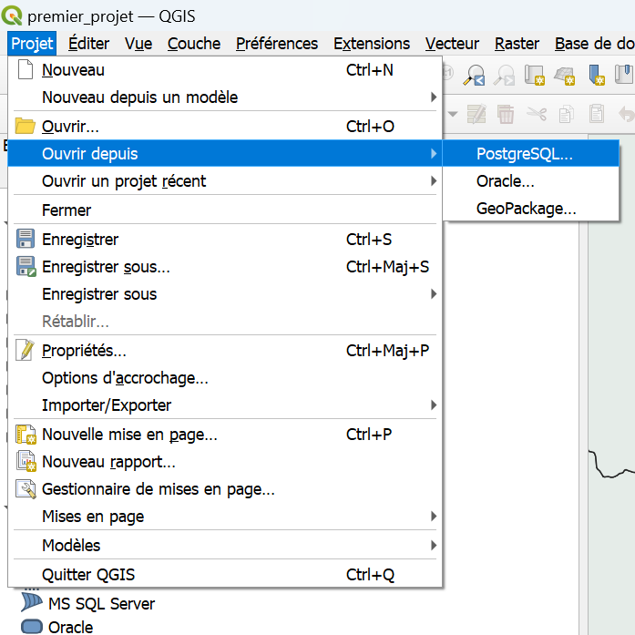

!!! note "Remplacer les couches manquantes"
    Il est possible qu'un projet QGIS fasse référence à des données locales ou qui ont été supprimées / déplacées.  
    Vous pouvez modifier le chemin vers lequel la couche fait référence : [tuto ici](./FAQ.md#traiter-les-couches-inutilisables-à-louverture-dun-projet--certaines-couches-ne-saffichent-pas)


## 3. Explorer le projet
Vous avez bien réussi à charger le projet **MonPremierProjet** et en voyez le contenu. Passons en revue les moyens de naviguer dans le projet et d'observer les données.

### L'interface en bref
_Dans QGIS, la position de la plupart des éléments est personnalisable._   
Il se peut que leur disposition soit différente si vous l'avez modifié (même par erreur), par défaut vous trouverez :

- **Panneau Couches** (à gauche) : la liste des couches du projet.
- **Canevas** (au centre) : la carte.
- **Barres d'outils** (en haut) : navigation, sélection, édition...
- **Barre de menu** (tout en haut) : ouvrir, options, ...
- **Barre d'état** (en bas à droite) : coordonnées, échelle, et SCR du projet.

!!! tip "Un panneau ou une barre d'outils a disparu ?" 
    Dans QGIS, la position de la plupart des éléments est personnalisable, et il arrive qu'on les modifie par accident.  
    Retrouvez-les dans le menu ++"Vue"++ et vérifiez que le panneau ou la barre d'outils concerné est bien coché.
    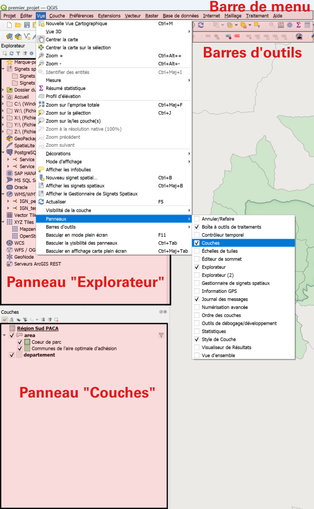


### Se déplacer sur la carte
- **Zoomer / dézoomer** : molette de la souris.
- **Déplacer la carte** : maintenez le clic molette enfoncé et déplacez la souris, ou utilisez l'outil Déplacer la carte de la barre d'outils de navigation.
- **Revenir sur une couche** : ++"clic droit"++ sur la couche > Zoom sur la couche.
- **Échelle** : elle s'affiche dans la barre d'état, en bas de la fenêtre, et vous pouvez y saisir une valeur.

### Afficher ou masquer des couches
A gauche de chaque couche se trouve une petite boite qui peut être cochée ou décochée. 
Cette boite permet d'afficher ou de masquer chaque couche, ou élément de symbologie d'une couche.

### Consulter les propriétés d'une couche

Double-cliquez sur une couche, ou faites ++"clic droit"++ > ++"Propriétés"++. Une série d'onglets donne des informations sur la couche.

L'onglet Information est particulièrement utile pour :

- **Vérifier la source des données** : si vous travaillez sur des données stockées sur votre machine, le chemin détaillé vers le fichier apparaît ; si vous travaillez sur le serveur, ce sont les paramètres de connexion qui sont visibles ;
- **Vérifier le type de données** (raster/vecteur, type de géométrie) et la projection ;
- **vérifier le nombre d'entités** (après application du filtre).

!!! tip "Un problème avec une couche ?" 
    Commencez par ses propriétés : s'agit-il bien du type de géométrie attendu ? Travaillez-vous bien sur le bon fichier ?

La table attributaire, elle, n'est pas visible dans les propriétés : [:octicons-arrow-down-24: voir plus bas](#la-table-attributaire) . 


### Les filtres

Un symbole  à droite d'une couche signifie qu'elle est **filtrée**.

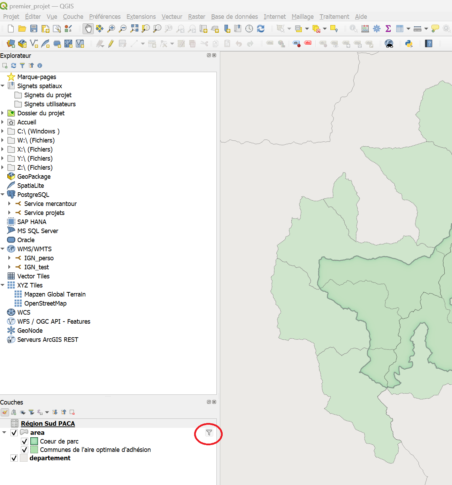

Les filtres sont des outils très puissants, notamment pour limiter la charge sur vos ordinateurs.  
Ils sont appliqués au niveau du serveur et permettent de ne charger que les entités d'une couche que vous avez choisies par une expression.

^^Exemple^^ : en cliquant sur le symbole filtre de la couche **Vallees**, ou en faisant ++"clic droit"++ > ++"Filtre sur cette couche"++, vous voyez l'expression suivante :
```sql
"id_type" = 3
```

Cette expression signifie: 
```
"Ne charge que les entités pour lesquelles la colonne "id_type" a la valeur 3."
```

!!! warning "Vous pouvez modifier un filtre, mais pas l'enregistrer" 
    Certaines couches du serveur sont chargées par défaut avec des filtres.  
    Vous pouvez les modifier pour accéder à d'autres données, ou les restreindre le temps de la consultation.  
    Veillez cependant à ne pas enregistrer vos modifications sur un projet partagé.

Les filtres emploient une syntaxe SQL : vous êtes encouragé·e·s à apprendre à les utiliser avec le [tutoriel sur les filtres](./filtres.md).

### La table attributaire

Les couches au format vecteur contiennent une table attributaire, qui donne des informations sur les données de la couche.

Pour l'afficher : ++"clic droit"++ sur la couche > ++"Ouvrir la table d'attributs"++.

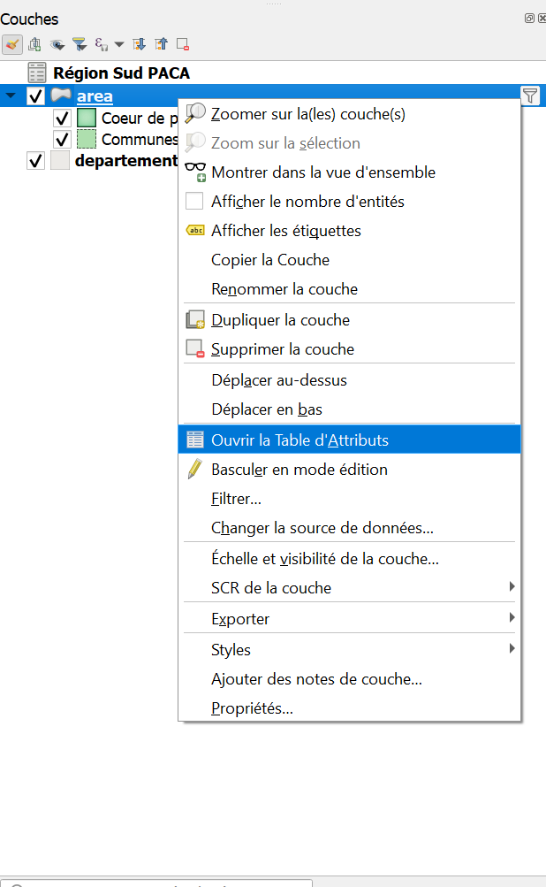


Elle peut se présenter de deux façons, entre lesquelles on bascule avec l'icône correspondante en bas à droite de la fenêtre.  

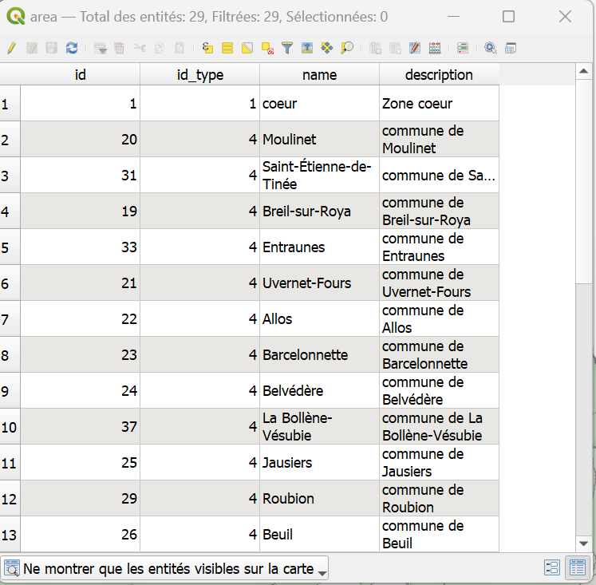
/// caption
Vue **Table** : elle permet de visualiser d'un coup d'œil l'ensemble des entités et attributs.
///  

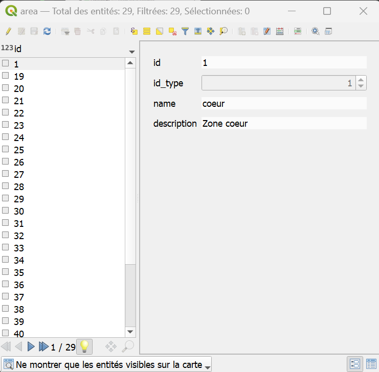
/// caption
Vue **Formulaire** : elle permet de visualiser les entités une à une, la liste des entités apparaissant sur la gauche.
///


Si votre version de QGIS a bien été paramétrée, un bouton déroulant apparaît en bas à gauche de la table attributaire : `Ne montrer que les entités visibles sur la carte`.

!!! warning "Attention aux couches volumineuses" 
    Vous pouvez demander à toujours afficher toutes les entités, mais ce mode peut faire planter QGIS sur les couches contenant un grand nombre d'entités.  
    Le mode d'affichage par défaut se modifie dans ++"Préférences"++ > ++"Options"++ > ++"Sources de données"++, rubrique ++"Comportement des tables d'attributs"++.

## 4. Saisir vos relevés

C'est ici que vous entrez vos relevés de terrain, en modifiant une couche.

!!! info "Ce qui est couvert ici" 
    On se concentre sur les couches au format **vecteur**, comme toutes celles du projet tutoriel.  
    Il existe des méthodes pour modifier les **rasters**, mais elles ne sont pas abordées ici.

!!! note "Droits d'édition" 
    L'édition d'une couche contenue dans la base de données n'est possible que si des droits particuliers vous ont été accordés.  
    La plupart des couches sont uniquement consultables : c'est pourquoi on commence par en faire une copie locale.


### Faire une copie locale de la couche
Éditer une couche QGIS modifie le fichier de source des données. Soyez donc prudent·e et conservez une copie des données d'origine quand c'est possible.

1. ++"Clic droit"++ sur la couche > ++"Exporter"++ > ++"Sauvegarder les entités sous..."++
2. Cliquez sur les ++"..."++ pour naviguer jusqu'à l'emplacement de votre machine où vous souhaitez enregistrer la couche.
3. Validez.

La nouvelle couche apparaît dans le projet. Pour vérifier qu'il s'agit bien d'une copie locale, regardez son emplacement dans ++"clic droit"++ > ++"Propriétés"++, onglet Information. Vous pouvez désormais l'éditer sans impact sur les données de la base.

Où trouver des couches sur lesquelles travailler : [Charger une couche depuis la base de données](./charger_une_couche_de_la_bd.md).


### Créer une nouvelle couche
Si les données que vous souhaitez representer n'ont pas de lien avec une couche de la base de données, créez une nouvelle couche vierge.  

- Dans la barre des menus, Cliquer sur ++"Couche"++ > ++"Créer une couche"++ > ++"Nouvelle couche GeoPackage"++ 

    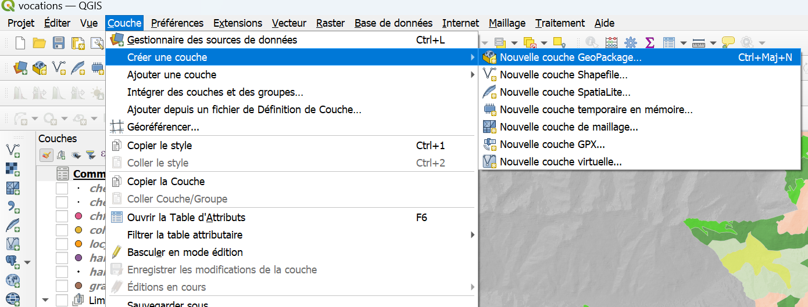

- Dans la fenêtre qui s'affiche, cliquer sur l'icône ++"..."++ pour renseigner l'emplacement où le fichier sera enregistré.

    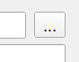

- Renseigner le type de géométrie selon le type d'usage voulu. Dans la plupart des cas: "Point", "Polyligne" ou "Polygone".
- Ne pas oublier d'indiquer la projection si elle est demandée: **EPSG:2154 - RGF v1 / Lambert-93**
- Si nécessaire, ajouter des champs. Il sera toujours possible d'en ajouter plus tard dans la [table d'attributs](#modification-de-la-table-attributaire).  


### Activer le mode Édition

Pour modifier une couche ou créer une entité, il faut d'abord activer le mode **Édition** pour la couche concernée. Trois façons de faire :

- Dans la **barre d'outils** QGIS 

    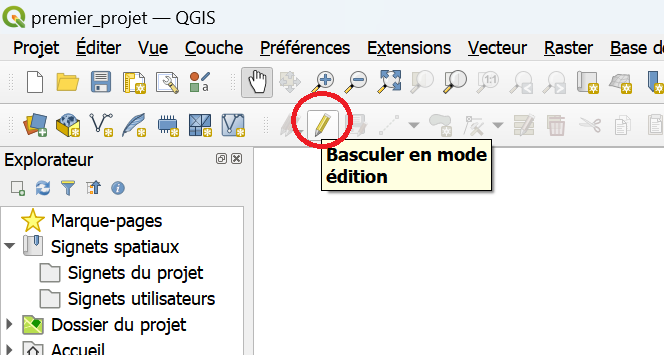

- Par un ++"clic droit"++ sur la couche

    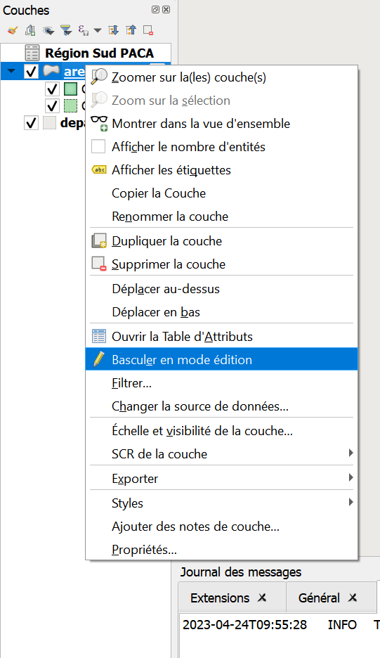 

- Depuis la fenêtre de la **table attributaire**

    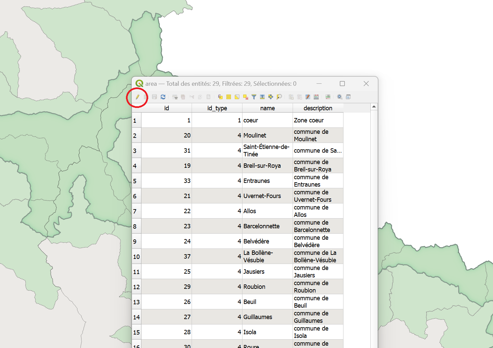


Dans tous les cas, cliquer sur le petit crayon activera le mode **Edition** pour la couche sélectionnée. On pourra alors y apporter des modifications de différentes façons :  

#### Modification de la table attributaire

En mode **Edition**, on peut modifier directement la table attributaire à la façon d'un tableur. 

!!! tip "Documentation complète sur l'édition de ^^table attributaire^^"
    La documentation de QGIS est très complète, n'hésitez pas à la parcourir pour explorer les possibilités : [Table attributaire](https://docs.qgis.org/3.44/fr/docs/user_manual/working_with_vector/attribute_table.html).


#### Création d'entités/Modification de géométrie

En mode **Edition**, on peut aussi éditer directement la géométrie d'une entité, ou en créer de nouvelles.   
Quelques outils à connaître pour faciliter vos modifications :  

!!! tip "Documentation complète sur l'^^édition de couche^^"
    La documentation de QGIS est très complète, n'hésitez pas à la parcourir pour explorer les possibilités : [Edition d'une couche](https://docs.qgis.org/3.44/fr/docs/user_manual/working_with_vector/editing_geometry_attributes.html).

#### Outils utiles
- Outil **sommet** 
    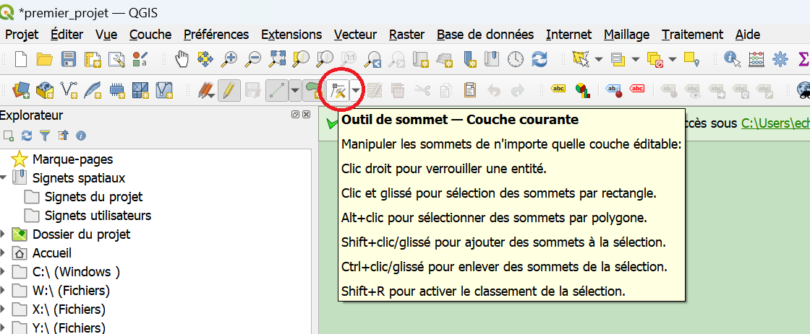  
    L'outil **sommet** permet de modifier la géométrie de points/lignes/polygones existants.  
    Une fois l'outil sommet sélectionné, on peut sélectionner n'importe quel sommet en cliquant dessus. Les sommets de chaque polygone sont visibles sous la forme de **petits cercles rouges**.

    

    **Supprimer** un sommet : touche ++"Suppr"++ du clavier après avoir sélectionné un sommet.
    **Déplacer** un sommet : cliquer à nouveau avec le ++"clic gauche"++ à un autre endroit après avoir sélectionné un sommet.   
    **Créer** de nouveaux sommets : cliquer très précisément sur la croix qui apparait en faisant passer le curseur entre deux sommets.    

    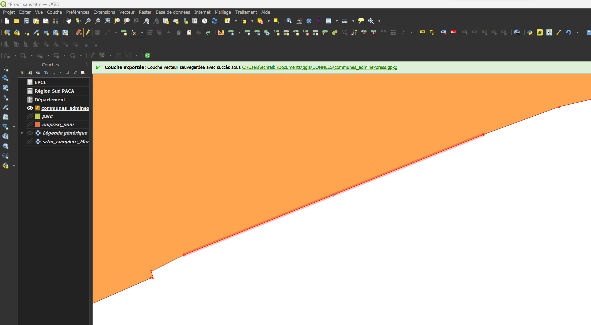

    En combinant le déplacement, la modification, et la création de sommets, il est possible de changer complètement la forme d'un polygone.

- **Ajouter une entité**
    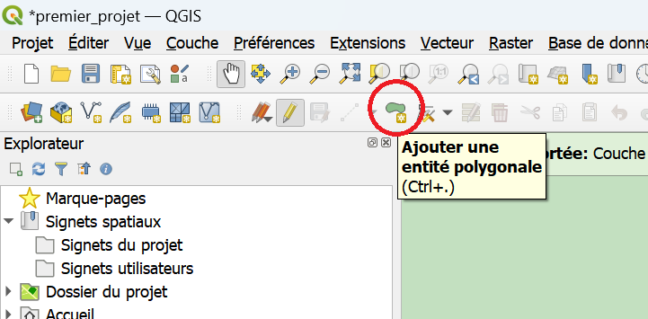  
    Cet outil permet de **créer de nouvelles données** dans la couche : points/lignes/polygones selon le type de géométrie paramétrée dans la couche.  
    La création d'une nouvelle entité se fait par une succession de ++"clics gauches"++, et est finalisée par un ++"clic droit"++.  
    A la finalisation de chaque entité, une fenêtre s'ouvre proposant d'entrer les attributs connus. 

    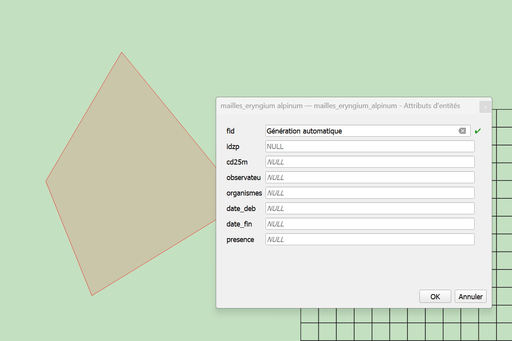

    Un "id" ou "fid" correspondant à l'identifiant unique de chaque entité peut être ^^généré automatiquement^^.   
    Il n'est pas nécessaire d'entrer les autres attributs pour que la nouvelle enttité soit sauvegardée. 

- **Outils de numérisation**  
    Il est souvent pratique d'afficher des barres d'outils supplémentaires (et parfois d'en cacher pour clarifier le menu : ++"clic droit"++ à n'importe quel endroit de la barre d'outils  
    ou menu ++"Vue"++ > ++"Barres d'outils"++

    Deux outils à cocher peuvent être particulièrement pratiques : 

    * **Accrochage** qui permet de rendre "magnétique" le clic, et de superposer parfaitement des points
    * **Numérisation avancée** qui permet à des outils de modifications de géométries en mode édition.

!!! tip "Les autres barres d'outils peuvent contenir des outils pratiques !"
    N'hésitez pas à les explorer ! La documentation de QGIS est très complète : [Outils](https://docs.qgis.org/3.44/fr/docs/user_manual/introduction/general_tools.html#)

!!! warning "Enregistrez vos modifications" 
    Vos modifications ne sont enregistrées et effectives qu'à la sortie du mode **Édition** (nouveau clic sur le crayon, puis confirmation).  
    Si le logiciel plante, ou si vous ne confirmez pas à la sortie, les modifications sont perdues et les données d'origine sont conservées.

### Connceter des données entre couches 

Il arrive que les informations dont vous avez besoin soient réparties dans **plusieurs couches** ou **tables** : par exemple, une couche de taxons et leur sensibilité et une table de relevés d'observation qui y font référence.  

Plutôt que de tout recopier à la main, QGIS permet de les connecter. Il existe deux manières de le faire, selon ce que vous souhaitez obtenir :  

||Jointure|Relation|
|:--:|:--:|:--:|
|**Principe**|Les champs d'une couche sont **ajoutés** à la table de l'autre|Les deux couches restent **séparées** mais **liées**|
|**Correspondances**|**1 pour 1 **: une entité reçoit les infos d'une seule entité de l'autre couche|**1 pour 1 ou plusieurs** : une entité "parent" peut être liée à plusieurs entités "enfants"|
|**Résultat**|Des colonnes supplémentaires dans la table attributaire|Un tableau des entités liées, dans le formulaire de l'entité parent|
|**Se configure dans**|++"Propriétés"++ de la couche > ++"Jointures"++|++"Projet"++ > ++"Propriétés"++ > ++"Relations"++|
|**Utile pour**|Enrichir une couche avec des informations (nom, catégorie, statut...)|Saisir ou consulter plusieurs relevés rattachés à un même objet|


!!! info "Un point commun : le champ identifiant" 
    Dans les deux cas, les couches doivent partager un champ commun (un identifiant, un code...) : c'est lui qui permet à QGIS de savoir quelle ligne correspond à quelle entité.

!!! tip "Documentation complète sur la ^^connexion entre données^^"
    La documentation de QGIS est très complète, n'hésitez pas à la parcourir pour explorer les possibilités : [Jointure](https://docs.qgis.org/3.44/fr/docs/user_manual/working_with_vector/joins_relations.html#joining-features-between-two-layers) & [Relation](https://docs.qgis.org/3.44/fr/docs/user_manual/working_with_vector/joins_relations.html#joining-features-between-two-layers) .


## 5. Changer la représentation d'une couche : symbologie

Le mode de représentation des données d'une couche s'appelle la **symbologie**. Par exemple : des aplats de couleur, des cercles noirs pour des points, des lignes vertes...).  
Elle se modifie couche par couche : ++"clic droit"++ > ++"Propriétés"++ > ++"Symbologie"++.  

Les outils de symbologie de QGIS sont très puissants et permettent de représenter les informations d'une couche de façon synthétique. Voici les modes les plus courants :

|Mode|Ce qu'il fait|Example|
|:--:|:--:|:--:|
|**Symbole unique**|Applique un même symbole à toutes les entités, sans tenir compte de leurs attributs. C'est le mode le plus simple.|Tous les points de relevé en rond noir|
|**Catégorisé**|Représente des différences **qualitatives** : un attribut permet de distinguer les entités.|Pour des polygones d'occupation des sols : forêt, culture, bâti...|
|**Gradué**|Représente des différences **quantitatives** entre les entités.|Pour des points représentant des villes : une taille variant selon la population|

!!! warning "Ne pas écraser la symbologie d'un projet partagé" 
    Faites des essais, mais en prenant soin de ne pas écraser la symbologie d'un projet partagé.  
    Sur une copie locale, le champ est libre !   
    
!!! tip "Documentation complète sur la ^^symbologie^^"
    La documentation de QGIS est très complète, n'hésitez pas à la parcourir pour explorer les possibilités : [Symbologie](https://docs.qgis.org/3.44/fr/docs/user_manual/working_with_vector/vector_properties.html#symbology-properties).


## 6. Les outils d'analyse

QGIS peut être utilisé comme un outil d'analyse particulièrement puissant : il contient un grand nombre d'outils permettant des analyses plus ou moins complexes.

La plupart sont disponibles dans les menus **Vecteur** et **Raster** de la barre de menu (mais pas tous !) : seule une sélection des outils y est affichée, organisée par catégorie.

Pour voir l'^^intégralité^^ des outils, activez le panneau **Boîte à outils de traitements** :

- soit par le menu ++"Vue"++ > ++"Panneaux"++,
- soit par un ++"clic droit"++ sur la barre de menus

Nous ne rentrons pas ici dans le détail de ces outils, mais ce sont eux qui permettent de réaliser les opérations les plus complexes de QGIS. Des examples d'outils utiles :  

- [Tampon (buffer)](https://docs.qgis.org/3.44/fr/docs/user_manual/processing_algs/qgis/vectorgeometry.html#buffer) : crée une zone de distance autour d'une entité (point, ligne, polygone)
- [Découper (clip)](https://docs.qgis.org/3.44/fr/docs/user_manual/processing_algs/gdal/vectorgeoprocessing.html#clip-vector-by-extent) : utilise une couche de polygone pour couper une autre couche
- [Intersection](https://docs.qgis.org/3.44/fr/docs/user_manual/processing_algs/qgis/vectoroverlay.html#intersection) : superpose deux couches et conserve uniquement la zone commune avec les attributs combinés
- [Union (réunion)](https://docs.qgis.org/3.44/fr/docs/user_manual/processing_algs/qgis/vectoroverlay.html#union) : combine les entités de deux couches en préservant toutes les zones et leurs découpages
- [Centroïde](https://docs.qgis.org/3.44/fr/docs/user_manual/processing_algs/qgis/vectorgeometry.html#centroids) : calcul et crée un point central pour chaque polygone d'une couche
- [Joindre les attributs par localisation](https://docs.qgis.org/3.44/fr/docs/user_manual/processing_algs/qgis/vectorgeneral.html#qgisjoinattributesbylocation) : transfère les attributs d'une couche à une autre en fonction de leur position spatiale

!!! tip "Documentation complète sur les ^^outils de traitement^^"
    La documentation de QGIS est très complète, n'hésitez pas à la parcourir pour explorer les possibilités : [Outils de traitement](https://docs.qgis.org/3.44/fr/docs/user_manual/processing_algs/qgis/index.html).


## 7. Exporter une carte au format image

!!! warning "Attention aux données sensibles" 
    De nombreux projets du Parc contiennent des données qui peuvent être sensibles.  
    Avant de publier ou de mettre en circulation un export, assurez-vous de la sensibilité des données auprès du chargé de mission en lien avec celles-ci.

### Export simple

Depuis le menu : ++"Projet"++ > ++"Importer/exporter"++ > ++"Exporter au format Image"++.  
Cette méthode exporte uniquement le contenu du canevas, c'est-à-dire la vue de la carte visible à l'écran.

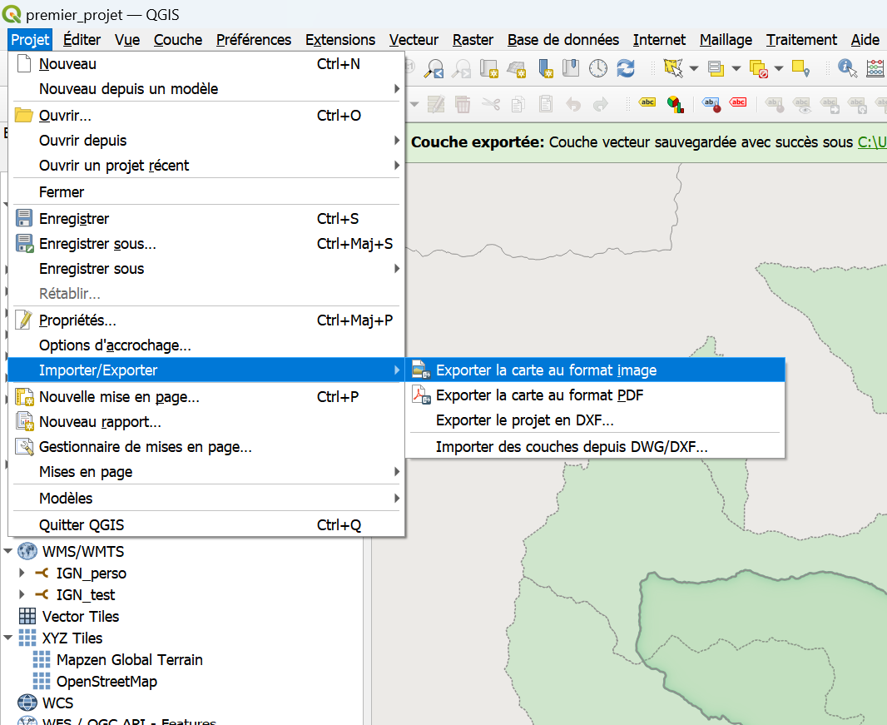

Une fenêtre permet de choisir l'emprise de l'export :

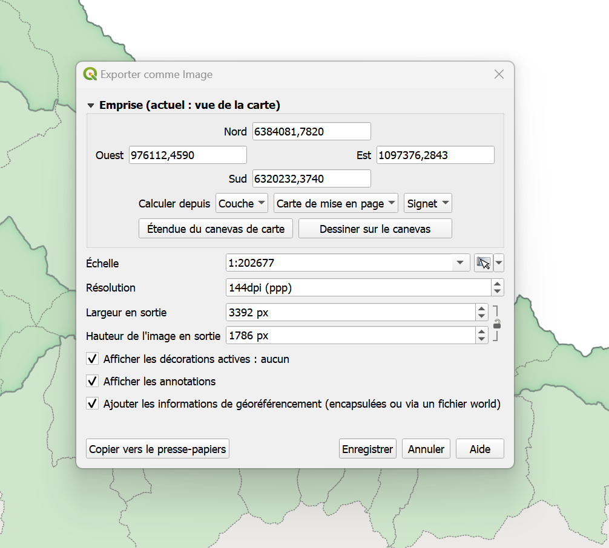

On peut ainsi facilement exporter au format image la vue de la carte visible à l'écran. 


### Mises en page

Pour des cartes plus élaborées, QGIS propose un outil de mise en page.

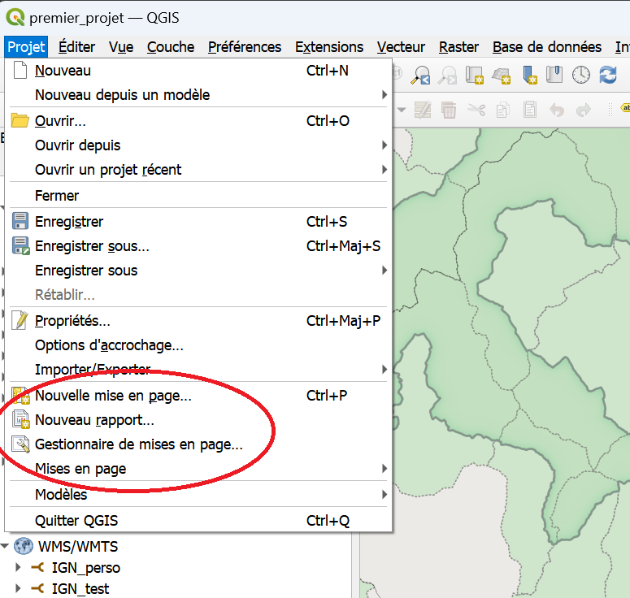

Si une mise en page a déjà été créée pour le projet, vous la trouverez dans le menu ++"Projet"++ > ++"Mise en page"++ ou dans le **Gestionnaire de mises en page**.   
Vous pouvez aussi en créer une nouvelle.   
Dans tous les cas, une nouvelle fenêtre s'ouvre à l'ouverture d'une mise en page.

!!! tip "Documentation complète sur les ^^mises en page de cartes^^"
    La documentation de QGIS est très complète, n'hésitez pas à la parcourir pour explorer les possibilités : [Mises en page de cartes](https://docs.qgis.org/3.44/fr/docs/user_manual/print_layout/index.html).


## 8. Enregister et partager son projet

!!! warning "Un projet ouvert depuis la base est partagé" 
    Vous pouvez à tout moment faire ++"Projet"++ > ++"Enregistrer sous..."++ pour créer une copie du projet qui n'est accessible qu'à vous.  
    Vous pourrez ensuite la modifier sans risque de perdre le travail de vos collègues.

Selon la façon dont vous souhaitez le partager, deux formats existent :

|Format|Ce qu'il contient|Avantages|Limites|
|:--:|:--:|:--:|:--:|
|`.qgz`/`.qgs` (ShapeFile)|Le projet uniquement : les chemins menant aux couches et leur définition de style|Léger|**Ne contient pas les données.** Une couche issue d'une base sécurisée ne s'affichera pas sur un ordinateur sans cet accès. Les fichiers locaux doivent se trouver exactement aux mêmes chemins sur l'autre machine.|
|`.gpkg` (GeoPackage)|Le projet ^^et^^ les données, avec leurs styles|Un seul fichier, facile à échanger ; évite les problèmes de chemins|Plus lourd ; la démarche est plus longue|


!!! info "Pourquoi le GeoPackage ?" 
    Le format GeoPackage (**.gpkg**) est un format relativement récent. Il peut contenir plusieurs sources de données spatialisées, **vecteur** et **raster**, tout en conservant l'intégrité de leurs **tables attributaires**.  
    Il peut aussi stocker des **projets** et des **fichiers de styles**.  
    Il réunit ainsi en **un seul fichier** ce qui demande traditionnellement plusieurs formats peu pratiques (shapefile), et évite les problèmes de chemins relatifs des projets .**qgs/.qgz**.

Pour construire un projet au format GeoPackage, suivez le tutoriel [Partager un projet](./empaqueter_un_projet.md).