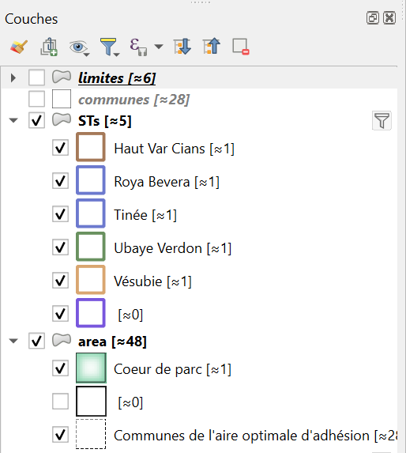

# Naviguer dans QGIS

Cette page présente l'interface de QGIS et les gestes à connaître pour se déplacer sur une carte : où se trouve quoi, comment utiliser la souris, zoomer, et quels raccourcis clavier vous feront gagner du temps.

--- 

## Où se trouve quoi ?

L'interface de QGIS est organisée en plusieurs zones.
 
| Zone | Où ? | À quoi ça sert ? |
|------|------|------------------|
| **Barre des menus** | En haut | Accéder à toutes les fonctions : ++"Projet"++, ++"Édition"++, ++"Vue"++, ++"Couche"++, ++"Préférences"++, ++"Extension"++, ++"Vecteur"++, ++"Raster"++, ++"Traitement"++, ++"Aide"++... |
| **Barres d'outils** | Sous les menus et sur les côtés | Raccourcis en icônes vers les outils les plus utilisés (navigation, sélection, édition...) |
| **Panneau Couches** | À gauche | Liste des couches du projet : afficher/masquer (case à cocher), réordonner (glisser-déposer), accéder aux propriétés (clic droit) |
| **Panneau Explorateur** | À gauche | Parcourir vos dossiers, GeoPackages et connexions aux bases de données |
| **Canevas de carte** | Au centre | La carte elle-même : c'est ici que vous naviguez et utilisez les outils |
| **Barre d'état** | En bas | Coordonnées du pointeur, **échelle**, loupe, rotation, **SCR** du projet, messages |
| **Barre de recherche (localisateur)** | En bas à gauche | Recherche rapide d'un outil, d'une couche, d'un menu ou d'une entité (++ctrl+k++) |
 
!!! tip "Un panneau a disparu ?"
    Faites un clic droit sur la barre des menus (ou allez dans ++"Vue"++ > ++"Panneaux"++) et cochez le panneau à réafficher. De la même façon, ++"Vue"++ > ++"Barres d'outils"++ permet de réafficher une barre d'outils.
 
!!! info "Les panneaux se déplacent"
    Chaque panneau peut être déplacé en le saisissant par sa barre de titre : à gauche, à droite, en onglet avec un autre panneau, ou flottant. Pratique pour adapter QGIS à votre écran.

--- 

## Afficher ou masquer des couches
A gauche de chaque couche se trouve une petite boite qui peut être cochée ou décochée.  

Cette boite permet d'afficher ou de masquer chaque couche, ou élément de symbologie d'une couche.

--- 

## Se déplacer avec la souris
 
Le plus simple est d'utiliser uniquement la souris, directement dans la carte.
 
| Action | Geste |
|--------|-------|
| **Zoomer / dézoomer** | Molette de la souris (vers l'avant : zoom avant ; vers soi : zoom arrière) |
| **Zoomer plus finement** | ++ctrl++ + molette |
| **Se déplacer dans la carte** | Maintenir **appuyée** la molette (clic molette) ou le clic gauche et glisser |
| **Se déplacer sans bouton** | Maintenir la barre ++space++ enfoncée et bouger la souris sans clic |
| **Se déplacer au clavier** | Touches fléchées |
| **Revenir à l'emprise précédente / suivante** | Boutons « précédent / suivant » de la souris, quand elle en possède |
 
!!! note "Le zoom se centre sur le pointeur"
    Quand vous zoomez à la molette, QGIS zoome autour de l'endroit où se trouve le curseur : placez-le sur la zone qui vous intéresse avant de zoomer.
 
--- 

## Les outils de navigation
 
La barre d'outils **Navigation de la carte** regroupe les outils de déplacement et de zoom. Si elle n'est pas visible, voir [Un panneau a disparu ?](#ou-se-trouve-quoi)
 
| Outil | Ce qu'il fait |
|-------|---------------|
| **Se déplacer dans la carte** (main) | Cliquer-glisser pour déplacer la carte. Un simple clic centre la carte sur le point cliqué |
| **Zoom +** (loupe +) | Dessiner un rectangle pour zoomer sur cette zone. Un simple clic double l'échelle |
| **Zoom -** (loupe -) | Dessiner un rectangle ou cliquer pour dézoomer |
| **Zoom sur la sélection** | Cadre la carte sur les entités sélectionnées |
| **Zoom sur la couche** | Cadre la carte sur toute la couche choisie |
| **Zoom sur l'emprise totale** | Affiche l'ensemble des couches du projet |
| **Zoom précédent / suivant** | Revient à l'affichage précédent (ou avance), comme dans un navigateur web |
 
!!! tip "Se perdre dans la carte ? Les deux réflexes"
    - **Zoom sur l'emprise totale** pour retrouver une vue d'ensemble.
    - **Clic droit sur une couche** > ++"Zoom sur la couche"++ pour aller directement sur ses données.
 
--- 

## Définir l'échelle précisément
 
Dans la **barre d'état**, en bas, le champ **Échelle** indique l'échelle actuelle (par exemple `1:25000`). Vous pouvez y saisir directement une valeur pour afficher la carte à l'échelle voulue : utile pour comparer avec un fond de carte ou préparer une impression.
 
À côté, la **loupe** permet d'agrandir l'affichage sans changer l'échelle, et la **rotation** de faire pivoter la carte.

--- 

## Les clics de souris dans QGIS
 
| Où ? | Clic gauche | Clic droit |
|------|-------------|------------|
| **Sur une couche** (panneau Couches) | La sélectionne | Ouvre le menu : **Zoom sur la couche**, **Ouvrir la table d'attributs**, **Filtrer**, **Exporter**, **Propriétés**... |
| **Sur la case à cocher d'une couche** | Affiche / masque la couche | — |
| **Sur la carte** | Utilise l'outil actif (déplacement, sélection, identification...) | Annule l'opération en cours (par exemple un tracé) |
| **Sur la barre des menus** | — | Liste des panneaux et barres d'outils à afficher |
 
!!! info "Le clic droit est votre ami"
    Dans QGIS, presque tout élément (couche, groupe, table...) possède un menu accessible par **clic droit**. En cas de doute, essayez-le.

--- 

## La barre de recherche (localisateur)
 
En bas à gauche de la fenêtre, la barre de recherche permet de tout retrouver sans chercher dans les menus.
 
1. Appuyez sur ++ctrl+k++ (ou cliquez dans la barre).
2. Tapez quelques lettres : le nom d'une couche, d'un outil de traitement, d'une commande de menu...
3. Cliquez sur le résultat ou appuyez sur ++enter++.
!!! tip "Ne cherchez plus un outil dans les menus"
    Tapez simplement son nom dans la barre de recherche : c'est souvent plus rapide que de parcourir les menus.

--- 

## Raccourcis clavier utiles
 
### Projet et affichage
 
| Action | Raccourci |
|--------|-----------|
| Nouveau projet | ++ctrl+n++ |
| Ouvrir un projet | ++ctrl+o++ |
| **Enregistrer le projet** | ++ctrl+s++ |
| Enregistrer sous... | ++ctrl+shift+s++ |
| **Annuler** / Rétablir | ++ctrl+z++ / ++ctrl+shift+z++ |
| Actualiser la carte | ++f5++ |
| Plein écran | ++f11++ |
| Masquer / afficher tous les panneaux | ++ctrl+tab++ |

### Zoom
 
| Action | Raccourci |
|--------|-----------|
| Zoom sur l'emprise totale | ++ctrl+shift+f++ |
| Zoom sur la sélection | ++ctrl+j++ |
| Zoom avant / arrière | ++page-up++ / ++page-down++ |
 
### Panneaux et fenêtres
 
| Action | Raccourci |
|--------|-----------|
| Panneau **Couches** | ++ctrl+1++ |
| Panneau **Aperçu** | ++ctrl+8++ |
| Panneau **Style des couches** (symbologie) | ++f7++ |
| **Gestionnaire de sources de données** | ++ctrl+l++ |
| Barre de recherche (localisateur) | ++ctrl+k++ |
 
!!! warning "Les raccourcis peuvent varier selon la version de QGIS"  
    Certains raccourcis (notamment pour le zoom) diffèrent d'une version à l'autre.   
    Pour les connaître sur votre poste, ouvrez ++"Préférences"++ > ++"Raccourcis clavier..."++ : vous y verrez la liste complète et pourrez les personnaliser.
 