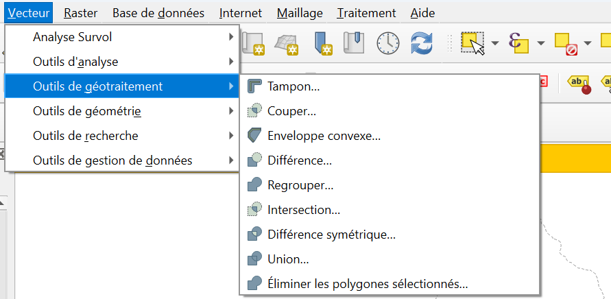
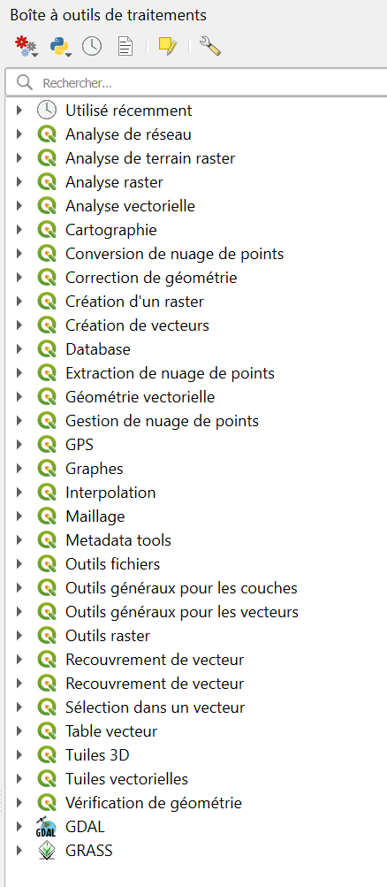
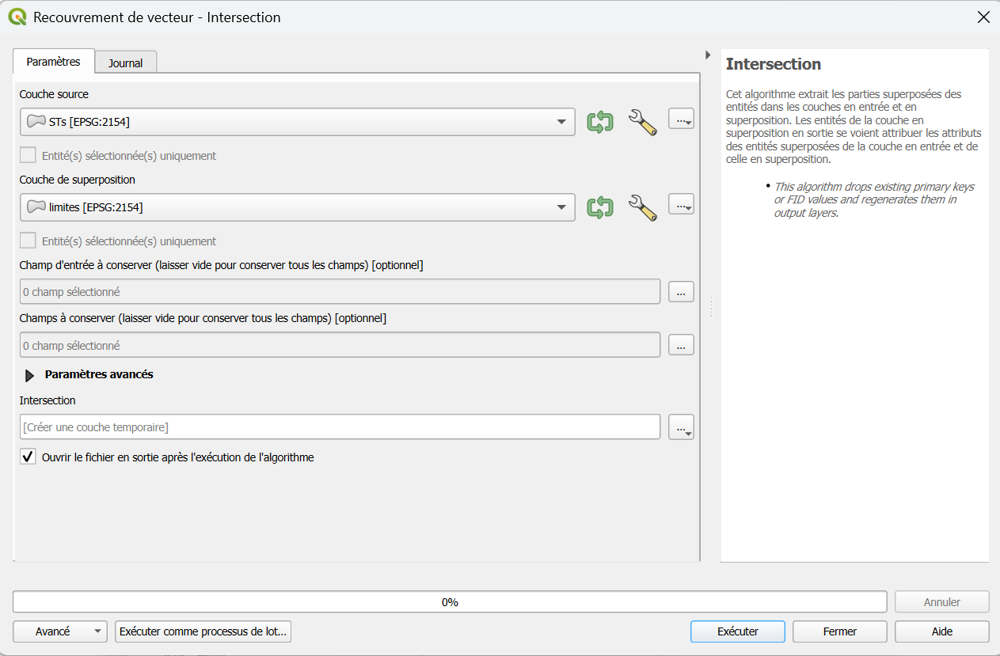

# Outils de traitement

QGIS peut être utilisé comme un outil d'analyse particulièrement puissant : il contient un grand nombre d'outils permettant des traitements plus ou moins complexes.

---

## Où trouver ces outils ?

La plupart sont disponibles dans les menus ++"Vecteur"++ et ++"Raster"++ de la barre de menu (mais pas tous !) : seule une sélection des outils y est affichée, organisée par catégorie.

Pour voir l'^^intégralité^^ des outils, activez le panneau **Boîte à outils de traitements** :

- soit par le menu ++"Vue"++ > ++"Panneaux"++
- soit par un ++"clic droit"++ sur la barre de menus : ++"Panneau Boîte à outils de traitements"++

---

## Utiliser un outil
 
Tous les outils fonctionnent **sur le même modèle**.
 
1. **Double-cliquez** sur l'outil dans la boîte à outils : sa fenêtre s'ouvre.
2. Choisissez la **couche en entrée** (celle à traiter).
3. Réglez les **paramètres** (distance, champ, prédicat...). L'aide s'affiche sur le côté droit de la fenêtre.
4. Choisissez la **sortie** :
    - **Créer une couche temporaire** : elle n'existe que le temps de la session ;
    - **Enregistrer dans un fichier...** : le résultat est écrit dans un fichier (GeoPackage, par exemple).
5. Cliquez sur **Exécuter**. Le résultat s'ajoute au projet.
6. Fermez la fenêtre, ou cliquez sur **Fermer**.

/// caption
Exemple de fenêtre : outil **intersection**
///
 

 
!!! warning "Une couche temporaire disparaît"
    Elle porte une petite **icône de puce** dans le panneau Couches. À la fermeture de QGIS, elle est perdue.  
    Pour la conserver : ++"clic droit"++ > **Rendre permanent**, et enregistrez-la dans un fichier.
 
!!! info "Les outils ne modifient pas vos données"
    Un outil crée toujours une **nouvelle couche** : la couche d'origine reste intacte.

---

## Quel outil pour quel besoin ?
 
Voici les outils les plus utiles. Chaque nom renvoie à la **documentation QGIS**.   
Maintenez ++ctrl++ au moment de cliquer sur le lien pour l'ouvrir dans un nouvel onglet :wink:

| Je veux... | Outil | Résultat |
|------------|-------|----------|
| Garder la **zone commune** à deux couches | [Intersection](https://docs.qgis.org/3.44/fr/docs/user_manual/processing_algs/qgis/vectoroverlay.html#intersection) | Les zones communes, avec les attributs des deux couches |
| **Couper** une couche avec un polygone | [Découper](https://docs.qgis.org/3.44/fr/docs/user_manual/processing_algs/qgis/vectoroverlay.html#clip) | Seule la partie dans le polygone est conservée |
| **Combiner** deux couches en gardant tout | [Union](https://docs.qgis.org/3.44/fr/docs/user_manual/processing_algs/qgis/vectoroverlay.html#union) | Toutes les parties superposées et non superposées, avec leurs attributs |
| **Retirer** d'une couche ce qui est dans une autre | [Différence](https://docs.qgis.org/3.44/fr/docs/user_manual/processing_algs/qgis/vectoroverlay.html#difference) | La partie de la première qui n'est pas dans la seconde |
| **Corriger** des géométries invalides | [Réparer les géométries](https://docs.qgis.org/3.44/fr/docs/user_manual/processing_algs/qgis/vectorgeometry.html#fix-geometries) | Une couche corrigée |
| Changer de **système de coordonnées** | [Reprojeter une couche](https://docs.qgis.org/3.44/fr/docs/user_manual/processing_algs/qgis/vectorgeneral.html#reproject-layer) | Une copie dans le nouveau SCR |
| Une **zone** autour d'entités | [Tampon](https://docs.qgis.org/3.44/fr/docs/user_manual/processing_algs/qgis/vectorgeometry.html#buffer) | Des polygones à une distance donnée |
| Le **centre** d'un polygone | [Centroïdes](https://docs.qgis.org/3.44/fr/docs/user_manual/processing_algs/qgis/vectorgeometry.html#centroids) | Un point par polygone |
| **Transférer des attributs** d'une couche à une autre selon leur position | [Joindre les attributs par localisation](https://docs.qgis.org/3.44/fr/docs/user_manual/processing_algs/qgis/vectorgeneral.html#qgisjoinattributesbylocation) | Les entités avec des colonnes en plus |
| Extraire selon une **expression** | [Extraire par expression](https://docs.qgis.org/3.44/fr/docs/user_manual/processing_algs/qgis/vectorselection.html#extract-by-expression) | Une couche d'entités qui répondent à la condition |

 
!!! tip "Documentation complète sur les ^^outils de traitement^^"
    La documentation de QGIS est très complète, n'hésitez pas à la parcourir pour explorer les possibilités : [Outils de traitement - Vecteurs](https://docs.qgis.org/3.44/fr/docs/user_manual/processing_algs/qgis/vectorgeometry.html).  
    Baladez-vous dans les pages 24.1.x à gauche de la documentation pour trouver votre bonheur !

    Maintenez ++ctrl++ au moment de cliquer sur le lien pour l'ouvrir dans un nouvel onglet :wink:

