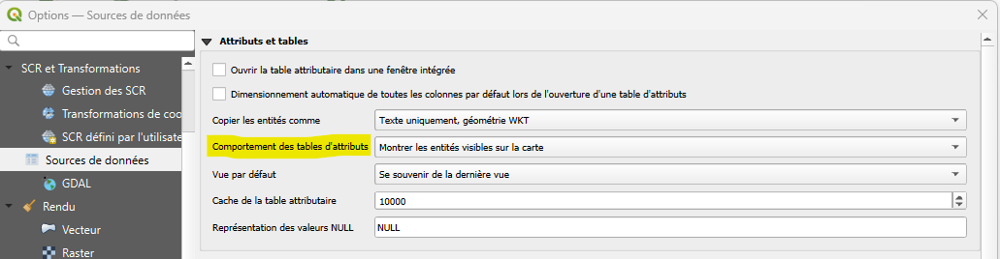
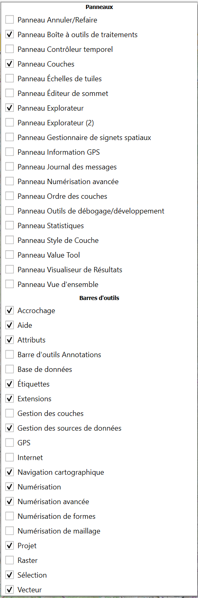

# Paramétrage de votre QGIS 

Si vous venez de recevoir votre ordinateur, il est nécessaire de réaliser les premiers paramétrages pour avoir accès à la base de données du parc, et aux fonds de carte au format WMS.  
D'autres paramètres aident aussi à rendre le logiciel lisible et à éviter des plantages :smile:

--- 

## Systèmes de coordonnées

Il est capital de gérer la [projection](./glossaire.md#projection) dans QGIS pour que les cartes produites soient lisibles dans le système de coordonnées de référence (SCR) français : **EPSG:2154 - Lambert-93**. 

Dans la barre de menu : ++"Préférences"++ > ++"Options"++ > ++"Gestion des SCR"++  

Paramétrer votre SCR par défaut pour qu'il soit toujours pour les projets et les couches à **EPSG:2154 - RGF93v1 /Lambert-93**. 

  

--- 

## Table d'attributs

Afin d'éviter que votre QGIS plante à l'ouverture de certaines tables d'attributs lourdes ([problème fréquent](FAQ.md#qgis-plante-quand-jessaie-douvrir-la-table-dattribut-dune-couche)), nous vous conseillons de modifier le paramètre général suivant :  

Dans la barre d'outils, en haut, cliquer sur ++"Préférences"++ > ++"Options"++.  
Ensuite, dans les onglets de gauche, cliquer sur ++"Sources de données"++, puis dans ++"Comportement des tables d'attributs"++ choisir ++"Montrer les entités visibles sur la carte"++.

--- 

## Panneaux & Barre d'outils
En cliquant droit sur la barre d'outils en haut de la fenêtre QGIS, sous les menus "Projet, Editer, ..." vous obtenez la fenêtre ci-dessous.   
Cliquez sur les cases pour activer/désactiver l'affichage d'un panneau ou d'un outil.  

Ceux présentés dans l'image sont les essentiels à avoir.   
Si un panneau disparaît de l'affichage, vous pouvez le ractiver par cette même fenêtre.

--- 

## Se connecter à la base de données du PNM

Suivre la démarche décrite dans l'onglet [Accéder aux ressources du PNM](./installer_certificats_base_de_donnees.md).

--- 

## Ajouter le catalogue de fond de cartes (WMS)

Suivre la démarche décrite dans l'onglet [Fonds de carte](./wms_wfs.md).

