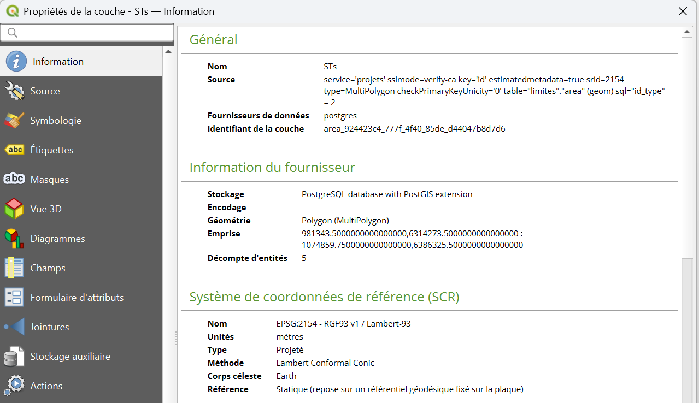
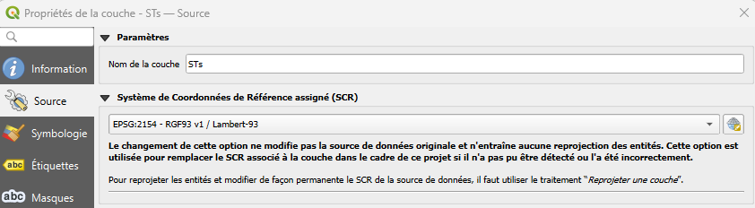
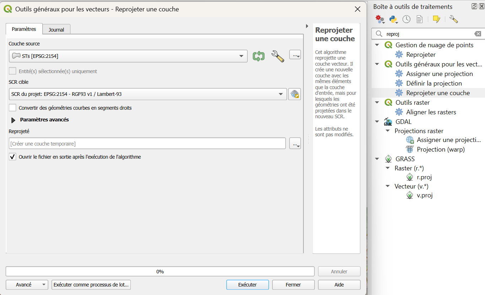
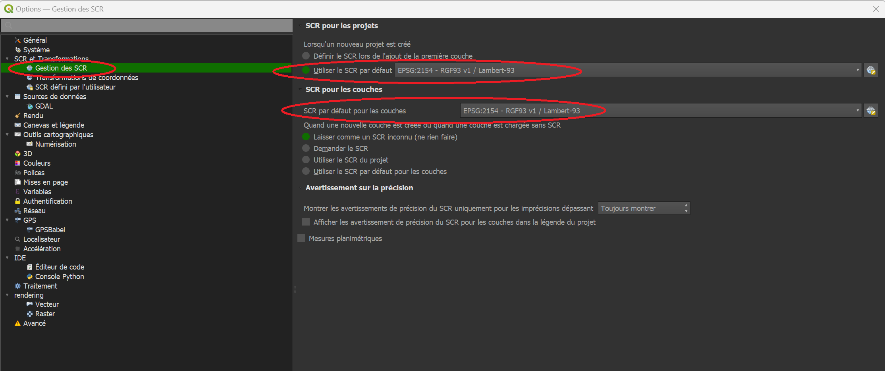
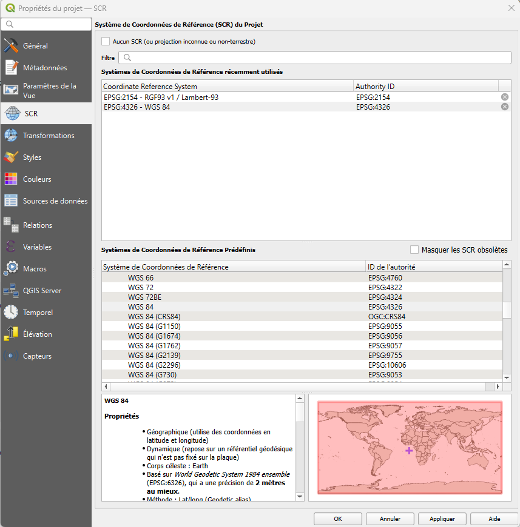
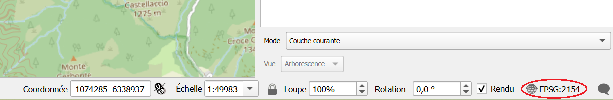

# Systèmes de coordonnées
--- 
## SCR principalement utilisés

|SCR|Code EPSG|Type|Unité|Ex : Cime du Gélas|
|:--:|:--:|:--:|:--:|:--:|
|**RGF93 / Lambert-93**|**2154**|SCR officiel en France métropolitaine pour la cartographie et les SIG, projection conique|Mètres (m)|1 050 699 m, 6 345 639 m|
|**WGS 84**|**4326**|SCR mondial utilisé par les GPS, non projeté (coord exprimées sur une sphère/ellipse)|Degrés (°)|7.384257° E, 44.122487° N|

Quel que soit le SCR utilisé, les deux premiers axes (X, Y) désignent toujours une position horizontale, et le troisième (Z) une altitude :

|X|Y|Z|
|:--:|:--:|:--:|
|Longitude|Latitude|Altitude|
|Est (+) / Ouest (-)|Nord (+) / Sud (-)|Ciel (+) / Centre de la Terre (-)|

!!! info "Point de référence" 
    En **WGS84**, X et Y sont la longitude et la latitude, mesurées depuis le méridien de Greenwich et l'équateur.  
    En **Lambert-93**, X et Y sont des distances en mètres (Est, Nord) depuis une origine conventionnelle propre à la projection.  
    Le principe reste le même, seule l'unité change.

--- 

## Projection 

Un SCR non projeté (comme le WGS84) exprime les coordonnées sur une surface courbe, en degrés.  
C'est adapté pour repérer un point n'importe où sur Terre, mais pas pour calculer une distance ou une surface de façon fiable.

La **projection** consiste à convertir ces coordonnées sur une surface plane, en mètres — c'est ce que fait Lambert-93 pour la France métropolitaine.  

**Résultat** : des mesures de distance et de surface directement exploitables, au prix d'une légère déformation (inévitable dès qu'on « aplatit » une sphère), négligeable à l'échelle du Parc.

!!! tip "Quel SCR utiliser pour vos mesures et analyses ?" 
    Privilégiez toujours Lambert-93 (EPSG:2154) pour calculer des distances, surfaces ou faire des géotraitements (buffer, intersection...).  
    En WGS84, une distance "en degrés" n'a pas de sens concret et les calculs seraient faux.

!!! warning "Attention à la précision"
    Même si, la précision dépend surtout de la façon dont elle a été acquise, le SCR choisi pour l'enregistrer peut avoir une influence, notamment lors d'une conversion d'un SCR à l'autre & vis à vis du nombre de décimales utilisées :  

    En WSG84 : ± 10 mètres pour 4 décimales, ± 10 cm pour 6 décimales  
    Lambert-93 est déjà exprimé en mètres : 1 décimale = ± 10 cm.  
    
    Donc, pour passer de WSG84 à Lambert-93 : conservez 1 à 2 décimales en Lambert-93 pour garder la même précision. 

---
## Quel est le SCR de ma couche ?

Vous pouvez consulter le SCR dans lequel a été projeté votre couche en ouvrant les propriétés de la couche :  
++"clic droit"++ sur la couche > ++"Information"++ > **Système de coordonnées de référence (SCR)**

L'onglet ++"Source"++ > ++"SCR assigné"++ donne la même information et permet de [corriger l'affichage de la couche](#corriger-laffichage-dune-couche) si celui-ci est incorrecte.

--- 

## Afficher des couches qui n'ont pas le même SCR

QGIS peut afficher ensemble, sur une même carte, des couches qui n'ont pas le même SCR : c'est la reprojection à la volée.  

Chaque couche garde son SCR d'origine - dans les paramètres de la couche, mais QGIS convertit automatiquement la couche ^^à l'affichage^^ pour qu'elle se superpose correctement aux autres, selon le SCR défini [:octicons-arrow-down-24: au niveau du projet](#scr-par-defaut).

Les fichiers de données restent inchangés.  

!!! info "Pourquoi ça fonctionne à l'affichage, mais pas toujours au calcul" 
    L'affichage reste fiable quel que soit le SCR du projet.    
    En revanche, certains calculs (mesures, géotraitements) peuvent être **faussés** si ce SCR n'est pas adapté — par exemple une couche restée en WGS84 alors que vous mesurez des distances.   
    D'où l'intérêt de [:octicons-arrow-up-24: vérifier le SCR de la couche](#quel-est-le-scr-de-ma-couche) avant de lancer une analyse ([:octicons-arrow-down-24: corriger le SCR de la couche s'il est incorrect](#convertir-les-donnees-dans-un-autre-scr)).

--- 

## Corriger l'affichage d'une couche

**Symptôme** : une couche s'affiche au mauvais endroit (par exemple au milieu de l'océan).

**Cause probable** : un mauvais SCR lui a été assigné à l'import. Les coordonnées du fichier sont justes, mais QGIS les lit dans le mauvais système.

**Solution** : modifier le SCR de la couche : ++"clic droit"++ sur la couche > ++"Source"++ > ++"SCR"++, choissisez le SCR dans lequel les données ont été produites.

!!! warning "Changer le SCR affiché ne convertit pas vos données" 
    Cette opération ne modifie pas les coordonnées du fichier : vous indiquez seulement à QGIS comment les lire.  
    
!!! tip "Identifier dans quel SCR la donnée a été produite" 
    Le producteur de la donnée peut vous donner l'info.  
    Sinon, le format des données peut vous donner quelques indices. Pour des données produites dans le Sud-Est de la France :  
    
    - X entre 5 et 7.5 ; Y entre 42 et 45 : **WSG84**  
    - X entre 800 000 et 1 050 000 ; Y entre 6 100 000 et 6 400 000 : **Lambert-93** 

Pour obtenir un fichier dans un autre SCR, il faut [convertir](#convertir-les-donnees-dans-un-autre-scr) le fichier.   

--- 

## Convertir les données dans un autre SCR

Pour consulter le SCR utilisé pour lire la couche dans QGIS, il s'agit de la même méthode que ci-dessus :

- ++"clic droit"++ sur la couche d'intérêt > ++"Propriétés"++ 
- onglet **Source** > SCR
- le SCR de la couche est lisible et modifiable dans le menu déroulant

Modifier le SCR a cet endroit là ne modifie pas la source de données, il faut convertir réellement les coordonnées d'un système vers un autre pour utiliser des outils d'analyse adaptés.   
Utilisez alors l'outil **Reprojeter une couche** : 

- ++"Boîte à outils de traitement"++ > **Reprojeter une couche**
- **Couche source** : la couche de travail
- **SCR cible** : généralement ^^Lambert-93^^ pour pouvoir calculer des distances

- Enregistrez la nouvelle couche dans une _couche temporaire_, ou dans un fichier dédié.
- Cliquez sur ++"Exécuter"++

!!! note "Vous pouvez également utiliser la même méthode manuellement"

    - ++"clic droit"++ sur la couche > ++"Exporter"++ > ++"Enregistrer les entités sous..."++
    - Choisissez le SCR cible dans la fenêtre d'export : exemple `EPSG:2154`
    - **Validez** : vous obtenez un fichier avec les coordonnées converties d'un SCR à un autre.

Les coordonnées sont recalculées dans le nouveau fichier ; la couche d'origine reste inchangée.
Utilisez ce nouveau fichier pour le traitement de données :thumbup:

--- 

## SCR par défaut
Vous pouvez définir le système de coordonnées par défaut :

- **Au niveau général** : barre d'outils en haut ++"Préférences"++ > ++"Options"++ > ++"Gestion des SCR"++

    

- **Au niveau du projet** : barre d'outils en haut ++"Projet"++ > ++"Propriétés"++ > ++"SCR"++

    

- Le SCR du projet est aussi affiché **en bas à droite** de votre fenêtre QGIS, en cliquant dessus vous obtiendrez la page du dessus

    

