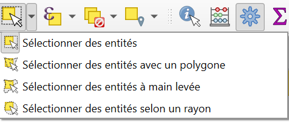
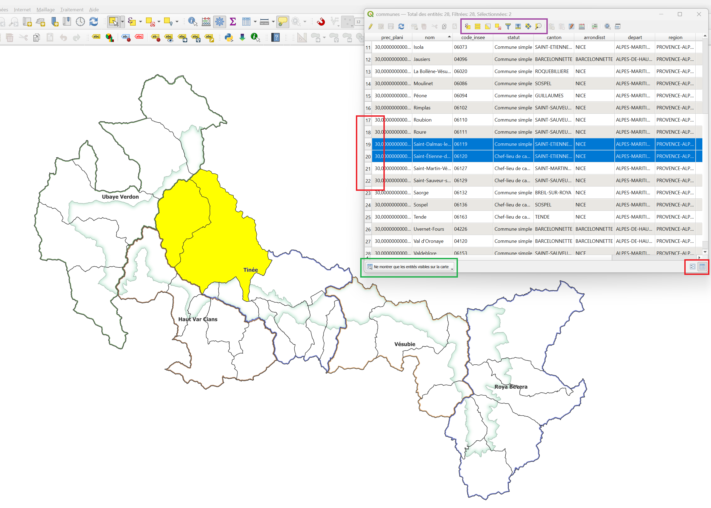
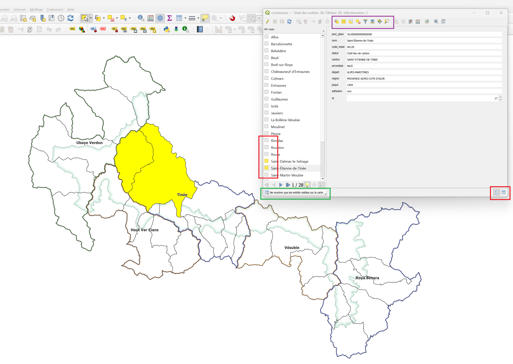
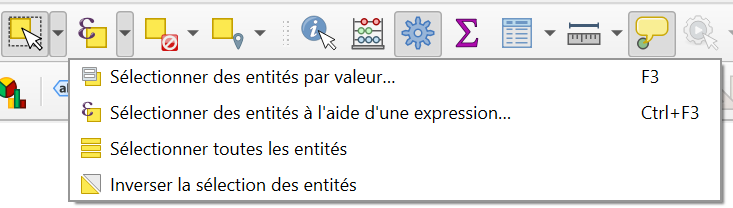
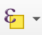
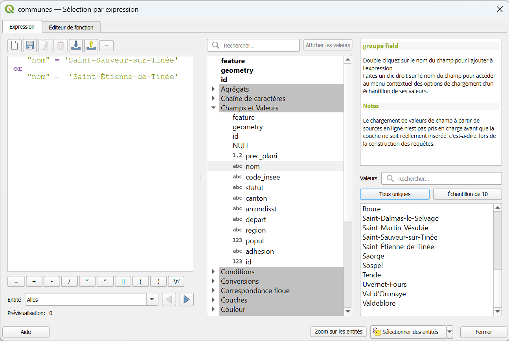
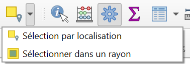
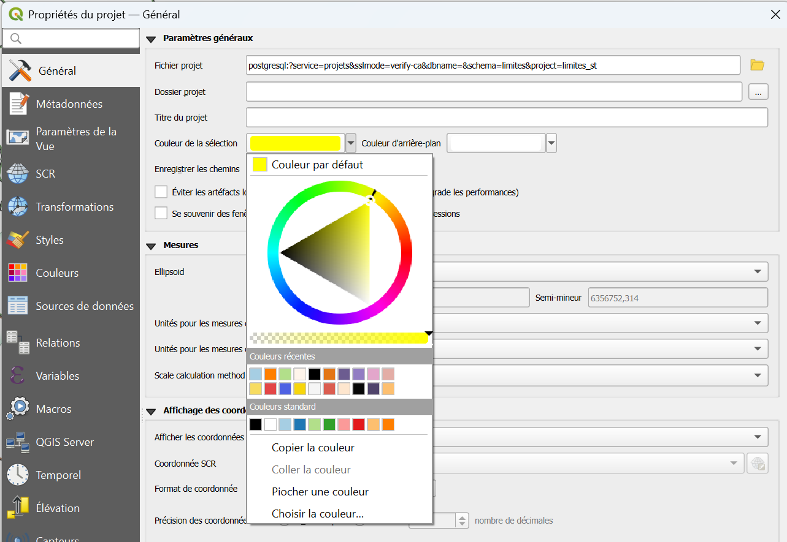

# Sélectionner des entités dans QGIS


**Sélectionner** des entités, c'est en désigner certaines (en ==jaune== sur la carte) pour agir uniquement sur elles : les compter, les exporter, les modifier, les analyser...
 
!!! info "À quoi ça sert ?"
    - **Repérer** des entités sur la carte ou dans la table attributaire.
    - **Exporter** uniquement une partie d'une couche.
    - **Modifier** seulement certaines entités.
    - **Croiser** des couches : sélectionner les entités d'une couche situées dans une autre.
 
!!! question "Sélection ou filtre ?"
    La sélection **surligne** des entités sans cacher les autres ; elle est temporaire.   
    Le [filtre](./filtres.md) **masque** les entités sur la carte qui ne correspondent pas, et reste appliqué tant qu'on ne le retire pas.  
    Les deux se combinent : on peut sélectionner dans une couche déjà filtrée.

--- 

## Sélectionner sur la carte avec la souris
 
La barre d'outils **Sélection** propose plusieurs outils de sélection (menu déroulant) :



 
| Outil | Comment l'utiliser |
|-------|--------------------|
| **Sélectionner des entités** | Un clic sur une entité, ou un rectangle à tracer |
| **Sélectionner par polygone** | Cliquez pour dessiner un polygone ; clic droit pour terminer |
| **Sélectionner à main levée** | Dessinez la zone en maintenant le bouton enfoncé |
| **Sélectionner par rayon** | Cliquez au centre, puis définissez le rayon |
 

!!! warning "« Rien ne se passe quand je clique » : vérifiez la couche active"
    Si vous sélectionnez sur la carte sans résultat, c'est souvent qu'aucune couche vecteur n'est active, ou que la couche active n'est pas celle que vous visez.


### Ajouter ou retirer des entités
 
Pour modifier une sélection existante, utilisez le clavier pendant que vous cliquez sur la carte :
 
| Touche maintenue | Effet |
|------------------|-------|
| ++shift++ | **Ajouter** les nouvelles entités à la sélection |
| ++ctrl++ | **Retirer** les entités de la sélection |


### Annuler la sélection
 
| Action | Raccourci |
|--------|-----------|
| Tout sélectionner | ++ctrl+a++ |
| **Tout désélectionner** | ++ctrl+shift+a++ |
| Inverser la sélection | Menu ++"Édition"++ > ++"Sélectionner"++ > ++"Inverser la sélection"++ |

---

## Sélectionner dans la table attributaire
 
Ouvrez la table attributaire d'une couche (++f6++), puis :
 
- Cliquez sur le **numéro de ligne** (à gauche) pour sélectionner une entité.
- ++ctrl++ + clic : sélection de lignes **non consécutives**.
- ++shift++ + clic : sélection de toutes les lignes **entre deux clics**.


/// caption
Vue **tabulaire** de la table attributaire 
///

Dans la vue **Formulaire**, cliquez sur le symbole à côté de l'identifiant de l'entité.


/// caption
Vue **formulaire** de la table attributaire
///
 
!!! tip "Mettre la sélection en évidence sur la carte"
    Le menu déroulant en bas à gauche de la table (encadré en vert ci-dessus) permet d'afficher **toutes** les entités, **seulement les sélectionnées**, ou seulement celles **visibles sur la carte**.   

    ^^Dans le bandeau d'outils encadré en violet de la table attributaire^^ :  

    * un bouton permet aussi de **déplacer la sélection en haut** de la table
    * un autre de **zoomer sur les entités sélectionnées**
 
--- 

## Sélectionner par valeur
 
Pour sélectionner les entités qui ont telle ou telle valeur dans un champ, sans écrire de formule.
 
**Raccourci** : ++f3++, ou menu ++"Édition"++ > ++"Sélectionner"++ > ++"Sélectionner par valeur..."++
 

Un formulaire s'ouvre avec tous les champs : renseignez les valeurs recherchées, choisissez comment les combiner avec la sélection existante, puis validez.
 

/// caption
Cliquer sur **Sélectionner des entités par valeur...** 
///

--- 

## Sélectionner par expression
 
La sélection par expression permet de choisir des entités selon **des conditions portant sur leurs colonnes** (les attributs). C'est l'outil le plus puissant pour sélectionner.
 
L'outil **Sélection par expression** se trouve à plusieurs endroits :
 
- dans la barre d'outils principale ;
- dans la barre d'outils de la table attributaire d'une couche ;
- au clavier : ++ctrl+f3++.  

Il est représenté par ce symbole dans tous les cas : 
 
Une fois ouvert, il donne accès à l'**éditeur d'expression**, tel qu'on le retrouve à différents endroits de QGIS (filtres, calculatrice de champs...).
 
### L'éditeur d'expression
L'éditeur d'expression est le même partout : [filtre](./filtres.md), [calculatrice de champs](./calculatrice_champs.md), sélection ... Les règles de syntaxes sont donc les mêmes !
 

 
Il est séparé en trois panneaux :
 
| Panneau | Rôle |
|---------|------|
| **À gauche : l'éditeur** | C'est là qu'on entre et qu'on modifie l'expression |
| **Au milieu : fonctions et variables** | Opérateurs, champs et fonctions sélectionnables, regroupés par catégories |
| **À droite : l'aide** | Informations sur l'opérateur, la fonction ou le champ sélectionné au milieu |
 
### Construire une expression
 
Pour une sélection, l'expression doit aboutir, pour **chaque entité**, à une condition **vraie ou fausse** (on peut aussi utiliser `1` pour vrai et `0` pour faux). Seules les entités pour lesquelles la condition est vraie sont sélectionnées.

 
#### Les règles de syntaxe à retenir
 
| Élément | Se note | Exemple |
|---------|---------|---------|
| **Nom de champ** | entre **guillemets doubles** `"` | `"nom"` |
| **Texte** | entre **apostrophes** `'` | `'Alpes-Maritimes'` |
| **Nombre** | sans rien | `4257` |
| **Texte contenant une apostrophe** | apostrophe **doublée** | `'Val d''Entraunes'` |
 
!!! warning "Majuscules et accents"
    Pour un texte, la valeur doit être **exactement** celle de la table (accents, tirets, majuscules).  
    `'Alpes-Maritimes'` fonctionne, `'alpes maritimes'` non.  
    Pour éviter les erreurs de frappe, rechercher la valeur d'un champ dans l'onglet **valeur** et double cliquer pour l'ajouter.


Le symbole `%` remplace n'importe quelle suite de caractères.  
Le symbole `_` remplace un seul caractère (exemple un mot qui contient - ou pas - un accent).


#### Combiner plusieurs conditions
 
| Mot | Sens | Exemple |
|-----|------|---------|
| `AND` | **les deux** conditions doivent être vraies | `"cd_ref" = 4257 AND "date_min" >= 2022` |
| `OR` | **au moins une** des conditions doit être vraie | `"date_min" >= 2022 OR "cd_ref" = 4257` |
| `NOT` | **inverse** une condition | `NOT "cd_ref" = 4257` |
 
Le premier exemple affiche les observations de l'espèce 4257 **faites depuis 2022**.  
Le deuxième affiche **toutes** les observations depuis 2022, **plus** toutes celles de l'espèce 4257, quelle que soit leur date.  
Le troisième affiche **toutes** les observations qui **ne concernent pas** l'espèce 4257.
 
!!! warning "Utilisez des parenthèses dès que vous mélangez `AND` et `OR`"
    Sans parenthèses, `AND` est évalué avant `OR`, ce qui donne souvent un résultat inattendu.  
    ```sql
        ("cd_ref" = 4257 OR "cd_ref" = 4258) AND "date_min" >= 2022
    ```
    

!!! example "Une valeur numérique"
    ```sql
        "id" = 10
    ```
    Ne sélectionne que les entités où la colonne `"id"` est égale à 10, puisque c'est la seule pour laquelle `"id" = 10` est vrai.
 
!!! example "Un texte exact"
    ```sql
        "nom" = 'Beuil'
    ```
    Ne sélectionne que les entités où la colonne `"nom"` contient **exactement** la chaîne de caractères `'Beuil'`. Les entités nommées `'beuil'` ou `' Beuil '` (avec des espaces autour) ne sont pas sélectionnées.
 
!!! tip "Le plus sûr : ne pas taper les noms de colonnes"
    Dépliez l'onglet **Champs et Valeurs** du panneau central et **double-cliquez** sur les colonnes qui vous intéressent : elles sont copiées dans l'éditeur avec la mise en forme appropriée.
 
    Une fois un champ sélectionné au milieu, le panneau de droite permet d'en vérifier les valeurs :
 
    - **Tous uniques** affiche toutes les valeurs possibles du champ dans la couche (à éviter sur les couches très volumineuses) ;
    - **Echantillon de 10** affiche 10 valeurs que le champ peut prendre.
 
Avec ces outils, on construit déjà de nombreuses expressions à conditions simples. Pour combiner plusieurs conditions (`AND`, `OR`, `IN`, `LIKE`...).
 
### Des expressions plus avancées
 
L'éditeur permet aussi de construire des expressions plus complexes.
 
!!! example "Comparer deux colonnes entre elles"
    ```sql
        "aire_pastorale" > "aire_forest"
    ```
    Ne sélectionne que les entités où la valeur de `"aire_pastorale"` est supérieure à celle de `"aire_forest"`.
 
!!! example "Utiliser une fonction : `$area`"
    ```sql
        "aire_pastorale" > $area / 2
    ```
    Sélectionne les entités où `"aire_pastorale"` est supérieure à la moitié de la surface de l'entité, dans l'unité d'aire définie dans le projet (en général le m²).   
    Ce paramètre se modifie dans ++"Projet"++ > ++"Propriétés"++, onglet **Général**.
 
!!! warning "`$area` et `area` sont deux fonctions différentes"
    `$area` renvoie la superficie de **chaque entité** de la couche. `area` est une fonction qui s'applique à **une géométrie donnée**.  
    Exemple tiré de la documentation de QGIS :  
    ```sql
        area(geom_from_wkt('POLYGON((0 0, 4 0, 4 2, 0 2, 0 0))'))
    ```
        renvoie `8.0`.
 
Il existe de nombreux autres outils à explorer, regroupés par catégories dans le panneau central :
 
| Catégorie | Pour... |
|-----------|---------|
| **Chaînes de caractères** | Manipuler du texte : récupérer les premiers ou derniers caractères d'un champ, changer la casse... |
| **Date et heure** | Gérer l'information temporelle et les champs au format `datetime` |
| **Géométrie** | Réaliser des opérations géométriques : vérifier des intersections, créer un tampon, obtenir les distances entre entités... |
| **Conversions** | Changer le type d'une valeur |
 
!!! tip "Combiner avec une sélection existante"
    Dans la fenêtre de sélection par expression, le bouton de validation en bas (**Sélectionner les entités**) est accompagné d'une petite flèche qui déroule d'autres choix : **ajouter à la sélection actuelle**, **retirer de la sélection actuelle**, ou **sélectionner dans la sélection actuelle**.   
    Cela permet de construire une sélection en plusieurs étapes.

--- 

## Sélectionner selon la position
 
Pour sélectionner les entités d'une couche selon leur **position par rapport à une autre couche** (par exemple, les observations situées dans le périmètre d'une zone d'étude), utilisez l'outil de traitement **Sélection par localisation**, disponible dans la barre d'outils :




| Paramètre | Rôle |
|-----------|------|
| **Sélectionner les entités de** | La couche dans laquelle sélectionner (ex : les observations) |
| **Où les entités** | La relation spatiale avec la couche de comparaison (:octicons-arrow-down-24: voir ci-dessous) |
| **En les comparant aux entités de** | La couche de comparaison (ex : zone d'étude) |
| **Modifier la sélection actuelle par** | Créer une nouvelle sélection, l'ajouter à la sélection actuelle, sélectionner dans la sélection actuelle, ou en retirer |
 
Les relations spatiales possibles (**prédicats géométriques**) :
 
| Prédicat | Les entités sélectionnées... |
|----------|------------------------------|
| **intersectent** | ont au moins un point en commun avec la couche de comparaison (le choix le plus courant) |
| **sont à l'intérieur** | sont entièrement dans une entité de comparaison |
| **contiennent** | contiennent entièrement une entité de comparaison |
| **touchent** | se touchent par leurs bords, sans se recouvrir |
| **chevauchent** | se recouvrent en partie |
| **croisent** | se croisent (lignes) |
| **sont disjoints** | n'ont rien en commun : tout ce qui est **en dehors** |
| **égalent** | ont exactement la même géométrie |
 
!!! tip "Choisir le prédicat"
    - « Les observations **dans** la zone » → **sont à l'intérieur**
    - « Tout ce qui touche de près ou de loin la zone » → **intersectent**
    - « Tout ce qui est **hors** de la zone » → **sont disjoints**
 
!!! warning "Les deux couches doivent être dans un même SCR"
    QGIS gère les différences de SCR, mais vérifiez que les couches se superposent bien sur la carte avant de lancer l'outil [ :octicons-arrow-right-24: Systèmes de coordonnées](./scr.md).
 
!!! note "Autres outils de sélection dans la boîte à outils"
    La boîte à outils de traitements propose aussi **Sélection par attribut**, **Sélection dans un rayon** (entités situées à une distance donnée d'une autre couche) et **Sélection aléatoire** (par exemple pour prélever un échantillon).
 
--- 

## Que faire d'une sélection ?
 
| Je veux... | Comment |
|------------|---------|
| **Voir** les entités sélectionnées | ++"Vue"++ > ++"Zoom sur la sélection"++ (++ctrl+j++), ou ++ctrl+p++ pour seulement centrer |
| **Les lire** dans la table | Table attributaire, menu en bas à gauche : afficher les entités sélectionnées |
| **Les exporter** dans un nouveau fichier | [:octicons-arrow-down-24: ci-dessous : enregistrer dans une nouvelle couche](#enregistrer-une-selection-dans-une-nouvelle-couche) |
| **Les copier** | ++ctrl+c++ dans la table, puis coller dans un tableur ou une autre couche (++ctrl+v++) |
| **Les modifier** toutes d'un coup | [Calculatrice de champs](./calculatrice_champs.md), en cochant l'option pour ne traiter que les entités sélectionnées |
| **Les mesurer ou les compter** | Titre de la table attributaire (nombre d'entités sélectionnées) |
 
---

## Enregistrer une sélection dans une nouvelle couche
 
Une fois la sélection réalisée (avec l'éditeur d'expression ou autrement), vous pouvez créer une couche qui ne contient que les entités sélectionnées :
 
1. ++"Clic droit"++ sur la couche qui contient la sélection > ++"Exporter"++ > ++"Sauvegarder les entités sous..."++
2. Cochez **Enregistrer uniquement les entités sélectionnées**.
3. Cliquez sur les ++"..."++ pour choisir l'emplacement et le nom du fichier, vérifiez le format et le [SCR](./scr.md).
4. Validez : la nouvelle couche apparaît dans le projet.

!!! warning "Sans la case cochée, toute la couche est exportée"
    Si **Enregistrer uniquement les entités sélectionnées** n'est pas cochée, l'export contient **toutes** les entités, même si une partie seulement est sélectionnée.
 
---

## Modifier la couleur de sélection

Par défaut, les entités sélectionnées sont en ==jaune==.  
Sur un fond de carte jaune ou beige (certaines orthophotos, cartes IGN...), la sélection peut être difficile à repérer : vous pouvez changer cette couleur.  

Cette modification est propre à chaque projet, et prime sur la valeur par défaut.


++"Projet"++ > ++"Propriétés"++ > ++"Général"++ > **Couleur de la sélection**




Il est également possible de modifier la couleur **par défaut** de sélection pour tous vos projets :  

++"Préférences"++ > ++"Options"++ > ++"Canevas et légende"++ > **Couleur de la sélection**


!!! tip "Documentation complète sur les ^^sélections^^"
    La documentation de QGIS est très complète, n'hésitez pas à la parcourir pour explorer les possibilités : [Sélections](https://docs.qgis.org/3.44/fr/docs/user_manual/introduction/general_tools.html#sec-selection).

    Maintenez ++ctrl++ en cliquant pour que la fenêtre s'ouvre dans un nouvel onglet :wink: