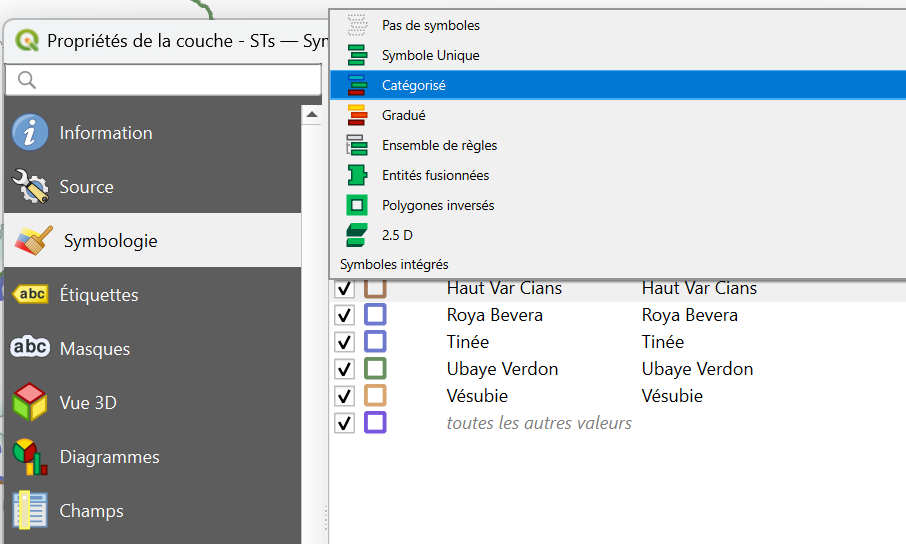
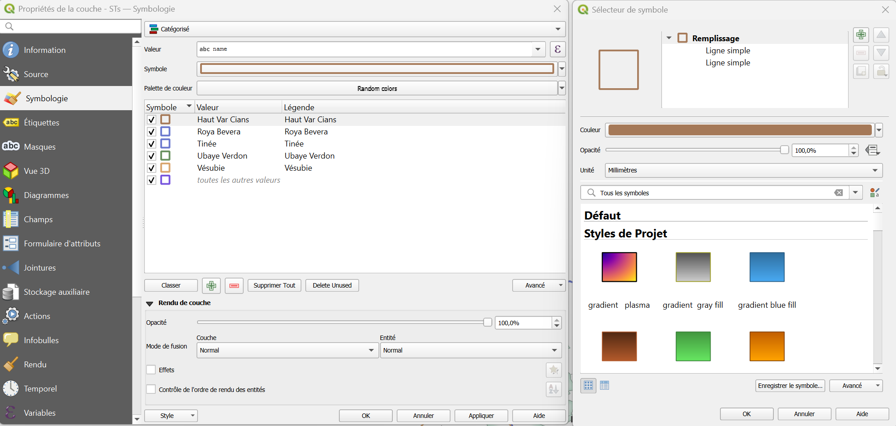
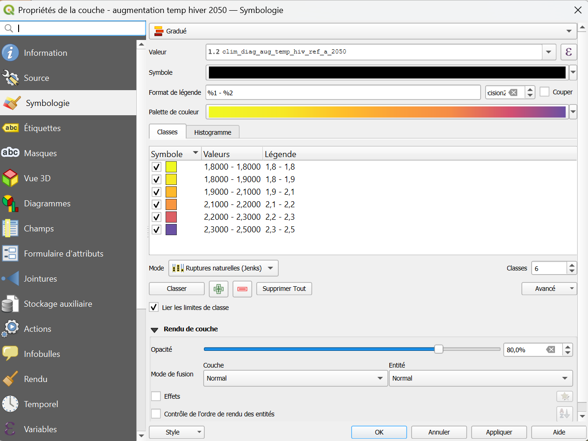
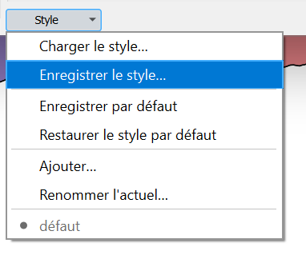
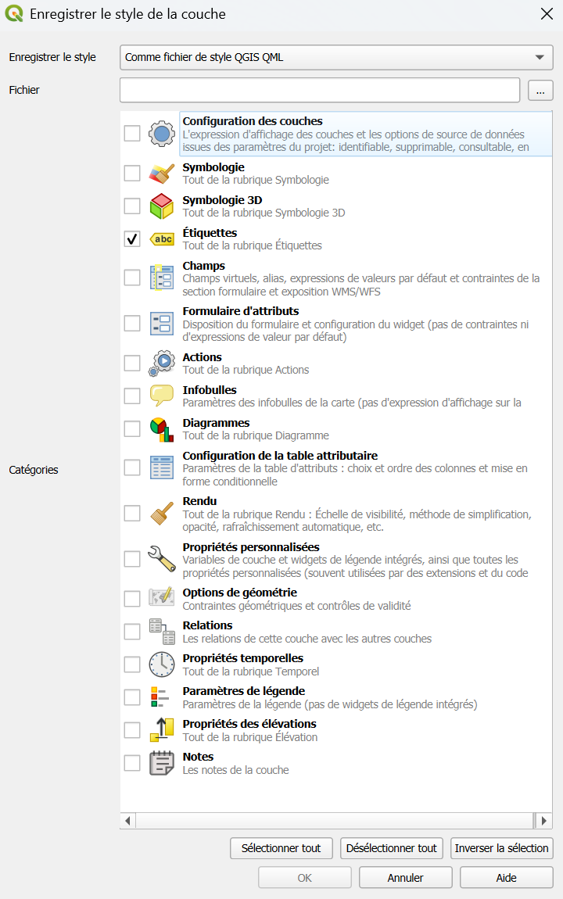
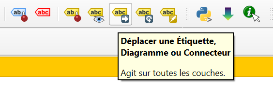
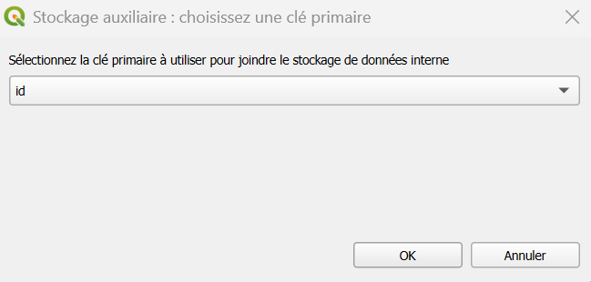

# Symbologie et étiquettes

Le mode de représentation des données d'une couche s'appelle la **symbologie**. Par exemple : des aplats de couleur, des cercles noirs pour des points, des lignes vertes...  

Les **étiquettes** complètent la symbologie : ce sont les textes affichés sur la carte, tirés de la table attributaire (un nom, un nombre...).

--- 

## Où trouver la symbologie ?

Elle se modifie **couche par couche** : ++"clic droit"++ sur la couche > ++"Propriétés"++ > ++"Symbologie"++.  

!!! tip "Le panneau « Styles de couche »"
    Pour tester plus vite, ouvrez le panneau **Styles de couche** avec ++f7++. Il reste à côté de la carte : chaque réglage se voit **immédiatement**, sans fenêtre à fermer.

--- 

## Modes de représentation

Les outils de symbologie de QGIS sont très puissants et permettent de représenter les informations d'une couche de façon synthétique. Voici les modes les plus courants :

|Mode|Ce qu'il fait|Type d'attributs|Cas d'emploi|
|:--:|:--:|:--:|:--:|
|**Symbole unique**|Applique un **même symbole** à toutes les entités, sans tenir compte de leurs attributs. C'est le mode par défaut.|Sans importance pour l'affichage|Tous les points de relevé en rond noir|
|**Catégorisé**|Représente des différences **qualitatives** : un attribut permet de distinguer les entités.|Un **texte** ou un **code** qui distingue des groupes|Pour des polygones d'occupation des sols : forêt, culture, bâti...|
|**Gradué**|Représente des différences **quantitatives** entre les entités.|Un **nombre** qui varie|Pour des points représentant des villes : une taille variant selon la population|
|**Ensemble de règles**|Applique des symboles selon des **conditions** que vous écrivez (même syntaxe que les [filtres](./filtres.md))|Une **condition** qui ne tient pas compte d'un seul champ|Les observations de 2025 en rouge, les autres en gris|




--- 

## Catégoriser et graduer en pratique
 
### Catégorisé : un symbole par valeur
 
1. Dans l'onglet **Symbologie**, choisissez **Catégorisé**.
2. Dans **Valeur**, sélectionnez le champ qui distingue les entités (par exemple `nom_commune`).
3. Cliquez sur **Classer** : QGIS crée une catégorie par valeur trouvée.
4. Choisissez les symboles à appliquer à chaque catégorie : double cliquer sur le symbole > la fenêtre **Sélecteur de symbole** s'ouvre (à droite sur la capture ci-dessous)
5. **Appliquer** pour visualiser les modifications, **OK** pour sortir de la fenêtre.



!!! tip "Retirer une catégorie"
    Sélectionnez une ligne puis cliquez sur ++minus++ pour la retirer.  

    La ligne **toutes les autres valeurs** (vide) couvre ce qui n'est pas listé.  
 
### Gradué : des classes de valeurs
 
1. Choisissez **Gradué**.
2. Dans **Valeur**, sélectionnez le champ numérique (par exemple `densite`).
3. Choisissez une **rampe de couleurs**, le **nombre de classes** (3 à 5 est lisible) et le **mode** de découpage, puis **Classer**.
4. **Appliquer**.




| Mode de découpage | Il fait... | Utile pour... |
|-------------------|------------|---------------|
| **Intervalles égaux** | Classes de même largeur | Des valeurs réparties régulièrement |
| **Quantile** | Autant d'entités dans chaque classe | Comparer des rangs, éviter les classes vides |
| **Ruptures naturelles** | Regroupe les valeurs proches | Une première lecture des données (Jenks) |
 
!!! info "Pourquoi ne pas utiliser 15 classes ?"
    Au-delà de 5 ou 6 classes, l'œil ne distingue plus les nuances. Mieux vaut peu de classes bien contrastées.

--- 
 
## Quelques réglages utiles
 
| Je veux... | Où | Comment |
|------------|----|---------|
| Changer la **couleur** ou la **taille** | Symbologie, clic sur le symbole | Couleur de remplissage, contour, taille |
| Rendre une couche **semi-transparente** | Onglet **Transparence**, ou l'opacité du symbole | Une valeur autour de 50 % laisse voir le fond |
| **Superposer** plusieurs couches | Panneau **Couches** | Faites glisser : **points > lignes > polygones** |
| Un **contour seul** (sans remplissage) | Symbologie > le symbole | Type **Contour simple**, ou remplissage transparent |
| **Copier** une symbologie d'une couche à une autre | ++"clic droit"++ > **Styles** > **Copier le style** puis **Coller le style** | Garder une mise en forme cohérente |
| **Réutiliser** un style dans un autre projet | Propriétés > **Style** > **Enregistrer le style...** | Un fichier `.qml` qu'on charge ailleurs |
 
!!! tip "Enregistrer et réutilliser un style"
    {align=right}

    L'enregistrement d'un style crée un petit fichier `.qml` qui stocke la configuration de style renseignée (item sélectionnés ci-dessous).  
    Ce fichier `.qml` peut ensuite être utilisé sur une autre couche pour appliquer les mêmes paramètres de style au lieu de tout régler à la main.  

    Accès depuis les propriétés de la couche, en bas à gauche : **Charger/Enregistrer le style** 
    

    
 
--- 
 
## Les étiquettes
 
Les étiquettes affichent un texte sur chaque entité.  
Elles se règlent dans ++"Propriétés"++ > ++"Étiquettes"++ de la couche.
 
### Afficher des étiquettes
 
1. Dans l'onglet **Étiquettes**, choisissez **Étiquettes simples** (en haut de la liste).
2. Dans **Valeur**, sélectionnez le champ à afficher (par exemple `nom_secteur`).
3. Réglez le **texte** : police, taille, couleur depuis l'onglet **Texte**.
4. D'autres paramètres permettent de faciliter la lecture de l'étiquette [:octicons-arrow-right-24: rendre les étiquettes lisibles](#rendre-les-etiquettes-lisibles).
4. Cliquez sur **Appliquer**.


| Mode | Il fait... |
|------|-----------|
| **Pas d'étiquettes** | Rien |
| **Étiquettes simples** | Le même réglage pour toutes les entités |
| **Basées sur des règles** | Des réglages différents selon des conditions |
 
### Rendre les étiquettes lisibles
 
| Réglage | À quoi ça sert | Valeur conseillée |
|---------|----------------|-------------------|
| **Tampon** (halo) | Détache le texte du fond | Contour blanc de 1 mm : très lisible sur une photo ou un fond coloré |
| **Placement** | Où se place le texte autour de l'entité | Au-dessus d'un point ; sur la ligne ou le long d'elle ; à l'intérieur d'un polygone |
| **Rendu** > **Visibilité selon l'échelle** | Éviter une carte surchargée | Afficher les étiquettes seulement à partir d'une certaine échelle |
| **Étiquettes dupliquées** | Éviter le même nom répété | Autoriser ou non |
 
!!! tip "Afficher un nombre, ou plusieurs champs"
    Dans **Valeur**, cliquez sur le bouton **ε** pour écrire une **expression**. Par exemple, pour afficher le nom et l'effectif :
    ```sql
        "nom_secteur" || ' : ' || "effectif"
    ```
    La syntaxe est celle des [filtres](./filtres.md#ecrire-un-filtre) et de la [calculatrice de champs](./calculatrice_champs.md#ecrire-une-expression).
 

!!! info "Positionner une étiquette à la main"
    Quand une étiquette gêne, activez l'outil **Déplacer une étiquette** dans la barre d'outils **Étiquettes**.  
    
    
    Sélectionner un champ dont la valeur est unique pour chaque entité lorsque la fenêtre "stockage auxilaire" s'ouvre :
    

    L'emplacement est enregistré dans une colonne auxiliaire de la couche. 

    
!!! tip "Documentation complète sur la ^^symbologie^^ et ^^etiquettes^^"
    La documentation de QGIS est très complète, n'hésitez pas à la parcourir pour explorer les possibilités : [Symbologie](https://docs.qgis.org/3.44/fr/docs/user_manual/working_with_vector/vector_properties.html#symbology-properties) & [Etiquettes](https://docs.qgis.org/3.44/fr/docs/user_manual/working_with_vector/vector_properties.html#labels-properties).

    Maintenez ++ctrl++ au moment de cliquer sur le lien pour l'ouvrir dans un nouvel onglet :wink:
