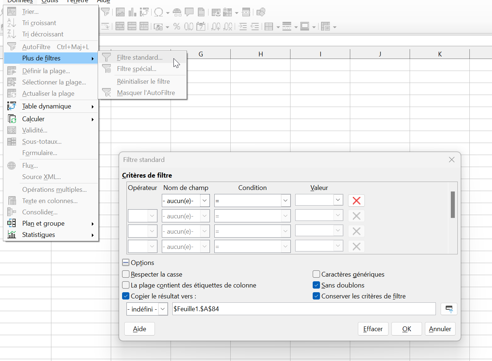
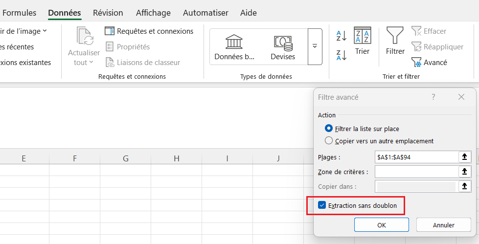
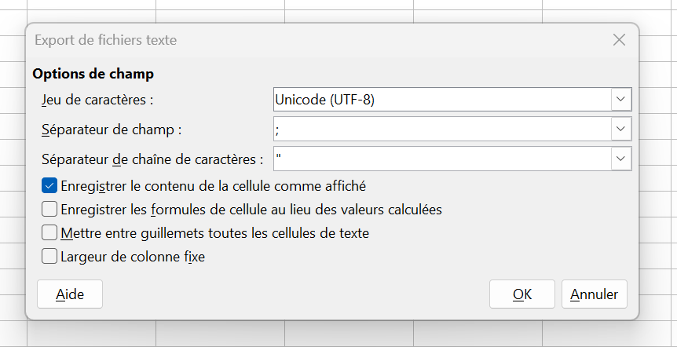
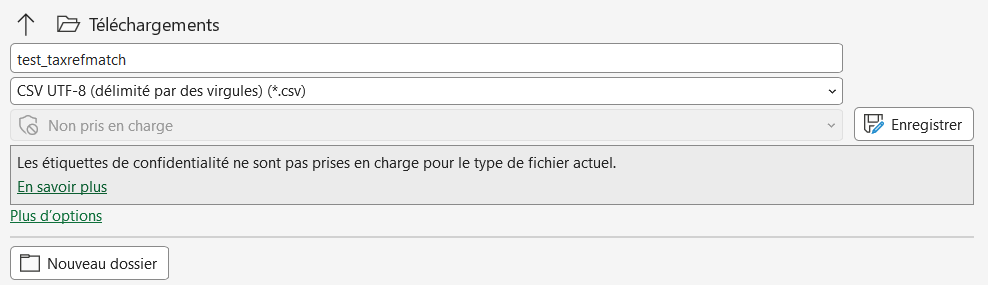
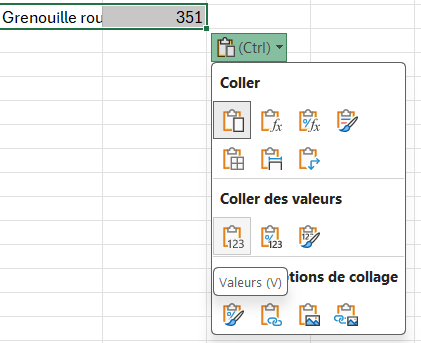

# Taxrefmatch et cd_nom

Pour que les données naturalistes puissent être **partagées et échangées**, chaque taxon est associé à un identifiant numérique unique : le **cd_nom**.  
Or les relevés de terrain sont faits avec un **nom** : il faut donc retrouver le cd_nom correspondant. **Taxrefmatch** le fait pour vous, et LibreOffice permet de l'appliquer à tout un tableau.

Afin que les données naturalistes puissent être **partagées** et **échangées**, chaque taxon est associé à un identifiant numérique unique qui s'appelle le **cd_nom**. Ce numéro est extrêmement important puisqu'il permet de suivre les observations indépendemment des changements de noms, d'orthographe, de taxonomie.

Or, de façon générale, les relevés naturalistes sont faits en utilisant un **nom**. Il faut donc leur associer un **cd_nom**.

**Taxrefmatch** est un outil qui permet à partir d'un **nom scientifique de taxon** de retrouver le **cd_nom** associé, et donc l'ensemble de ses propriétés (nom scientifique valide, niveau taxonomique etc...).

En combinant taxrefmatch et les formules disponibles sur LibreOffice/Excel il est possible d'**automatiser** et de **simplifier** le processus associant à chaque nom de taxon saisi un cd_nom correct et unique.

---

## Le principe

Le processus se fait en **trois étapes** :

| Étape | Ce qu'on fait | Outil |
|-------|---------------|-------|
| **1. Lister** | Récupérer la liste des noms de taxons observés, **sans doublons** | LibreOffice Calc / Excel |
| **2. Faire correspondre** | Obtenir le cd_nom de chaque nom | [Taxrefmatch](https://taxref.mnhn.fr/taxref-match/taxrefmatch/import) |
| **3. Appliquer** | Associer un cd_nom à **chaque observation** | LibreOffice Calc / Excel (`RECHERCHEV`) |

!!! warning "Toujours vérifier les résultats"
    Un outil automatique comme Taxrefmatch se trompe parfois.  
	**Relisez les correspondances** avant de les utiliser, pour ne pas introduire d'erreurs dans les relevés.

## Situation de départ

Vous avez un tableau d'observations, par exemple `observations.csv` :

| Date | Observateur | Taxon | x | y |
|:----:|:-----------:|:-----:|:-:|:-:|
| 12/10/2016 | Paul Bismut | Nicrophorus vespilloides | 7.070697 | 44.204141 |
| 10/12/2016 | Serge Plouf | Cossus cossus | 7.020686 | 44.188697 |
| 16/10/2012 | Jean-Paul Pierre | Glomeris klugii | 7.10808 | 44.207472 |
| ... | ... | ... | ... | ... |

Il manque le **cd_nom** pour pouvoir enregistrer ces observations en base de données. D'autres informations peuvent aussi s'ajouter : le déterminateur, les effectifs, la méthode d'observation...

## Étape 1 : lister les taxons sans doublons

1. Créez un nouveau fichier `input-taxrefmatch.csv`.
2. Copiez la colonne des **noms de taxons** de `observations.csv` dans la **première colonne** du nouveau fichier.
3. Sur LibreOffice :
	* Cliquez sur ++"Données"++ > ++"Plus de filtres"++ > ++"Filtre standard..."++.

    	

	* Dans la boîte de dialogue :
		- réglez le premier **nom de champ** sur `- aucun -` ;
		- cochez **Sans doublon** ;
		- cochez **Copier les résultats vers** et choisissez une cellule vide.

4. Sur Excel :
	* Cliquez sur ++"Données"++ > ++"Avancé"++ (dans l'emplacement des ++"Filtres"++) 

		
	
	* Dans la boîte de dialogue :
		- `Filtrer la liste sur place` doit être coché
		- La plage correspond à la colonne sélectionnée
		- Cochez **extraction sans doublon**

Vous obtenez la liste de chaque taxon **une seule fois**.

## Étape 2 : passer par Taxrefmatch

[Méthode automatisée : Taxref Matcher du Mercantour](https://taxref-match.mercantour.eu/)

Cliquez sur ++"Upload"++ pour récupérer les **cd_nom** de votre fichier fraichement anti-doublonné.


### Mettre au format Taxrefmatch

Le fichier envoyé à Taxrefmatch a **trois colonnes** :

|| `nom_complet` | `classification` | `fk` |
|---|---|---|---|
|**Contenu**|Le nom du taxon|Les taxons supérieurs, séparés par des virgules (voir la [documentation Taxrefmatch](https://taxref.mnhn.fr/taxref-match/taxrefmatch/taxrefMatchDoc))|Un identifiant libre|
|**Obligatoire**| OUI | Non, mais aide à départager | Non, on peut la laisser vide |

Exemple :

| nom_complet | classification | fk |
|:-----------:|:--------------:|:--:|
| Helix lapicida Linnaeus, 1758 | mollusca,gastropoda,helicidae | |
| Cyclops minutus O.F. Müller, 1776 | | |

!!! tip "Commencez simple"
    Un premier essai avec la colonne `classification` **vide** est possible. Certaines correspondances peuvent alors échouer ou être fausses : on complète ensuite pour celles-là.

### Enregistrer et envoyer

1. Enregistrez le fichier en **CSV**, en choisissant le **point-virgule** comme séparateur de champ ; format **CSV UTF-8 (délimité par des virgules)** dans Excel

    
	/// caption
	Sous **LibreOffice**
	///

	
	/// caption
	Sous **Excel**
	///

2. Envoyez-le sur [Taxrefmatch](https://taxref.mnhn.fr/taxref-match/taxrefmatch/import).

!!! warning "Le séparateur compte"
    Avec une virgule ou une tabulation, Taxrefmatch ne lit pas les colonnes correctement.

## Étape 3 : récupérer les cd_nom dans le tableau

### Préparer le fichier de résultats

1. Taxrefmatch fournit un fichier `résultats.csv` : renommez-le en **`taxrefmatch.csv`**.
2. Ouvrez-le et renommez sa première feuille en **`taxrefmatch`**.
3. **Relisez-le** et corrigez-le si besoin. Quand Taxrefmatch propose **plusieurs options** pour un même taxon, supprimez les lignes erronées.
4. Dans `observations.csv`, créez une nouvelle colonne **`cd_nom`**.

### Écrire la formule

La formule `RECHERCHEV` de LibreOffice ou Excel prend la valeur d'une cellule, la cherche dans la première colonne d'une plage, et renvoie la valeur d'une autre colonne **sur la même ligne**. Ici : elle cherche le nom du taxon dans `taxrefmatch.csv` et renvoie son cd_nom.

```
=RECHERCHEV(A ; B ; C ; D)
```

| Élément | À remplacer par | Pour notre cas |
|:-------:|-----------------|----------------|
| **A** | La cellule qui contient le nom du taxon saisi | `E2` |
| **B** | Le chemin vers `taxrefmatch.csv`, puis la feuille et la plage de données | voir ci-dessous |
| **C** | Le **numéro de la colonne** à renvoyer dans la plage | `4` (le cd_nom est la 4ᵉ colonne, si la plage va du nom au cd_nom) |
| **D** | Le mode de recherche | `0` (correspondance exacte) |

Le paramètre **B** s'écrit de cette façon :

```
'file:///C:/Users/prenom.nom/Documents/taxrefmatch.csv'#$taxrefmatch.$A$1:$D$99
```

| Partie | Rôle |
|--------|------|
| `'file:///C:/Users/.../taxrefmatch.csv'` | Le **chemin** vers le fichier, entre apostrophes, avec des `/` |
| `#$taxrefmatch` | Le **nom de la feuille**, précédé de `#$` |
| `.$A$1:$D$99` | La **plage** de données où chercher. Les `$` verrouillent la plage pour copier la formule sans la décaler : appuyez sur ++f4++ lorsque le curseur est sur 'A1' et 'D99' pour écrire les $ à votre place |

!!! example "Exemple complet"
    ```
    =RECHERCHEV(E2;'file:///C:/Users/prenom.nom/Downloads/taxrefmatch.csv'#$taxrefmatch.$A$1:$D$62;4;0)
    ```


### Étendre la formule et la figer

1. **Etendre** : copiez la formule sur **toute la colonne** `cd_nom` : cliquer/glisser ou copier/coller.

2. **Figer** : les cd_nom deviennent des **nombres fixes**, qui ne dépendent plus du fichier `taxrefmatch.csv`
	* Sur **LibreOffice** : sélectionnez la colonne `cd_nom`, puis ++"Données"++ > ++"Calculer"++ > ++"Formules en valeurs"++. 
	* Sur [**Excel**](https://support.microsoft.com/fr-fr/excel/replace-a-formula-with-its-result-in-excel) : copier toute la colonne `cd_nom`, coller là à côté, cliquez sur la flèche d'**Options de collage** et sélectionnez **Valeurs uniquement** (raccourci ++ctrl++ **puis** ++v++): cette nouvelle colonne est indépendante, vous pouvez supprimer la colonne de départ.
	

!!! warning "Certaines correspondances peuvent avoir échoué"
    Vérifiez les cases en erreur (`#N/A`). Dans ce cas :

    - **réessayez** en complétant autrement la colonne `classification` avant de soumettre à Taxrefmatch ;
    - ou **complétez à la main** depuis le site de l'[INPN](https://inpn.mnhn.fr/).

## Bonnes pratiques

| Réflexe | Pourquoi |
|---------|----------|
| **Garder une copie** de `observations.csv` d'origine | On peut recommencer en cas d'erreur |
| **Relire** `taxrefmatch.csv` avant la formule | Les homonymes et les doublons faussent les cd_nom |
| **Convertir les formules en valeurs** | Le fichier reste valable si `taxrefmatch.csv` est déplacé |
| **Contrôler** quelques lignes à la main | Un résultat qui « s'affiche » n'est pas forcément correct |
| **Séparateur** `;` pour tous les CSV | Évite les colonnes mal découpées |

## En cas de problème

| Symptôme | Cause probable | Solution |
|----------|----------------|----------|
| `#N/A` dans la colonne `cd_nom` | Le nom n'est pas dans `taxrefmatch.csv`, ou n'est pas écrit à l'identique | Vérifiez l'orthographe, les espaces en trop, et la ligne dans `taxrefmatch.csv` |
| `Err:502` ou `#REF!` | Chemin du fichier ou nom de feuille incorrect | Vérifiez le chemin (`/`, apostrophes) et le nom de la feuille (`taxrefmatch`) |
| La formule renvoie un mauvais cd_nom | Colonne `C` mal choisie, ou doublons dans `taxrefmatch.csv` | Contrôlez que `C` = `4`, et supprimez les lignes erronées |
| Taxrefmatch ne lit pas mon fichier | Mauvais séparateur de champ | Réenregistrez en CSV avec le **point-virgule** |
| La plage s'est décalée en copiant la formule | `$` oubliés dans la plage | Écrivez `$A$1:$D$99`, pas `A1:D99` |
| Les cd_nom disparaissent à la réouverture | Formule non convertie, fichier source déplacé | **Formules en valeurs** avant de fermer |
| Taxrefmatch propose plusieurs taxons | Nom ambigu | Supprimez les lignes erronées, ou précisez la `classification` |

