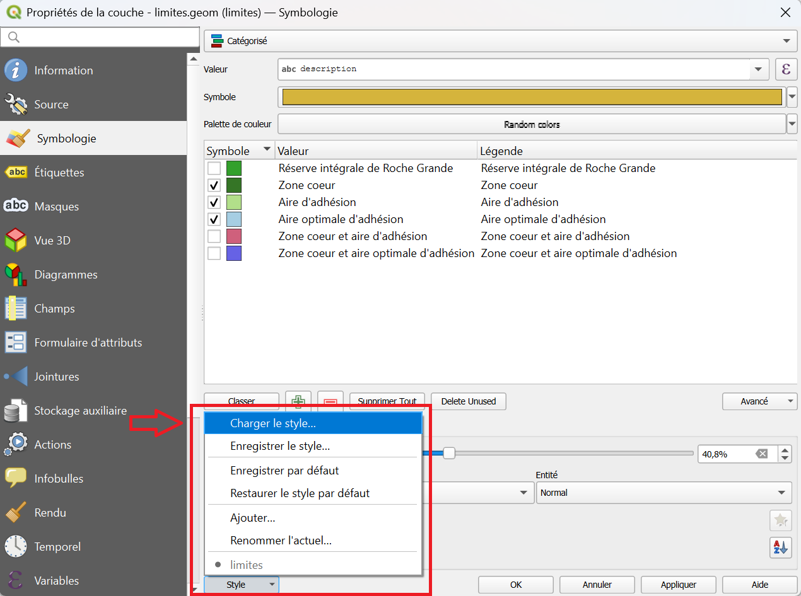

# Utiliser un masque

Un **masque** met en avant une couche, ou une entité, en **grisant** (ou « floutant ») tout ce qui l'entoure.

!!! info "Pourquoi le faire à la main ?"
    Certaines extensions QGIS savent le faire, mais cette opération est très simple à réaliser soi-même. Savoir la faire évite de dépendre d'une extension en cas de problème de mise à jour ou de bug.

--- 

## Quelle méthode choisir ?

| | **Polygone inversé** | **Masque piloté par l'atlas** |
|---|---|---|
| **Principe** | Un style "polygone inversé" vide l'intérieur du polygone et grise l'extérieur | Une couche grise transparente, dans laquelle un "trou" se crée automatiquement sur l'entité de chaque page |
| **Pour** | Une carte simple : ne voir que la zone d'une couche (par exemple une commune) | Une série de cartes : un atlas où seule l'entité de la page courante ressort |
| **Difficulté** | Facile | Un peu plus long |

---

## Méthode 1 : le style "polygone inversé"

Cette solution convient à une carte simple : on ne souhaite voir que la zone couverte par une couche (par exemple celle d'une commune).

1. Faites un ++"clic droit"++ sur la couche de la zone désirée > **Dupliquer la couche**. On travaille sur la copie pour garder la couche d'origine intacte.
2. Double-cliquez sur la copie, ou ++"clic droit"++ > ++"Propriétés"++, puis allez dans l'onglet **Symbologie**.
3. Tout en bas à gauche de la fenêtre, cliquez sur le bouton **Style**, puis sur **Charger**.
4. Cliquez sur les **...** et naviguez jusqu'au fichier `W:\symbologie\masque.qml`.
5. Cliquez sur **Appliquer**.

!!! tip "Régler l'intensité du grisé"
    Dans l'onglet **Symbologie**, vous pouvez modifier la couleur de remplissage et son **opacité** pour un masque plus ou moins marqué.

!!! note "Le fichier de style est sur le disque partagé"
    Le fichier `masque.qml` se trouve sur le lecteur réseau `W:`. Si vous n'y avez pas accès, contactez le SI : `si@mercantour-parcnational.fr`.

---

## Méthode 2 : mettre en valeur l'entité de chaque page d'un atlas

Cette méthode crée un masque qui **s'adapte automatiquement** à l'entité représentée sur chaque page d'un atlas.

### 1. Générer l'atlas

Préparez d'abord l'atlas à partir de la couche désirée [:octicons-arrow-right-24: Générer un atlas](./generer_un_atlas.md#pas-a-pas).

### 2. Créer la couche de masque

Il s'agit de créer un fond uni et grisé, dont la géométrie sera calculée pour **ne pas cacher** l'entité de la page courante.

1. Dans la barre de menu, cliquez sur ++"Couche"++ > ++"Créer une couche"++ et choisissez une **nouvelle couche shapefile** de type **polygone** (un **GeoPackage** convient aussi).
2. Cliquez sur les ++"..."++ pour l'enregistrer dans votre dossier de travail, avec un nom clair : `masque_xxx`.
3. Créez **une seule entité** qui englobe toute la zone à représenter, **avec une bonne marge**. Si besoin, voir [éditer des polygones](./creer_modifier_couche.md#creation-dentitesmodification-de-geometrie).
4. Enregistrez les modifications.

!!! warning "Une marge suffisante"
    L'entité du masque doit couvrir **toutes** les zones qui pourront apparaître sur la carte, quelle que soit la page de l'atlas. Sinon, des zones sans grisé apparaîtront en bordure de carte.

### 3. Faire un "trou" dans le masque

1. Dans la couche de masque, ouvrez ses **Propriétés** (double-clic, ou ++"clic droit"++ > ++"Propriétés"++).
2. Dans l'onglet **Symbologie**, choisissez **Générateur de géométrie** comme type de symbole.
3. Réglez le **type de géométrie** sur **Polygone**.
4. Remplacez la formule existante par : `difference( $geometry, @atlas_geometry )`
5. Réglez l'apparence du masque (gris, avec une certaine opacité), puis cliquez sur **Appliquer**.

!!! info "Que fait cette formule ?"
    `difference( $geometry, @atlas_geometry )` retire de la géométrie du masque (`$geometry`) celle de l'entité courante de l'atlas (`@atlas_geometry`). Le « trou » laisse apparaître l'entité de la page, et le reste de la carte est grisé.

Désormais, quand vous générez l'atlas, un **trou se forme automatiquement** à l'emplacement de l'entité d'intérêt de chaque page.

!!! tip "Vérifier le résultat"
    Dans la mise en page, cliquez sur ++"Atlas"++ > ++"Prévisualiser l'atlas"++ et passez d'une page à l'autre : le trou doit suivre l'entité.

---

## En cas de problème

| Symptôme | Cause probable | Solution |
|----------|----------------|----------|
| Rien n'est grisé | Style non appliqué, ou couche placée sous les autres | Remontez la couche de masque en haut du panneau **Couches** |
| Pas de trou dans le masque (méthode 2) | L'aperçu de l'atlas n'est pas actif | Lancez **Prévisualiser l'atlas** dans la mise en page |
| Le masque est vide ou erreur de formule | Type de géométrie non réglé sur **Polygone** | Vérifiez le type du générateur de géométrie et la formule |
| Des zones restent claires en bordure de carte | Entité de masque trop petite | Modifiez-la pour qu'elle déborde largement de la zone à représenter |
| Le style `masque.qml` est introuvable | Pas d'accès au lecteur `W:` | Vérifiez votre connexion au réseau du Parc, ou contactez le SI |