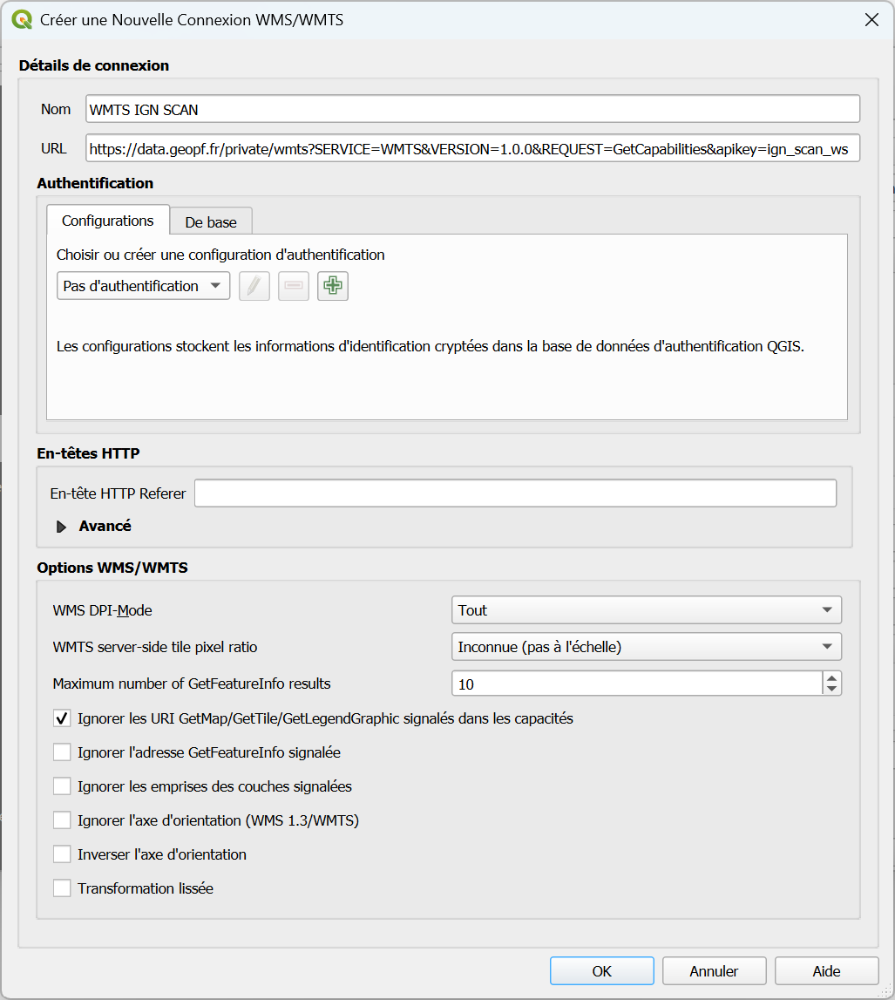
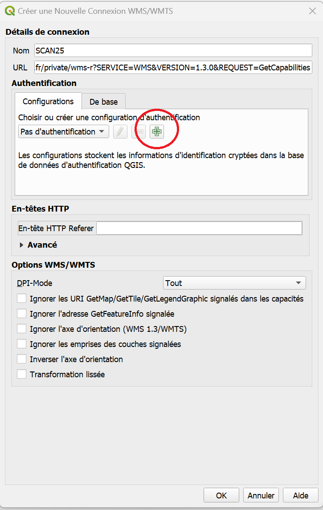
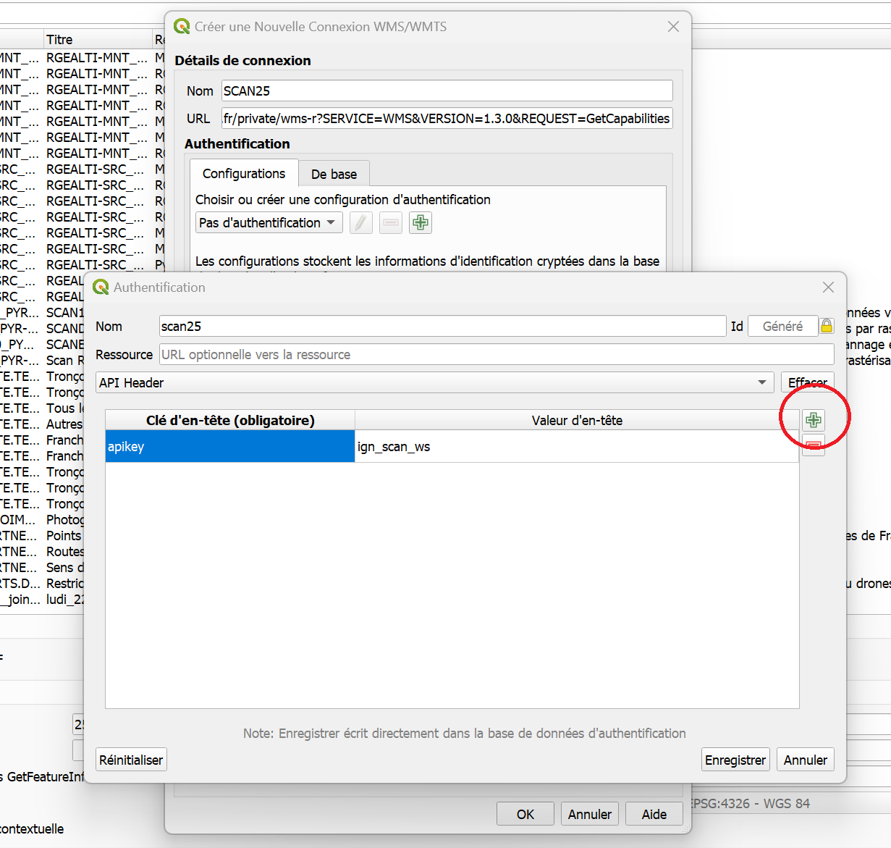
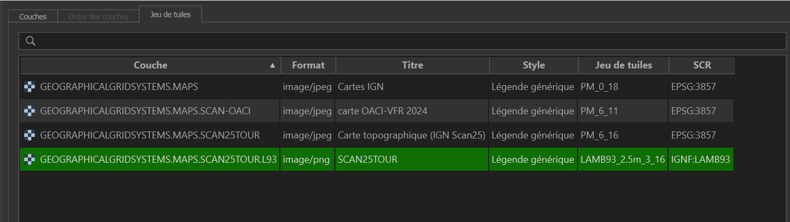
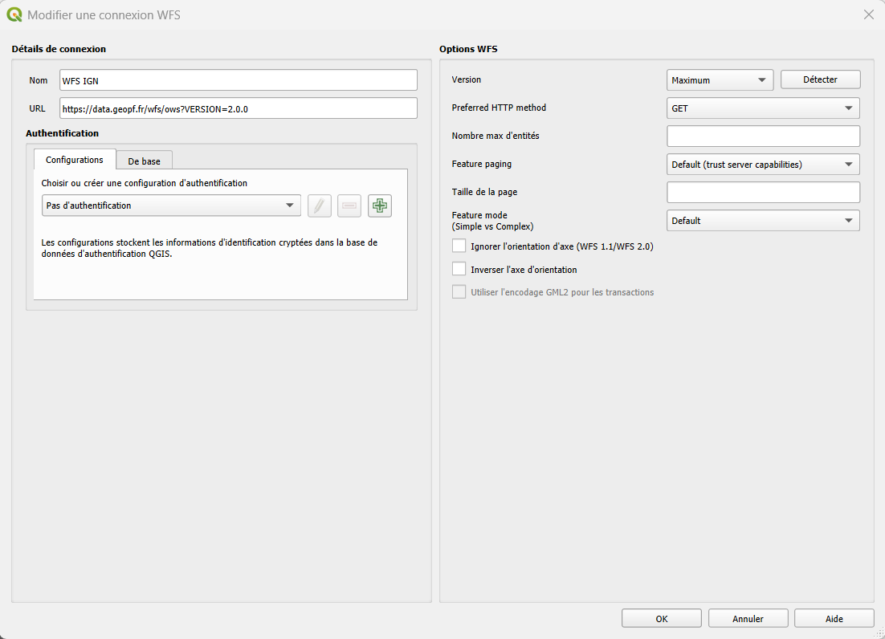
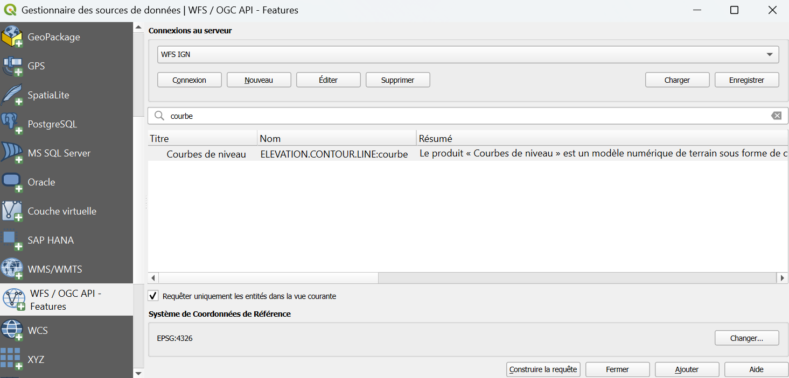
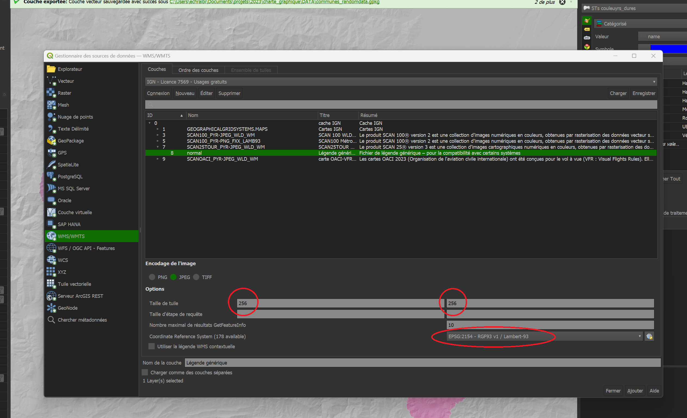

# Fonds de cartes
--- 
## Pourquoi utiliser des fonds de carte ?

Un projet QGIS sert avant tout à croiser et analyser **vos propres données**. Mais ces données n'ont de sens que replacées dans leur contexte géographique. 

C'est le rôle des fonds de carte : ils donnent un **repère visuel ou thématique** à vos propres données (cadastre, suivis naturalistes...), sans que vous ayez à recréer ou maintenir vous-même ces données déjà produites et mises à jour par d'autres organismes (IGN, DGFiP, Sandre, ...).

Plutôt que de télécharger et stocker ces données — souvent volumineuses — sur chaque poste, on y accède **à la demande** via un flux réseau (WMS, WMTS ou WFS) au moyen d'un URL.  

Le fond de carte reste toujours à jour, et votre machine ne charge que la portion du territoire affichée à l'écran. Ainsi, à chaque déplacement sur la carte, QGIS interroge automatiquement le serveur distant pour récupérer les données correspondant à la zone affichée à l'écran.

!!! tip "Quel flux choisir ?"
    - Juste voir un **repère visuel** (carte IGN, orthophotos, ...) : [WMS/WMTS](#wmswmts)
    - **Interroger ou analyser** les objets du fond de carte (ex: attributs d'une commune - surface, code INSEE, ...) : [WFS](#wfs)

Vous trouverez ci-dessous les configurations à réaliser pour accéder à ces ressources, puis les ajouter à vos projets.

--- 

## Ajouter des fonds de carte

De manière générale, toutes les sources de données se trouvent dans le **Gestionnaire des sources de données**, accessible depuis :  

Onglet du haut ++"Couche"++ > ++"Gestionnaire de source de données"++ ou tout simplement ++ctrl+l++

### WMS/WMTS

Le format le plus courant pour nos fonds de carte (SCAN 25, orthophotos...) est le **WMS**. 

Ce format, en plus de ne pas être stocké directement sur nos machines, présente l'avantage de générer des images à la demande. Ce qui rend l'affichage plus rapide et plus léger !

!!! info "Point définition"  
    **WMS** : le serveur génère une image de la carte à la demande.  
    **WMTS** : le serveur diffuse des images précalculées découpées en petits carrés, appelés "tuiles", organisées par niveau de zoom. 

#### SCAN 25 - IGN

<!--
**Explications**  
Dans le cadre de la bascule des ressources de l'IGN, le SCAN 25 est temporairement accessible selon la démarche décrite ci dessous.

  https://geoservices.ign.fr/documentation/services/utilisation-sig/tutoriel-qgis/gpf-wms-wmts-donneesnonlibres 

Cette solution est temporaire, et cessera de fonctionner dès la fin de la bascule des ressources de l'ign sur la géoplateforme. Quand cela arrivera, le nouveau mode d'accès au SAN25 vous sera communiqué.

**Pas à pas**
--> 

- Ouvrir le [gestionnaire de sources de données](#ajouter-des-fonds-de-carte) : ++ctrl+l++
- Aller sur **WMS/WMTS** dans le gestionnaire et cliquer sur **Nouveau** 
- Dans la boîte de dialogue qui vient de s'ouvrir, renseignez les champs :
    - **Nom** : c'est le nom qui vous permettra de retrouver la connexion, donnez lui un nom explicite, par exemple **"WMTS IGN SCAN"**
    - **URL** : `https://data.geopf.fr/private/wmts?SERVICE=WMTS&VERSION=1.0.0&REQUEST=GetCapabilities&apikey=ign_scan_ws`
    - **Authentification** : pas besoin de configurer une authentification.
    - Cocher la case _Ignorer les URI GetMap/GetTile/GetLegendGraphic signalés dans les capacités_.  
    
    - Valider en cliquant sur **OK**.
<!--
- Il faut ensuite cliquer sur la petite croix verte dans l'encadré "Athentification"

- Puis entrer les données comme dans l'image ci dessous après avoir cliqué à nouveau sur la petite croix verte: 
    - Nom: Scan25
    - clé d'en-tête: apikey
    - Valeur d'en-tête: ign_scan_ws

--> 
    
Une fois sorti de la boîte de dialogue :

- Dans le menu déroulant sélectionner la connexion que vous venez de créer (**WMTS IGN SCAN**) puis cliquer sur **Connexion**.

- Un nouvel onglet s'ouvre automatiquement vous permettant de choisir entre plusieurs versions du SCAN 25, choisir celui projeté en Lambert-93 (EPSG:2154)

- Cliquer sur **Ajouter** en bas à droite pour ajouter cette couche WMTS au projet actuel.

!!! tip "On peut aussi ajouter tous les fonds IGN libres (Orthophotos, SCAN 1000, SCAN Régions,...)"
    Réitérer cette procédure avec le lien suivant dans URL :  
    `https://data.geopf.fr/wmts?SERVICE=WMTS&VERSION=1.0.0&REQUEST=GetCapabilities`

#### WMS depuis un XML

- Télécharger le catalogue en faisant ++"clic droit"++ > ++"Enregistrer la cible du lien sous"++ sur le lien suivant :  [service WMS.xml](https://raw.githubusercontent.com/PnMercantour/donnees/refs/heads/main/docs/tutos/ressources/service%20WMS.xml)

- Déplacer ce fichier dans un dossier où il sera facile à retrouver.
    
    > Exemple : C:\Users\"VotreNom"\Documents\QgisXML  
    > _Remplacer "VotreNom" par le nom d'utilisateur sur votre machine._

- Lancer QGIS
 
- Ouvrir le [gestionnaire de sources de données](#ajouter-des-fonds-de-carte) : ++ctrl+l++

- Cliquer sur **WMS/WMTS** dans l'explorateur, sélectionner ++"Charger des connexions"++ 

- Sélectionner le fichier `service WMS.xml` précédemment enregistré. 
 
- Une fenêtre s'ouvre, cliquez sur ++"Tout Sélectionner"++ puis ++"Importer"++

Cette opération a enrichi l'annuaire des couches WMS avec les catalogues IGN les plus souvent utilisés.    

!!! success "Vous pouvez maintenant [:octicons-arrow-down-24: ajouter des fonds de carte à votre projet](#charger-un-fond-de-carte-dans-un-projet-qgis) au format WMS."

--- 

### WFS

Les flux WFS sont moins utilisés au parc, même s'ils sont parfois très utiles ! 

Ce flux WFS permet d'accéder aux données géographiques vectorielles brutes avec leurs attributs, en plus de leur représentation. 

#### Données vectorielles IGN
- Ouvrir le [gestionnaire de sources de données](#ajouter-des-fonds-de-carte) : ++ctrl+l++

- Aller dans l'onglet **WFS** dans le ruban de gauche.
 
- Cliquer sur **Nouveau**

- Entrer un nom clair permettant d'identifier la ressource (ex : **WFS IGN**)

- Coller le lien de la ressource dans le champs **URL** : `https://data.geopf.fr/wfs/ows?VERSION=2.0.0`

    

- Cliquer sur **OK**

### WMS ou WFS depuis un autre lien
!!! tip "Vous avez trouvé le lien vers une ressource WMS ou WFS qui n'est pas dans le catalogue mentionné plus haut."
    Une liste de [ressources supplémentaires](#catalogue-des-ressources-wmswfs) est disponible plus bas également.

- Ouvrir le [gestionnaire de sources de données](#ajouter-des-fonds-de-carte) : ++ctrl+l++

- Aller dans l'onglet **WMS/WMTS** ou **WFS** dans le ruban de gauche.
 
- Cliquer sur **Nouveau**

- Entrer un nom clair permettant d'identifier la ressource ( i.e."IGN - base de données Hydro" )

- Coller le lien de la ressource dans le champs **URL**

- **Authentification** : pas besoin de configurer une authentification.

- Pour un flux **WMS** :
    
    * Cocher la case _Ignorer les URI GetMap/GetTile/GetLegendGraphic signalés dans les capacités_.

- Cliquer sur **OK**

 
--- 

## Charger un fond de carte dans un projet QGIS

- Lancer QGIS
 
- Ouvrir le [gestionnaire de sources de données](#ajouter-des-fonds-de-carte) : ++ctrl+l++ 

- Cliquer sur l'onglet à gauche [WMS/WMTS](#wmswmts) ou [WFS](#wfs) selon le flux que vous voulez utiliser. 

- Cliquer sur la ressource d'intérêt dans le menu déroulant ("WFS IGN", ou "WMTS IGN" par exemple) puis sur **Connexion**

- Cliquer sur la couche souhaitée qui s'affiche dans le menu central

    

- Vous pouvez filtrer en écrivant des mots clés pour trouver la couche à ajouter

- Puis sur **Ajouter**

!!! info "Lorsqu'il s'agit de flux **WMS**"
    Prendre soin de bien remplir les champs "taille de la tuile" avec, par exemple 512 comme valeur.  
    
    Entrer une valeur dans ce champ évite que QGIS n'essaie de charger des tuiles trop grosses depuis le WMS, ce qui peut ralentir voire complètement bloquer l'affichage de votre projet.

--- 

## Des problèmes persistants ?

Si les fonds de carte IGN ne s'affichent pas et qu'aucune erreur explicite n'apparaît :

- Vérifier que la case ++"Ignorer les URI GetMap/GetTile/GetLegendGraphic signalés dans les capacités"++ est bien cochée en [:octicons-arrow-up-24: éditant la source](#ajouter-des-fonds-de-carte)

- Suivre la procédure décrite dans cette section [Problème d'affichage des couches IGN WMTS dans QGIS](./FAQ.md#probleme-daffichage-des-couches-ign-wmts-dans-qgis)

--- 

## Catalogue des ressources WMS/WFS

Vous trouverez ci-dessous une liste de connexions WFS et WMS dont vous pourriez avoir besoin.  
La première colonne mentionne dans quel onglet vous devez vous trouver pour ajouter la connexion.  
Suivez les instructions [:octicons-arrow-up-24: ci-dessus](#wms-ou-wfs-depuis-un-autre-lien) pour ajouter ces nouvelles connexions selon les URL listés en dernière colonne.

|Source|Nom Couche|Description|Lien|
|:--:|:--:|:--:|:--:|
|WFS|RPG|Registre Parcellaire Graphique (ilots, parcelles....)|https://data.geopf.fr/annexes/ressources/wfs/agriculture.xml|
|WFS|IGN|Ressources mises à disposition par l'IGN|https://data.geopf.fr/wfs/ows?SERVICE=WFS&VERSION=2.0.0&REQUEST=GetCapabilities|
|WMS|CLC 2018|Données Corine Land Cover|https://image.discomap.eea.europa.eu/arcgis/services/Corine/CLC2018_WM/MapServer/WMSServer?version=1.3.0|
|WMS|Géoplateforme - SCAN 25|SCAN25|https://data.geopf.fr/private/wmts?SERVICE=WMTS&VERSION=1.0.0&REQUEST=GetCapabilities&apikey=ign_scan_ws|
|WMS|Géoplateforme - données mélangées|Corine Land Cover, Registre Parcellaire Graphique, Occupation du Sol à Grande Echelle, imageries Ortho, RGE Alti|https://data.geopf.fr/wms-r/wms?VERSION=1.3.0|
|WMS|Géoplateforme - données vecteur|Contient de nombreuses informations: Corine Land Cover, données INSEE, RPG , OCSGE et cadastre|https://data.geopf.fr/wms-v/ows?version=1.3.0|
|WMS|Géoplateforme - parcellaire|Parcellaire cadastre|https://data.geopf.fr/annexes/ressources/wms-v/parcellaire.xml|
|WMS|INPN - Espaces naturels|Zones de protection ou sensibles|https://ws.carmencarto.fr/WMS/119/fxx_inpn|
|WMS|ONF|Données en accès libre de l'ONF|http://ws.carmencarto.fr/WMS/105/ONF_Forets|
|WMS|Sandre - BD Topage|Hydrographie: cours d'eau, plan d'eau, bassin versant|https://services.sandre.eaufrance.fr/geo/topage|
|WMS|Sandre - mdo|Masses d'eau, hydro-ecoregions.|https://services.sandre.eaufrance.fr/geo/mdo|
|WMS|INRAE enquête pastorale||https://enquete-pastorale.inrae.fr/cgi-bin/mapserv?map=/var/www/module_wms_wfs/enquete_pasto/ows_enquete_pasto.map|
<!-- # Autres ressources disponibles 

https://data.geopf.fr/wfs/ows?SERVICE=WFS&VERSION=2.0.0&REQUEST=GetCapabilities

--> 

